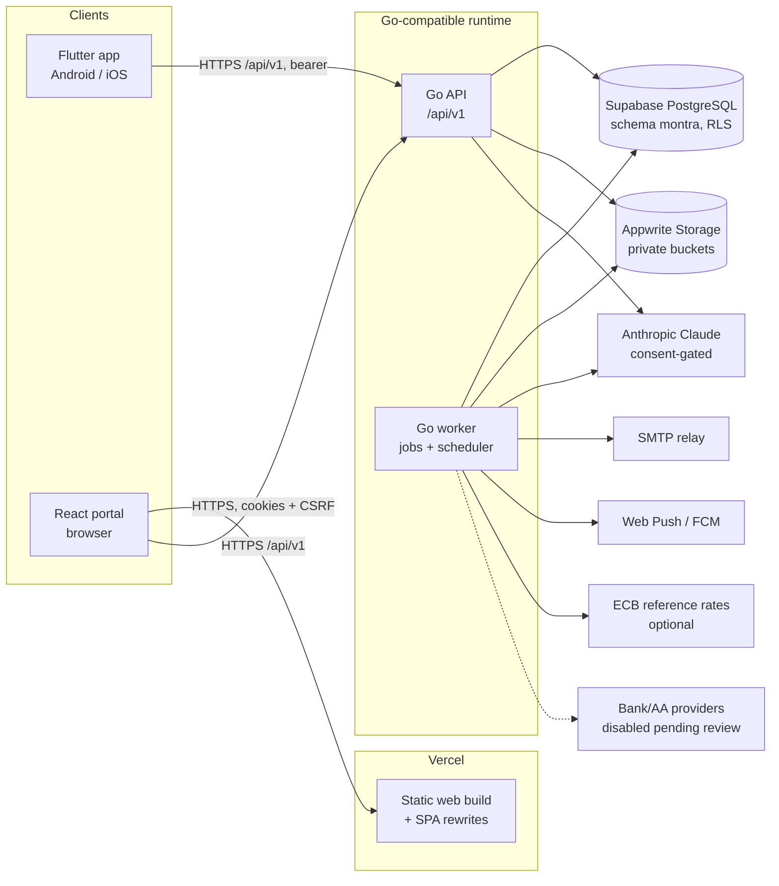

# Montra — Architecture

Authoritative product requirements: `Montra_Full_Feature_Production_Spec.md`.
Decisions referenced as ADR-nnn live in `docs/DECISIONS.md`.

## 1. System context



Clients never connect to Supabase or Appwrite directly and never hold
privileged credentials. The Go backend is the sole owner of business rules,
authorization, money arithmetic, integrations, audit and job orchestration
(spec §1.1, §1.4).

## 2. Repository layout (ADR-001)

```text
backend/            Go module `montra/backend`
  cmd/api           HTTP API server
  cmd/worker        durable job worker + scheduler leader
  cmd/migrate       forward-only migration runner (ADR-004)
  cmd/openapi       exports the OpenAPI contract (+ `-check` drift mode)
  internal/
    platform/       config, logging, errors, httpx, database, jobs, outbox,
                    ratelimit, crypto, observability, storage, email, push
    domain/         pure packages: money, currency, split, ledger, period,
                    recurrence, budgetcalc, subdetect, settlement, statement
                    (file parsing/normalization), reconcile
    <feature>/      application services + repositories + HTTP registration:
                    auth, users, files, notifications, privacy, finance
                    (accounts, transactions, transfers, categories, tags,
                    merchants), analytics, budgets, recurring (rules,
                    occurrences, bills, calendar), subscriptions, goals,
                    imports, receipts, reconciliation
supabase/
  migrations/       YYYYMMDDHHMMSS_*.sql (PostgreSQL 15+ compatible); RLS
                    checks live in backend/tests/rls; demo data comes from
                    backend/cmd/seed (`make seed`), not SQL seed files
contracts/openapi/  montra.v1.json (generated, committed, drift-checked)
web/                React + TypeScript portal (Vite); `pnpm gen:api` types
mobile/             Flutter application; `tool/gen_api.dart` models
backend/Dockerfile  API/worker image (no secrets); deployment in docs/DEPLOYMENT.md
scripts/            db (bootstrap), ci (e2e stack), docs (generators)
docs/               all project documentation
.github/workflows/  ci.yml and e2e.yml (validate only, never deploy)
```

## 3. Backend layering

1. **Transport** — chi router, Huma operations (schema validation, OpenAPI).
2. **Authentication middleware** — resolves bearer token or session cookie
   to a session row; enforces CSRF for cookie-authenticated unsafe methods.
3. **Authorization** — explicit per-resource checks in services (owner,
   group role, community role); RLS as defense in depth.
4. **Application services** — use cases; own transaction boundaries,
   idempotency, audit and outbox events.
5. **Domain logic** — pure Go packages under `internal/domain`, no HTTP,
   SQL or UI imports; exhaustively unit/fuzz tested.
6. **Repositories** — parameterized SQL via pgx, always inside
   `database.WithUserTx` (sets `montra.user_id`) or `WithSystemTx` (worker).
7. **Integration adapters** — storage, email, push, AI, FX, OCR, providers;
   each behind an interface with timeouts and error classification.
8. **Durable jobs** — PostgreSQL queue (ADR-008).
9. **Observability** — slog JSON logs with request/job IDs and redaction,
   Prometheus metrics (no tracing is implemented; the access log carries request IDs and error codes).

### Enforced dependency boundaries (ARCH-004)

The layering is checked by the linters. Each check passes on the current
code because today's deliberate cross-module imports are allowlisted, and
each fails on a new edge. Adding to an allowlist is a design decision made
in review.

| Codebase | Rule | Enforced by |
|---|---|---|
| Backend | `internal/domain/*` imports only other domain packages: no platform, store, feature or app packages, and no `net/http`, pgx or Huma | depguard `domain-is-pure` in `backend/.golangci.yml` |
| Backend | `internal/platform/*` imports only platform; `apitypes` only domain; `store/*` nothing internal | depguard `platform-is-infrastructure`, `apitypes-shared`, `store-is-generated` |
| Backend | A feature package imports platform, domain, apitypes, store, its own subpackages and only its listed feature edges. The shared services most features use are `finance` (ledger) and `notifications`. `analytics`, `reports` and `ai` read across features. | depguard `feature-<name>` rules (one per feature, edges listed in the file) |
| Backend | `internal/app` (composition root) is imported only by `cmd/*`, `internal/testutil` and `internal/seed`; nothing imports `cmd/*`; `package main` exists only under `cmd/` | depguard `wiring-in-cmd`; grep step in `make lint` and CI |
| Web | `src/shared` imports neither `src/features` nor `src/app`. A feature imports `src/app` only from tests, and another feature only through the modules listed in `allowedFeatureImports`. Alias (`@/…`) and relative specifiers are both resolved. | `montra/module-boundaries` rule in `web/eslint.config.js` (`pnpm lint`) |
| Mobile | `lib/core` imports from `lib/app` only the shared modules (l10n, theme, route names) and from `lib/features` only `coreFeatureImports`. A feature imports the same shared app modules and only the other-feature files listed in `featureImports`. | `mobile/tool/check_imports.dart` (`make mobile-imports`, `make check`, CI) |

depguard compares an import with the nearest entry of each sorted list, so
the backend rules keep every deny list free of overlapping prefixes. Each
rule denies the single prefix `montra/backend/internal/` in lax mode and
allows the longer prefixes the layer may use.

## 4. Data flow: committed write → side effects

```mermaid
sequenceDiagram
  participant C as Client
  participant A as API service
  participant D as PostgreSQL
  participant W as Worker
  C->>A: POST /transactions (Idempotency-Key)
  A->>D: BEGIN; set montra.user_id
  A->>D: check idempotency key / version
  A->>D: insert transaction + ledger entries + audit + outbox
  A->>D: COMMIT
  A-->>C: 201 {data, meta}
  W->>D: claim outbox events (SKIP LOCKED)
  W->>D: enqueue jobs (budget evaluation, notifications)
  W->>D: process job, record attempt, dedupe notification
```

## 5. Identity and sessions (ADR-002)

- Web: HttpOnly cookies + double-submit CSRF. Mobile: bearer access token
  in memory, refresh token in secure storage.
- Each request: hash token → `user_sessions` lookup (active, not expired,
  not revoked) → user status check (active, not deletion-locked).
- RLS propagation: `set_config('montra.user_id', <uuid>, true)` per
  transaction.

## 6. Storage (ADR-009/010)

Upload intent → backend-hosted single-use upload URL → content validation
(size, magic bytes, extension allow-list, checksum, image dimension limits,
EXIF stripping for previews) → storage adapter (`appwrite` in hosted
environments, `local_disk` in development only) → `files` metadata commit
→ processing job. Downloads: per-request authorization → short-lived signed
URL → streamed response with `Content-Disposition: attachment` and
`X-Content-Type-Options: nosniff`.

## 7. Jobs and scheduling (ADR-008)

Job classes and objectives are inventoried in `docs/BACKGROUND_JOBS.md`.
The scheduler enqueues time-bucketed periodic jobs with dedupe keys:
`recurring.generate` (15 min: materialize, auto-post, auto-add recurring
shared bills through the groups hook (ADR-040), overdue, bill and recurring
reminders), `subscriptions.renewals` (hourly), 
`subscriptions.detect_all` (daily fan-out to `subscriptions.detect`),
`goals.reminders` (6 h), `privacy.deletion_due`, `files.cleanup`,
`retention.cleanup`, `notifications.digest_scan` (hourly; digests at
08:00 local, ADR-047), `integrations.schedule` (30 min: abandoned-run
recovery, consent expiry, scheduled syncs, stale webhook re-queue,
ADR-048), `insights.generate_all` (daily), `fx.refresh` (6 h),
`reports.schedules`, `support.notify_staff` (hourly) and
`groups.trip_reminders` (hourly); the full list with intervals is
`docs/BACKGROUND_JOBS.md`. Request-driven jobs: `imports.parse`,
`imports.normalize`, `imports.process`, `imports.rollback`,
`receipts.extract`, `subscriptions.detect`, `notifications.deliver`
(per channel), `notifications.digest_send`, `integrations.sync` (one run;
cursor pages), `integrations.webhook` (queued for verified webhook events
through a definer helper). Outbox events drive per-change jobs
(`budgets.evaluate`, `goals.evaluate`, `goals.notify_member`,
`social.notify_friend_request`, `groups.notify_activity`,
`groups.join_requested`, `groups.sync_expense`, `groups.sync_settlement`,
`communities.notify_comment`, `communities.notify_membership`,
`communities.notify_mentions`, `communities.notify_invitation`,
`moderation.reported` (moderator notice + auto-hide), `moderation.actioned`,
`challenges.notify_completed`).
Group activity fans out to members by notification level (ADR-039); edits
by one member to records linked to another member's personal ledger are
applied by the worker as `system` (ADR-036). Recurring
generation is idempotent through a unique `(rule_id, occurrence_date)`
constraint, a locked posting step and a unique occurrence→transaction
link (ADR-026). Notifications addressed to other users are created only
by worker jobs (owner-only RLS on `notifications`, ADR-028).

## 8. Deployment topology (ADR-011)

- **Web:** Vercel static hosting; `web/vercel.json` with SPA rewrites and
  security headers. `VITE_API_BASE_URL` points to the Go API.
- **API + worker:** one container image (`backend/Dockerfile`), two process
  types (`api`, `worker`), at least one worker instance always on.
- **Database:** Supabase PostgreSQL; migrations run manually by the owner
  with `cmd/migrate` against the hosted connection string.
- **Storage:** Appwrite buckets created by the owner per
  the buckets listed in `docs/DEPLOYMENT.md` §2 (names configured in `backend/internal/platform/config/config.go`).
- **Mobile:** store builds via Android/iOS release processes (not Vercel).

No deployment is performed by the implementation agent (spec §15).

## 9. Local development topology

| Component | Address | Notes |
|---|---|---|
| PostgreSQL 18.3 (existing Homebrew service) | `localhost:5432` | databases `montra_dev`, `montra_test` |
| Go API | `http://localhost:8080` | `/api/v1`, `/health/live`, `/health/ready`, `/metrics` |
| Go worker | — | same database, scheduler leader via advisory lock |
| React portal | `http://localhost:5173` | Vite dev server, `/api` proxied to `:8080` |
| Flutter | emulator/device | Android emulator uses `http://10.0.2.2:8080` |
| Storage | `.data/storage/` | `local_disk` dev adapter, never Appwrite |
| Email | `.data/mail/*.eml` | `dev_mailbox` adapter |

Startup order: database bootstrap → migrate → seed (optional) → API →
worker → web/mobile.
