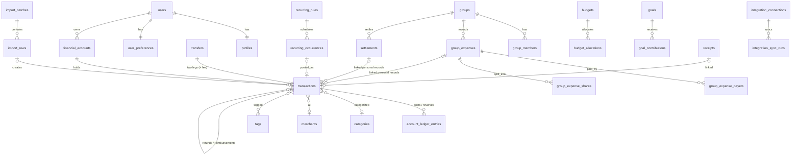

# Montra — Data Model

PostgreSQL schema `montra`: 113 tables and `schema_migrations`, created by
`supabase/migrations/*.sql` (the only source of DDL, applied by
`cmd/migrate`). Row-level security covers every table
(`docs/RLS_POLICY_MATRIX.md`). This document explains the entities and
the invariants the code relies on. Column-level detail lives in the
migrations, and typed queries live in `backend/internal/store`.

## Conventions

- **IDs:** UUID primary keys (`gen_random_uuid()`), except append-only
  logs, which use identity bigints.
- **Money:**
  - Stored as `amount_minor bigint` plus an ISO 4217 `currency`
    referencing `currencies` (exponent 0–4). Totals are summed in minor
    units; there are no floats.
  - The API exchanges decimal strings and parses them exactly
    (`internal/domain/money`, fuzzed).
  - Foreign amounts keep `original_amount_minor`, `original_currency`,
    `fx_rate` (numeric), `fx_rate_source` and `fx_rate_at`.
- **Time:**
  - `timestamptz` for instants.
  - User-facing dates are `local_date` in the user's IANA timezone,
    stored with the record's `timezone`.
  - Periods (months, weeks, custom ranges) are computed in that timezone
    (`internal/domain/period`).
- **Versioning:** editable financial rows carry `version`. Edits check and
  increment it (`VERSION_CONFLICT` on mismatch), and every ledger effect
  records the version it belongs to.
- **Soft delete:** transactions are voided (`status = 'voided'`,
  `deleted_at`) with reversing ledger entries and can be restored. Other
  user data is deleted, or archived where history matters (accounts,
  categories, groups).
- **Append-only:**
  - `account_ledger_entries`, `transaction_audit_events`, `audit_events`,
    `security_events`, `group_activity_events`,
    `group_expense_revisions`, `subscription_events` and `ai_usage`
    cannot be updated or deleted by the API role.
  - The worker may delete them for retention or account deletion only.
- **Idempotency:**
  - `idempotency_keys` stores the request hash and response for financial
    creates (24 h).
  - Natural unique keys prevent duplicates: recurring
    `(rule_id, occurrence_date)`, integration
    `external_id (account, live rows)`, webhook `(provider, event_id)`,
    job `dedupe_key`, notification `(user_id, dedupe_key)`.
- **Encryption at rest (application level):** push subscriptions,
  integration tokens, webhook payloads, MFA secrets and stored provider
  credentials are sealed with the keyring (AES-256-GCM, key IDs for
  rotation, AAD bound to the row).

## Domains

| Domain | Tables | Notes |
|---|---|---|
| Platform | `currencies`, `jobs`, `job_attempts`, `outbox_events`, `idempotency_keys`, `audit_events`, `security_events` | Durable jobs and outbox (ADR-008); audit trail |
| Identity | `users`, `user_credentials`, `user_sessions`, `user_session_refresh_history`, `auth_tokens`, `mfa_factors`, `mfa_recovery_codes`, `login_attempts`, `profiles`, `user_preferences`, `dashboard_widgets`, `user_consents`, `data_exports`, `account_deletion_requests`, `push_endpoints` | Argon2id hashes, hashed refresh/auth tokens, rotation history for reuse detection, versioned consents |
| Finance core | `financial_accounts`, `payment_methods`, `categories`, `merchants`, `merchant_aliases`, `tags`, `category_rules`, `transactions`, `transfers`, `account_ledger_entries`, `transaction_tags`, `transaction_audit_events`, `saved_filters`, `fx_rates` | Balances = opening balance + sum of ledger entries |
| Files and imports | `files`, `transaction_attachments`, `receipts`, `receipt_files`, `receipt_extractions`, `receipt_line_items`, `import_batches`, `import_rows`, `reconciliation_matches`, `reconciliation_match_items`, `account_reconciliations` | Files are metadata only; bytes live in storage (Appwrite hosted, local disk in development) |
| Social and groups | `groups`, `group_members`, `group_invitations`, `group_join_requests`, `group_expenses`, `group_expense_payers`, `group_expense_shares`, `group_expense_items`, `group_expense_item_shares`, `group_expense_comments`, `group_expense_revisions`, `settlements`, `group_disputes`, `group_activity_events`, `friend_requests`, `user_connections`, `user_blocks`, `user_mutes` | Balances are derived per read from expenses and confirmed settlements |
| Communities | `communities`, `community_members`, `community_invitations`, `community_posts`, `community_comments`, `community_reactions`, `community_polls`, `community_poll_options`, `community_poll_votes`, `community_reports`, `moderation_actions`, `moderation_appeals`, `challenges`, `challenge_participants`, `challenge_progress_events` | Plain-text content; moderation actions reversible and audited |
| Planning | `budgets`, `budget_members`, `budget_allocations`, `budget_period_snapshots`, `budget_alerts`, `recurring_rules`, `recurring_occurrences`, `bills`, `subscription_detection_candidates`, `subscriptions`, `subscription_events`, `subscription_payments`, `goals`, `goal_members`, `goal_contributions`, `goal_milestones` | Budget spend computed from transactions; snapshots for closed periods |
| Platform features | `notifications`, `notification_preferences`, `notification_deliveries`, `integration_connections`, `integration_sync_runs`, `integration_webhook_events`, `ai_conversations`, `ai_messages`, `ai_usage`, `insights`, `insight_feedback`, `insight_mutes`, `reports`, `scheduled_reports`, `search_history`, `support_requests` | One delivery row per notification and channel; webhook inbox write-only for the API role |

## Core relationships

## Invariants the code relies on

- **Ledger:**
  - Pending and posted transactions affect balances; drafts and voided
    ones do not (`ledger.AffectsBalance`).
  - An edit that changes the amount, date, account or the balance effect
    writes a reversing entry for the old version and a posting for the
    new one.
- **Transfers:** a transfer's legs (and fee) are voided and restored as a
  unit. Transfers never count as income or spending.
- **Refunds:** refunds and reimbursements cannot exceed the original's
  remaining amount, and a voided original rejects new ones.
- **Group records:**
  - A group expense or settlement creates linked personal records for the
    payer or parties.
  - Those records are changed only through the group (or by the worker
    as `system`) and are visible only to their owner (ADR-036; RLS
    narrowed in 000016).
- **Recurring:** one occurrence per rule and date, and at most one posted
  transaction per occurrence (ADR-026). An edit whose dates are unchanged
  keeps occurrences the user adjusted (`overrides`: postponed or own
  amount); a date change regenerates open future occurrences from today.
- **Jobs:** `dedupe_key` means "at most once ever" (unique across completed
  jobs too); `jobs.Spec.CoalesceQueued` instead skips an enqueue only
  while an equal job is still queued (debounced re-evaluations such as
  `budgets.evaluate`).
- **Push endpoints** carry the session that registered them; revoking a
  session deletes them (trigger), so a shared browser never keeps a
  previous user's pushes.
- **Support threads:** `support_messages` (requester or staff; RLS checks
  the author's role).
- **Subscription payments:** `subscription_payments` holds the payment
  links in force (one subscription per transaction, unique
  `transaction_id`); `subscription_events` stays the append-only history
  (`payment_recorded` / `payment_unlinked`).
- **Merges:** merging categories or merchants re-points every reference,
  including budget filter arrays (`budgets.excluded_category_ids`,
  `budgets.merchant_ids`, which have no foreign keys) and pending
  subscription detections, and keeps `merged_into_id` one hop long.
  Transaction filters on a merged ID resolve to its target.
- **Category rules:** amount bounds are stored with their currency
  (`category_rules.amount_currency`) and match only transactions in that
  currency.
- **Optimistic concurrency:** `version` on accounts, payment methods,
  categories, category rules, tags, merchants, transactions, budgets,
  bills, recurring rules, subscriptions and goals; updates and
  lifecycle actions that receive a stale version answer
  `VERSION_CONFLICT`.
- **Integrations:** a provider item maps to at most one live transaction
  per account. Voided items are never re-created (ADR-048).
- **Deletion:** account deletion runs in the worker after the grace
  period. User-owned rows cascade from `users`; storage objects are
  deleted through file deletion jobs.
