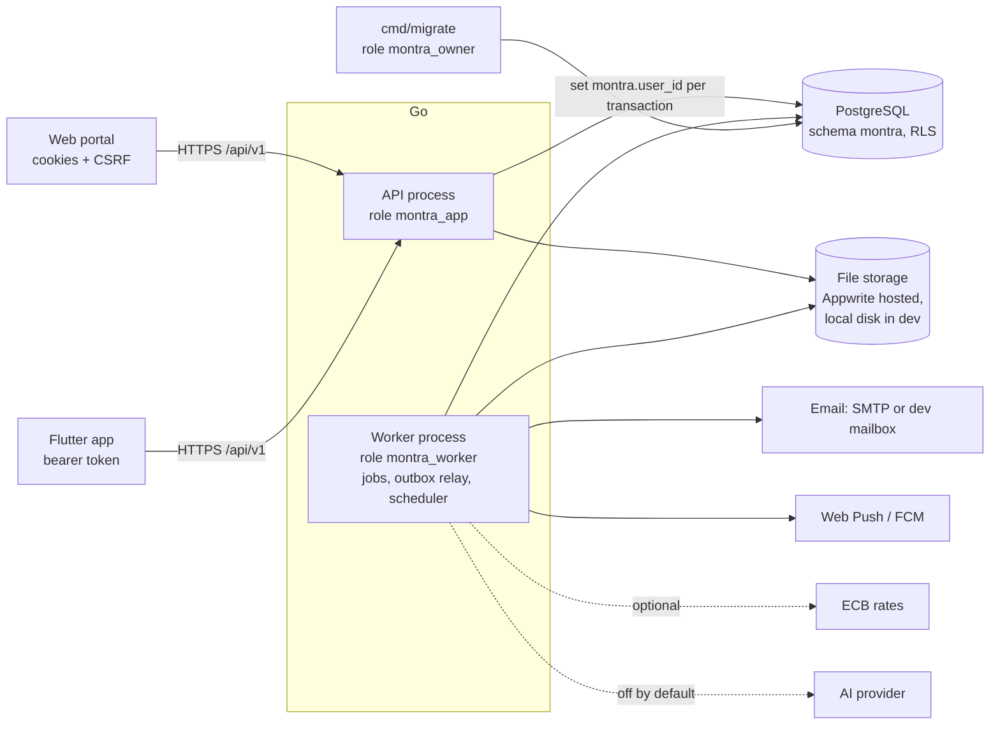

# Montra — Features and How They Work

Last checked against the code: 2026-11-13.

Montra is a free, privacy-first personal finance and shared-money app. A
person records accounts and transactions by hand, from statement files or
from receipts; plans with budgets, bills, recurring payments,
subscriptions and goals; reads analytics, reports and rule-based
insights; and shares money with friends, groups and households. It also
has communities and savings challenges. There are three clients of one
backend: a React web portal, a Flutter app for Android and iOS, and a Go
API with a Go worker in front of PostgreSQL.

This document describes every implemented feature end to end: what it
does for a person, how a request moves from the screen through the API to
the database and the background jobs, and which rules protect it. It is
written for engineers and product people who are new to the project and
for reviewers. It describes only what exists in the code today. Where
other documents disagree with the code, the code was followed and the
difference is listed in [Notes for maintainers](#8-notes-for-maintainers).

**Product principles** (spec §0, §17), and where they show up in the code:

| Principle | What it means in practice |
|---|---|
| Free for everyone, no paywalls | There are no plans, billing, premium flags or upgrade prompts. CI has a `no-paywall` job that rejects paid-tier code paths. Limits exist only for fair use and are the same for everyone (`GET /limits`). |
| Private by default | Financial records are visible only to their owner. Sharing is always explicit (household accounts, group expenses, budget and goal collaborators). The API checks ownership and PostgreSQL row-level security (RLS) enforces it again. |
| No bank linking required | Every feature works with manual entry, statement imports and receipts. Montra never asks for bank passwords, UPI PINs, OTPs or CVVs, never reads SMS and never initiates payments. |
| Exact money | Amounts are stored as integer minor units with an ISO 4217 currency. The API accepts and returns decimal strings, never floats. Currencies are never added together silently. |
| AI is advisory and off by default | The AI backend exists but is disabled unless the owner configures a provider and the person consents. By owner decision, no AI screen is built on either client. |
| Honest about what is not connected | Integrations show `unavailable` or `not_configured` with a reason. Receipts are entered by hand unless a reader is configured. Web push says when the server cannot send. Nothing shows sample or placeholder data. |

## Contents

1. [System overview](#1-system-overview)
2. [Cross-cutting conventions](#2-cross-cutting-conventions)
   - [2.1 Sessions and two-step verification](#21-sessions-and-two-step-verification)
   - [2.2 Authorization and row-level security](#22-authorization-and-row-level-security)
   - [2.3 Errors and coded responses](#23-errors-and-coded-responses)
   - [2.4 Idempotency keys](#24-idempotency-keys)
   - [2.5 Partial updates and versions](#25-partial-updates-and-versions)
   - [2.6 Lifecycle actions](#26-lifecycle-actions)
   - [2.7 Cursor paging](#27-cursor-paging)
   - [2.8 Rate limits and fair-use caps](#28-rate-limits-and-fair-use-caps)
   - [2.9 Money, currencies and exchange rates](#29-money-currencies-and-exchange-rates)
   - [2.10 Files and storage](#210-files-and-storage)
   - [2.11 Audit log](#211-audit-log)
   - [2.12 Background jobs and the outbox](#212-background-jobs-and-the-outbox)
   - [2.13 Languages](#213-languages)
   - [2.14 Accessibility](#214-accessibility)
   - [2.15 Notifications and email](#215-notifications-and-email)
3. [Feature areas](#3-feature-areas)
   - [3.1 Sign-in and account security](#31-sign-in-and-account-security)
   - [3.2 Onboarding](#32-onboarding)
   - [3.3 Dashboard](#33-dashboard)
   - [3.4 Accounts, balances and payment methods](#34-accounts-balances-and-payment-methods)
   - [3.5 Transactions](#35-transactions)
   - [3.6 Categories, merchants, tags and rules](#36-categories-merchants-tags-and-rules)
   - [3.7 Budgets and alerts](#37-budgets-and-alerts)
   - [3.8 Recurring rules, bills and the calendar](#38-recurring-rules-bills-and-the-calendar)
   - [3.9 Subscriptions and detection](#39-subscriptions-and-detection)
   - [3.10 Receipts](#310-receipts)
   - [3.11 Statement imports and reconciliation](#311-statement-imports-and-reconciliation)
   - [3.12 Analytics, reports and exports](#312-analytics-reports-and-exports)
   - [3.13 AI assistant (deferred)](#313-ai-assistant-deferred)
   - [3.14 Insights](#314-insights)
   - [3.15 Goals](#315-goals)
   - [3.16 Friends and social](#316-friends-and-social)
   - [3.17 Groups](#317-groups)
   - [3.18 Group money](#318-group-money)
   - [3.19 Communities, posts and comments](#319-communities-posts-and-comments)
   - [3.20 Challenges](#320-challenges)
   - [3.21 Moderation and appeals](#321-moderation-and-appeals)
   - [3.22 Notifications](#322-notifications)
   - [3.23 Integrations](#323-integrations)
   - [3.24 Exchange rates and multi-currency](#324-exchange-rates-and-multi-currency)
   - [3.25 Search](#325-search)
   - [3.26 Profile and preferences](#326-profile-and-preferences)
   - [3.27 Help and support](#327-help-and-support)
   - [3.28 Privacy: consents, export, deletion and deactivation](#328-privacy-consents-export-deletion-and-deactivation)
   - [3.29 Fair-use limits](#329-fair-use-limits)
   - [3.30 Admin and staff tools](#330-admin-and-staff-tools)
4. [Quality and operations](#4-quality-and-operations)
5. [What needs the owner](#5-what-needs-the-owner)
6. [Glossary](#6-glossary)
7. [Related documents](#7-related-documents)
8. [Notes for maintainers](#8-notes-for-maintainers)

Feature areas follow the order of the spec's feature catalogue (§4.1 to
§4.21), followed by the platform areas (privacy, fair use, staff tools).

---

## 1. System overview

### Monorepo layout

| Path | What lives there |
|---|---|
| `backend/` | Go module `montra/backend`. `cmd/api` (HTTP API), `cmd/worker` (jobs, outbox relay, scheduler), `cmd/migrate` (forward-only migrations), `cmd/openapi` (contract export and drift check), `cmd/loadtest`. |
| `backend/internal/<module>` | One package per feature (`auth`, `users`, `finance`, `budgets`, `recurring`, `subscriptions`, `goals`, `receipts`, `imports`, `reconciliation`, `analytics`, `reports`, `fx`, `insights`, `ai`, `social`, `groups`, `communities`, `moderation`, `challenges`, `notifications`, `integrations`, `search`, `support`, `privacy`, `fairuse`, `admin`, `files`). Each holds its service, SQL and Huma route registration (`http.go`). |
| `backend/internal/domain` | Pure logic with no HTTP or SQL: `money`, `split`, `settlement`, `ledger`, `period`, `recurrence`, `budgetcalc`, `subdetect`, `statement`, `reconcile`, `textsafe`, among others. |
| `backend/internal/platform` | Config, logging, error envelope (`apperr`), HTTP middleware (`httpx`), database helpers and RLS identity, jobs, outbox, rate limiting, fair-use caps, idempotency, audit, crypto, storage, email, observability. |
| `backend/internal/app/app.go` | Wiring: builds every service, mounts the routes (`RegisterRoutes`), registers job handlers (`RegisterJobs`) and lists the periodic jobs (`Periodic`). |
| `supabase/migrations` | 28 SQL migrations, the only source of schema. They create 113 tables in schema `montra`, all with RLS. |
| `contracts/openapi/montra.v1.json` | The OpenAPI contract, generated from the Go handlers and drift-checked in CI: 330 paths and 420 operations. |
| `web/` | React 19 + TypeScript (Vite). Routing with React Router, data with TanStack Query and `openapi-fetch`, forms with React Hook Form and Zod. Features live in `web/src/features/<area>`; routes in `web/src/shared/config/paths.ts` and `web/src/app/router/routes.tsx`. |
| `mobile/` | Flutter (Android and iOS). Dio for HTTP, Riverpod for state, go_router for navigation, `flutter_secure_storage` for the refresh token. Features live in `mobile/lib/features/<area>`; routes in `mobile/lib/app/router`. |
| `storage/appwrite/` | Bucket definitions and permission conventions for hosted file storage. |
| `infra/`, `scripts/`, `.github/workflows/` | Container and deployment templates (no secrets), database bootstrap and e2e scripts, CI. |

### Request flow



1. A client calls `/api/v1/...`. Clients send `X-Montra-Client` (`web`,
   `android` or `ios`) and `X-Client-Version`; every response carries
   `X-Request-ID`.
2. Middleware in the API assigns the request ID, applies security headers,
   CORS, a body limit and a timeout, resolves the session (cookie or
   bearer token), checks CSRF for cookie sessions and applies the rate
   limit (`backend/internal/app/app.go`, `NewRouter`).
3. The Huma operation validates the request against its schema, and the
   feature service checks authorization explicitly (owner, group role,
   community role, platform role).
4. The service runs its SQL inside `database.WithUserTx`, which sets
   `montra.user_id` for that transaction only. RLS policies on every
   table use it, so a missed check fails closed.
5. In the same transaction the service writes audit rows and, where other
   work must follow, an outbox event. The response is
   `{"data": …, "meta": {"request_id", "timestamp", "next_cursor?"}}`.
6. The worker relays outbox events into durable jobs and runs them
   (budget evaluation, notifications, group sync, and so on). It also
   runs the scheduler for periodic jobs.

### Database roles

| Role | Used by | Access |
|---|---|---|
| `montra_app` | the API | Subject to RLS on every table. Sees rows through policies keyed on `montra.current_user_id()`. Cannot update or delete append-only tables. |
| `montra_worker` | the worker | `worker_all` policies for system work across users. No DDL. Append-only tables stay append-only except for retention and account deletion. |
| `montra_owner` | `cmd/migrate` only | Owns the schema. Never used at runtime. |

Cross-user reads (for example another person's name in a group) never
widen table policies. They go through `SECURITY DEFINER` helpers that
require an identity, return a minimal profile (display name, username,
avatar) and honour blocks both ways. See `docs/RLS_POLICY_MATRIX.md`.

### Worker, outbox and scheduler

The worker (`cmd/worker`) runs three loops: the job worker, the outbox
relay and the scheduler. Jobs live in PostgreSQL and are claimed with
`FOR UPDATE SKIP LOCKED`. The scheduler elects one leader with a
PostgreSQL advisory lock and enqueues periodic jobs with time-bucketed
dedupe keys. Details are in [2.12](#212-background-jobs-and-the-outbox).

### Storage

Bytes live in file storage; the database keeps only metadata (`files`).
Hosted environments use Appwrite with five private buckets
(`private-user-docs`, `group-docs`, `public-media`, `temp-processing`,
`exports`). Development uses the `local_disk` adapter under `.data/`.
Clients never talk to storage directly. See [2.10](#210-files-and-storage).

### Environments

| Environment | API and worker | Database | Storage and email |
|---|---|---|---|
| Development (local) | `make api`, `make worker` on `:8080` | Local PostgreSQL, database `montra_dev` | `local_disk` and the `dev_mailbox` adapter (emails written as `.eml` files) |
| Test | `go test`; e2e uses `scripts/ci/e2e-stack.sh` | `montra_test` (the harness refuses any name not ending in `_test`) | Local disk, dev mailbox, AI disabled, manual FX |
| Staging and production | One container image (`backend/Dockerfile`), two always-on processes (`api`, `worker`) | Supabase PostgreSQL | Appwrite, SMTP, optional VAPID/FCM, optional ECB, optional AI |

`APP_ENV=production` refuses development adapters, insecure cookies,
`*` CORS and the development email-verification bypass. The web portal is
a static build for Vercel; mobile apps go through the stores. Nothing in
this repository deploys automatically (`docs/DEPLOYMENT.md`).

---

## 2. Cross-cutting conventions

These rules apply to every feature. Feature sections refer back to them
instead of repeating them.

### 2.1 Sessions and two-step verification

- **Web** uses HttpOnly, `Secure`, `SameSite=Lax` cookies. Every unsafe
  request (POST, PUT, PATCH, DELETE) must send `X-CSRF-Token`, taken from
  `csrf_token` in auth responses or the readable `montra_csrf` cookie
  (double-submit). A missing or wrong token answers 403 `CSRF_FAILED`.
- **Mobile** receives tokens in the response body. The access token stays
  in memory; the refresh token is kept in the Keychain or Keystore
  (`mobile/lib/core/auth/credential_store.dart`). Requests send
  `Authorization: Bearer`.
- **Tokens:** access tokens are 256-bit opaque values with a 15-minute
  life, stored only as SHA-256 hashes. Refresh tokens rotate on every
  use (`POST /auth/refresh`); reusing an old one revokes the session and
  records a security event.
- **Refresh rule for clients:** only `UNAUTHENTICATED` triggers one shared
  refresh and one retry. `MFA_REQUIRED`, `MFA_*` and `REAUTH_REQUIRED`
  share HTTP 401 but never trigger a refresh.
- **Two-step verification:** TOTP (RFC 6238, 6 digits, 30 s) with the
  secret encrypted using AES-256-GCM, plus 10 single-use recovery codes
  stored hashed. When it is on, `POST /auth/login` answers
  `status: mfa_required` with an `mfa_token`, and the client completes
  sign-in with `POST /auth/mfa/verify` (code or recovery code).
- **Re-authentication:** the sensitive actions (starting or disabling
  two-step verification, new recovery codes, data export, account
  deletion and deactivation) need a recent
  `POST /auth/reauthenticate` (password plus code when two-step is on).
  The window is 10 minutes by default (`AUTH_REAUTH_WINDOW`); a fresh
  sign-in counts.

### 2.2 Authorization and row-level security

- Every handler takes the user from the session. Owner IDs sent by a
  client are ignored.
- Services check ownership and roles explicitly. RLS is defence in depth.
- Anything a caller may not see answers 404 `NOT_FOUND`, never 403, so
  the existence of other people's records is not disclosed. This applies
  to non-members of groups and invite-only communities too.
- Group membership never grants access to anyone's personal records.
  Personal transactions linked to group activity are visible only to
  their owner.
- Rows addressed to another user (notifications and deliveries) are
  written only by the worker. The API role's RLS on `notifications` is
  owner-only, so a request cannot place a notification in someone else's
  inbox.
- Support and admin roles have no default access to private financial
  data. The full operation-by-operation matrix is
  `docs/AUTHORIZATION_MATRIX.md`.

### 2.3 Errors and coded responses

Errors use one envelope:

```json
{"error": {"code": "VALIDATION_ERROR", "message": "…", "details": [{"field": "body.amount", "code": "too_long", "message": "…", "params": {}}], "request_id": "…"}}
```

- `code` is a closed enum in the contract (`ErrorObject.code`), for
  example `VALIDATION_ERROR` (422), `NOT_FOUND` (404), `CONFLICT` (409),
  `VERSION_CONFLICT` (409), `DUPLICATE` (409), `GONE` (410),
  `DOMAIN_RULE_VIOLATION` (422), `RATE_LIMITED` (429),
  `CONSENT_REQUIRED` (403), `FEATURE_NOT_CONFIGURED` (503).
- Business rules answer 422 `DOMAIN_RULE_VIOLATION` with a stable
  `details[0].code` (106 codes, such as `refund_exceeds_remaining`) and
  `params` where values matter. State conflicts answer 409 `CONFLICT`
  with a detail code (41 codes, such as `settlement_voided`). Both tables
  are generated into `docs/API.md` and checked in CI.
- Clients branch on codes, never on message text. Both clients localize
  by code and fall back to the English message.
- The access log records the error code, the first detail code and its
  field for every error response, never the message or values
  (`backend/internal/platform/httpx/middleware.go`).

### 2.4 Idempotency keys

Creates that a retry could duplicate require an `Idempotency-Key` header
(8 to 128 characters, generated by the client). The contract marks each
one. They include accounts, transactions, transfers, refunds,
duplicates, balance adjustments, bills, recurring rules, group expenses
and settlements, receipts, statement imports, and payment-style actions
(bill mark-paid, recurring occurrence actions, subscription payments,
goal contributions, import confirm, receipt to transaction).

- Same key and same body: the original result, with
  `Idempotent-Replayed: true`.
- Same key, different body: 409 `IDEMPOTENCY_CONFLICT`.
- Same key while the first request is still running: 409
  `IDEMPOTENCY_IN_PROGRESS`.

Keys and responses are stored in `idempotency_keys` for 24 hours. Both
clients reuse the key when they retry the same submission
(`web/src/shared/api/idempotency.ts`,
`mobile/lib/core/api/idempotency.dart`). Natural unique keys back this up, for
example one recurring occurrence per rule and date.

### 2.5 Partial updates and versions

- Editable records carry `version`: accounts, payment methods,
  categories, category rules, tags, merchants, transactions, budgets,
  bills, recurring rules, subscriptions, goals, groups, communities,
  challenges, report schedules and receipts among them. An update must
  send the version it read; a stale one answers 409 `VERSION_CONFLICT`
  and the client reloads and reapplies.
- `PATCH` changes only the fields sent. A list replaces the whole list
  (`[]` empties it). Text is cleared with `""`. Other optional fields
  (references, numbers) are cleared by naming them in `clear`, for
  example `"clear": ["payment_account_id"]`. Sending a value and clearing
  the same field is rejected.
- Both clients send only changed fields (web form diffing;
  `mobile/lib/core/api/partial_patch.dart`).

### 2.6 Lifecycle actions

Status changes are explicit actions rather than field edits: for
example `POST /bills/{id}/pause`, `resume`, `archive`, `restore`; budget
`pause`, `resume`, `restore` (with `DELETE /budgets/{id}` archiving);
subscription `cancellation-started`, `cancelled`, `reactivate`; goal
`achieve`, `cancel`, `pause`, `resume`. An action that does not apply to
the current status answers 422 `DOMAIN_RULE_VIOLATION` with code
`invalid_status_transition` and params `from` and `to`. Records with
history are archived or voided rather than deleted.

### 2.7 Cursor paging

Long lists return `meta.next_cursor` (and `meta.has_more`); the client
passes it back as `cursor`. `limit` is usually at most 200. Cursors are
signed with the URL signing key, so they cannot be forged. Where a list
has several sorts (the community feed), a cursor from one sort is
rejected for another. Lists that were once
unpaged keep their old first page when no cursor is sent.

### 2.8 Rate limits and fair-use caps

- **Rate limits** are token buckets per user (or per IP when signed out)
  in the API process (`backend/internal/platform/ratelimit`):

  | Policy | Approximate rate | Burst |
  |---|---|---|
  | `default` | 600 per minute | 60 |
  | `auth` | 10 per minute | 10 |
  | `write` | 240 per minute | 40 |
  | `upload` | 20 per minute | 10 |
  | `ai` | 20 per minute | 10 |
  | `export` | 2 per minute | 5 |
  | `social` | 30 per minute | 15 |

  A limited request answers 429 `RATE_LIMITED` with `Retry-After`.
  Repeated failed sign-ins answer 429 `LOGIN_THROTTLED`; those counters
  are stored in PostgreSQL so they hold across instances.
- **Fair-use caps** are the same for everyone and listed in
  `GET /limits` (see [3.29](#329-fair-use-limits)): open records (500
  recurring rules, 200 bills, 500 subscriptions, 200 goals; beyond them
  `record_limit_reached`), daily caps on community actions and support
  requests (429 with detail code `daily_cap`), a storage allowance
  (`storage_quota_exceeded`) and import size limits. They are never paid
  tiers.

### 2.9 Money, currencies and exchange rates

- Stored as `amount_minor bigint` plus an ISO 4217 `currency` that
  references `currencies` (exponent 0 to 4). Sums are integer sums.
- Requests send exact decimal strings in the currency's precision
  (`"1234.50"`). Responses return
  `{"amount_minor": 123450, "amount": "1234.50", "currency": "INR"}`.
  Parsing is exact and fuzz-tested (`internal/domain/money`).
- Percentages are basis points (`percent_bp`, 10000 = 100 %).
- `GET /currencies` lists codes with their exponent. Retired currencies
  stay valid for history but have `selectable: false` and are refused for
  new accounts, budgets, goals, subscriptions, recurring rules and
  preferences.
- Totals in different currencies are never added together. Where a
  combined figure is shown, it is converted with a disclosed rate and
  policy (see [3.24](#324-exchange-rates-and-multi-currency)).
- Foreign amounts keep `original_amount`, `original_currency`, `fx_rate`,
  `fx_rate_source` and `fx_rate_at`.
- Dates are `YYYY-MM-DD` in the user's (or the record's) IANA time zone;
  instants are RFC 3339 UTC. Periods are computed in that time zone
  (`internal/domain/period`).

### 2.10 Files and storage

All uploads (receipts, attachments, avatars, statements, bill documents,
invoices, goal and group attachments) use one flow:

1. `POST /files/upload-intent` with a `purpose` (`receipt`,
   `bill_document`, `transaction_attachment`, `goal_attachment`,
   `subscription_invoice`, `statement_import`, `avatar`,
   `group_attachment`, `trip_document`), name, size and checksum. The API
   checks the purpose's allow-list, the size limit and the person's
   storage allowance, and returns a single-use upload URL.
2. `PUT /files/{fileId}/content` with `X-Upload-Token` and
   `X-Upload-Checksum`. The API sniffs the content type from magic bytes,
   checks the extension and checksum, and writes through the storage
   adapter under a randomized name.
3. `POST /files/{fileId}/complete` finalizes the file (`ready`).
4. Reading: `GET /files/{fileId}/access` re-checks authorization and
   returns a short-lived signed URL (about 5 minutes);
   `GET /files/{fileId}/content` streams it with
   `Content-Disposition: attachment` and `nosniff`.
5. `DELETE /files/{fileId}` queues `files.delete`. The hourly
   `files.cleanup` removes abandoned uploads after 24 hours.

Defaults: 20 MiB per upload (`STORAGE_MAX_UPLOAD_BYTES`) with smaller
per-purpose limits, and a 2 GiB allowance per person
(`STORAGE_USER_QUOTA_BYTES`). There is no public link to any receipt or
document. There is no virus scanner yet (`scan_status = skipped`).
Client helpers: `web/src/shared/files`, `mobile/lib/core/files`.

### 2.11 Audit log

- `audit_events` records important writes (who, what entity, which
  action) without personal values. `security_events` records sign-ins,
  token reuse, MFA changes, deactivation and similar.
- Transactions also have their own history in `transaction_audit_events`
  (`created`, `updated`, `voided`, `restored`, `refund_added`,
  `reconciled`, `rule_categorized`, `imported`, and more), shown in
  `GET /transactions/{id}/audit`.
- These tables, plus `account_ledger_entries`, `group_activity_events`,
  `group_expense_revisions`, `subscription_events` and `ai_usage`, are
  append-only for the API role.

### 2.12 Background jobs and the outbox

- Domain writes emit `outbox_events` in the same transaction. The relay
  turns them into jobs through registered routes and marks them
  processed (deleted after 7 days).
- Delivery is at least once: leases of 5 minutes, exponential backoff
  with jitter (5 s doubling, capped at 1 h), up to 8 attempts, then
  `dead`. Every handler is idempotent (dedupe keys, unique constraints,
  status checks under row locks).
- `jobs.dedupe_key` is unique, so outbox replays and scheduler restarts
  never enqueue twice. Debounced jobs such as `budgets.evaluate` use
  "coalesce while queued" instead.
- Jobs that act for a user run as that user where reads must be scoped
  (for example reports).
- Periodic jobs (from `Periodic()` in `app.go`):

  | Job | Every | Purpose |
  |---|---|---|
  | `recurring.generate` | 15 min | Create occurrences, auto-post, add shared recurring expenses, mark overdue, send bill and recurring reminders |
  | `privacy.deletion_due` | 15 min | Start account deletions whose grace period ended |
  | `integrations.schedule` | 30 min | Recover abandoned runs, expire consents, start scheduled syncs, re-queue stale webhooks |
  | `subscriptions.renewals` | 1 h | Renewal and trial-end reminders, roll renewal dates |
  | `notifications.digest_scan` | 1 h | Find people whose digest is due at 08:00 local |
  | `reports.schedules` | 1 h | Generate scheduled reports; fail reports whose job ended without a result |
  | `groups.trip_reminders` | 1 h | Trip starting, and trip ended with open balances |
  | `support.notify_staff` | 1 h | Counts-only email to staff about open requests |
  | `platform.retention_cleanup` | 1 h | Delete expired sessions, tokens, finished jobs, old outbox events and more (ADR-021) |
  | `files.cleanup` | 1 h | Remove abandoned uploads and expired temporary files |
  | `goals.reminders` | 6 h | Contribution reminders |
  | `fx.refresh` | 6 h | Fetch ECB reference rates when `FX_PROVIDER=ecb` |
  | `subscriptions.detect_all` | 24 h | Fan out `subscriptions.detect` per person |
  | `insights.generate_all` | 24 h | Fan out `insights.generate` per person |

  The full inventory with timeouts and concurrency is in
  `docs/BACKGROUND_JOBS.md`, generated by `TestJobInventory`, which also
  fails if a periodic job has no handler.

### 2.13 Languages

- English and Hindi on both clients. Web strings are in
  `web/src/shared/i18n/locales/en.ts` and `hi.ts`; mobile strings in
  `mobile/lib/app/l10n/arb/app_en.arb` and `app_hi.arb`.
- The API returns stable codes next to English text (error detail codes,
  `note_codes`, insight `message_code`, import and receipt warning codes,
  reason codes) so clients can localize computed explanations.
- Amounts and dates follow the person's `locale`, `number_format`
  (`indian` or `international` grouping) and `date_format` preferences.
- Not every string has a Hindi translation yet (a count of 183 missing web
  strings was recorded in the P13 pass). Legal texts are not localized.

### 2.14 Accessibility

- Both clients apply the account's `reduced_motion`, `high_contrast` and
  `text_scale_percent` (80 to 200 %) preferences app-wide, on top of the
  device settings. Web sets `data-motion`, `data-contrast` and the root
  font size (`web/src/shared/theme/displayPreferences.ts`, applied before
  first paint by `public/theme-init.js`). Mobile adjusts `MediaQuery` and
  the theme (`mobile/lib/core/settings/app_preferences.dart`).
- Light, dark and system themes on both.
- Every feature has loading, empty, error, success and permission-denied
  states (spec §0.9).
- Checked by axe (jest-axe in `web/src/tests/a11y`, and
  `web/e2e/accessibility.spec.ts` for WCAG A/AA in light and dark at three
  widths) and by Flutter `meetsGuideline` checks on 11 screens. No
  screen-reader review has been done yet.

### 2.15 Notifications and email

- Every notification is first stored in-app (`notifications`, deduplicated
  per user by `dedupe_key`), then one `notification_deliveries` row and
  one `notifications.deliver` job per external channel.
- Channels: `in_app`, `email`, `web_push`, `push` (FCM). Categories:
  `budget`, `bill`, `subscription`, `recurring`, `goal`, `group`,
  `settlement`, `trip`, `community`, `challenge`, `security`, `import`,
  `receipt`, `export`, `account`, `insight`, `system`, `social`.
  `security` and `account` cannot be turned off.
- Titles and bodies are safe summaries with no amounts, merchants or
  descriptions. Every API test checks this
  (`internal/testutil/apitest`).
- Deep links are web paths carrying IDs only, such as
  `/planning/bills/{id}` or `/groups/{id}/settlements/{settlementId}`.
  Mobile uses the same paths.
- Quiet hours delay external deliveries; email digests batch
  non-urgent email. Details in [3.22](#322-notifications).
- Account emails (verification, password reset, security alerts,
  account-exists) are sent by `auth.send_*` jobs; locally they are written
  to the dev mailbox.

---
## 3. Feature areas

Each area uses the same sub-headings. "Web" and "Mobile" name the routes
and the main files; "Data" names the main tables. Conventions from
section 2 apply everywhere and are not repeated.

### 3.1 Sign-in and account security

#### What a person can do

Create an account with email and password, verify the email, sign in and
out, reset a forgotten password, change the password, turn on two-step
verification with an authenticator app and recovery codes, see active
sessions and sign out one session or all of them.

#### How it works end to end

1. **Sign-up.** The sign-up form posts `POST /auth/register` with email,
   password, display name, country, currency, time zone, locale,
   `accept_terms`, `confirm_adult` and the current terms and privacy
   versions (from `GET /legal`). The API always answers 202, whether or
   not the email exists, so the form cannot be used to discover accounts.
   A new user gets `users`, `user_credentials` (Argon2id hash),
   `profiles`, `user_preferences`, the required consents and the starter
   categories; the `auth.send_verification` job emails a link. An email
   that is already registered gets an "account exists" email instead
   (`auth.send_account_exists`).
2. **Verification.** The link opens `/verify-email` with a token, which the
   page posts to `POST /auth/email/verify`. Tokens are 256-bit, hashed,
   single use and expire after 24 hours. `POST /auth/email/resend` sends a
   new one. Sign-in before verification answers 403
   `EMAIL_NOT_VERIFIED`.
3. **Sign-in.** `POST /auth/login` checks the throttle counters (per email
   hash and per IP), verifies the password and creates a `user_sessions`
   row. Web receives cookies plus a `csrf_token`; mobile receives
   `access_token` and `refresh_token`. If two-step verification is on,
   the answer is `status: mfa_required` with an `mfa_token`, and the
   client finishes with `POST /auth/mfa/verify`.
4. **Staying signed in.** `GET /auth/session` returns the account summary.
   `POST /auth/refresh` rotates the tokens (empty body for web cookies;
   `refresh_token` for mobile).
5. **Password reset.** `POST /auth/password/forgot` always answers the
   same way and emails a 1-hour link (`auth.send_password_reset`).
   `POST /auth/password/reset` sets the new password and revokes every
   session.
6. **Security settings.** `POST /me/password` changes the password and
   signs out other sessions. Two-step verification:
   `POST /me/mfa/totp/setup` (returns `otpauth_uri` and secret; web shows
   a QR code), `POST /me/mfa/totp/activate` with the first code (returns
   recovery codes), `POST /me/mfa/recovery-codes` and
   `POST /me/mfa/totp/disable`. Sessions: `GET /me/sessions`,
   `DELETE /me/sessions/{sessionId}`, `POST /auth/logout`,
   `POST /auth/logout-all`.
7. Security-relevant events are written to `security_events` and the
   person is emailed about important ones (`auth.send_security_email`);
   an in-app copy goes to the notification centre.

| Endpoint | Purpose |
|---|---|
| `POST /auth/register` | Create an account (always 202) |
| `POST /auth/email/verify`, `POST /auth/email/resend` | Email verification |
| `POST /auth/login`, `POST /auth/mfa/verify` | Sign in, second step |
| `POST /auth/refresh`, `GET /auth/session` | Session upkeep |
| `POST /auth/logout`, `POST /auth/logout-all` | Sign out |
| `POST /auth/password/forgot`, `POST /auth/password/reset` | Password reset |
| `POST /auth/reauthenticate` | Confirm identity before a sensitive action |
| `POST /me/password` | Change password |
| `POST /me/mfa/totp/setup`, `POST /me/mfa/totp/activate`, `POST /me/mfa/totp/disable`, `POST /me/mfa/recovery-codes` | Two-step verification |
| `GET /me/sessions`, `DELETE /me/sessions/{sessionId}` | Sessions and devices |

#### Rules and safeguards

- Passwords: 10 to 128 characters, not a common password, not containing
  the email's local part, at least four distinct characters. Errors name
  the field (`body.password` or `body.new_password`).
- Sign-in errors are generic and never say whether an email exists.
  Failed attempts lead to a progressive delay and a temporary lockout
  (429 `LOGIN_THROTTLED` with `Retry-After`); a locked account answers
  403 `ACCOUNT_LOCKED`.
- The `auth` rate limit applies to sign-in and sign-up endpoints.
- Two-step setup, disable and new recovery codes need recent
  re-authentication ([2.1](#21-sessions-and-two-step-verification)).
- Push endpoints belong to the session that registered them and are
  deleted when that session ends, so a shared browser never receives the
  previous person's notifications.
- Captcha (`TURNSTILE_SECRET_KEY`) is supported by the API but must stay
  off until the clients ship the widget.

#### Web

`/sign-up`, `/sign-in`, `/verify-email`, `/forgot-password`,
`/reset-password`, `/settings/security`, `/account`. Files:
`web/src/features/auth/pages/*`, `web/src/features/settings/pages/SecuritySettingsPage.tsx`
with `TwoStepCard`, `MfaEnrollment`, `RecoveryCodesPanel`,
`SessionsCard`, `ChangePasswordCard`, `SignOutEverywhereCard`;
`web/src/shared/api/session-recovery.ts` and `csrf.ts` handle refresh and
CSRF.

#### Mobile

`/welcome`, `/sign-up`, `/check-email`, `/sign-in`, `/verify-email`,
`/forgot-password`, `/reset-password`, `/profile/security`,
`/profile/security/sessions`, `/profile/security/password`,
`/profile/security/two-step`. Files: `mobile/lib/features/auth/presentation/*`,
`mobile/lib/features/settings/presentation/security_screen.dart`,
`two_step_screen.dart`, `sessions_screen.dart`, `reauth_sheet.dart`,
`mobile/lib/core/auth/*`. A protected link opened while signed out is
kept as `next` and opened after sign-in (`authRedirect` in
`app_routes.dart`).

#### Data

`users`, `user_credentials`, `user_sessions`,
`user_session_refresh_history`, `auth_tokens`, `mfa_factors`,
`mfa_recovery_codes`, `login_attempts`, `security_events`.

#### Background work

`auth.send_verification`, `auth.send_password_reset`,
`auth.send_account_exists`, `auth.send_security_email`;
`platform.retention_cleanup` removes login attempts after 2 days, expired
auth tokens after 7 days and ended sessions after 90 days.

#### Limits and not yet available

Sign-in with Google or Apple and passkeys are not built (optional in the
spec). Captcha is off. The mobile sign-up form and mobile sign-out are not
covered by widget tests.

### 3.2 Onboarding

#### What a person can do

After the first sign-in, go through a short setup that can be skipped at
every step after the welcome: privacy choices, country, currency and time
zone (plus week and month start), income range, a first goal, first
accounts, which starter categories to keep, and how often to receive
email summaries. Leaving and coming back resumes at the first unanswered
step.

#### How it works end to end

1. After signing in, a user whose `onboarding_completed` is false is sent
   to `/onboarding`. The page reads `GET /me/onboarding`
   (`completed_steps`, `skipped_steps`) to resume.
2. Each step saves its own data with the normal endpoints:
   `PATCH /me/preferences` (country, currency, time zone, week and month
   start, `income_range`, `analytics_opt_in`, `email_digest`),
   `POST /goals` with an `Idempotency-Key` (goal step),
   `POST /accounts` (accounts step) and
   `POST /categories/{id}/archive` for starter categories the person
   unticks (archived, not deleted).
3. After each step the client records progress with
   `POST /me/onboarding`. The server merges steps with what it stored (a
   completed step wins over a skipped one). Finishing sends
   `complete: true`; every unanswered step counts as skipped.
4. The user lands on the dashboard, or on the link they were opening when
   they signed up.

#### Rules and safeguards

- Bank linking is never asked for.
- The analytics opt-in is stored, but no product analytics is collected
  today; the copy says so.
- The goal step's idempotency key means a retry after a lost connection
  never creates a second goal.

#### Web

`/onboarding` (focus layout). Files: `web/src/features/onboarding/pages/OnboardingPage.tsx`,
`steps.ts` (step list mapped to the API's step names),
`components/*Step.tsx`.

#### Mobile

`/onboarding`. Files: `mobile/lib/features/onboarding/presentation/onboarding_screen.dart`,
`onboarding_goal_step.dart`,
`mobile/lib/features/onboarding/application/onboarding_controller.dart`.

#### Data

`user_preferences` (onboarding fields), `profiles`, plus whatever the
steps create (`goals`, `financial_accounts`, `categories`).

#### Background work

None.

#### Limits and not yet available

The server step list has separate `country`, `currency` and `timezone`
steps; both clients show them as one region page.

### 3.3 Dashboard

#### What a person can do

See money at a glance on Home: balances, cash flow for a chosen period,
income against spending, a trend, top categories and merchants, recent
activity and how complete the data is, plus planning cards for budget
alerts, budgets, what is coming up, subscription renewals, recurring
commitments, goals and group balances. The person can hide, reorder and
reset the 15 widgets; filters narrow the period-based widgets.

#### How it works end to end

1. Home reads `GET /dashboard/widgets` for the saved layout (widget key,
   position, visibility, settings). New widgets added by the server appear
   at the end, visible.
2. Period widgets come from one call, `GET /dashboard/summary`, with
   `range` or `from`/`to` and optional filters (`account_id`,
   `category_id`, `merchant_id`, `tag`, `currency`, `type`,
   `include_pending`, `display_currency`). It returns balances,
   `cash_flow` and `previous_cash_flow`, `trend`, top categories and
   merchants (ranked per currency), recent transactions, `coverage` and
   `note_codes` (for example `excludes_transfers_adjustments`,
   `refunds_reduce_spending`, `currencies_separate`).
3. Planning widgets come from one call, `GET /dashboard/planning`, which
   is independent of the period filter: up to 5 active budgets (fullest
   first), up to 8 upcoming items (overdue first, then the next 14 days:
   bills, recurring transactions, shared recurring expenses, subscription
   renewals, trial ends and goal target dates), up to 4 goals, up to 5
   group balances, up to 5 active budget alerts, up to 6 renewals and
   trial ends in the next 30 days, and monthly recurring commitments per
   kind and currency. Each list comes with its full count, so a card can
   say "N more".
4. Hidden planning widgets are not requested. Saving the layout calls
   `PATCH /dashboard/widgets` with the full list, or `{"reset": true}`.
5. Cards link to their full screens; widgets that drill down open the
   transactions list with the same filters.

The 15 widget keys, in the API's default order: `balances`, `cash_flow`,
`alerts`, `budgets`, `upcoming`, `renewals`, `income_vs_expense`,
`cash_flow_trend`, `category_breakdown`, `top_merchants`, `recurring`,
`goals`, `group_balances`, `recent_transactions`, `data_coverage`.

| Endpoint | Purpose |
|---|---|
| `GET /dashboard/summary` | Period figures for the summary widgets |
| `GET /dashboard/planning` | All planning cards in one read |
| `GET /dashboard/widgets`, `PATCH /dashboard/widgets` | Layout |

#### Rules and safeguards

- Transfers and balance adjustments never count as income or spending.
  Refunds reduce spending. Currencies are shown separately unless a
  display currency is chosen, in which case the conversion rate and
  policy are disclosed.
- Balances are labelled as tracked, not bank-verified
  (`balances_tracked_not_verified`).
- Group balances show only the caller's own net per group.
- Weekly trend buckets start on the person's `week_start` preference.

#### Web

`/dashboard`. Files: `web/src/features/dashboard/pages/DashboardPage.tsx`,
`registry.ts` (labels and default order),
`widgets/*Widget.tsx` (one per key), `components/WidgetSettingsDialog.tsx`,
`components/DashboardFilters.tsx`, `components/PlanningWidgetCard.tsx`.

#### Mobile

`/home` (Home tab) and `/home/widgets` (layout). Files:
`mobile/lib/features/dashboard/presentation/dashboard_screen.dart`,
`dashboard_widgets.dart`, `planning_cards.dart`,
`widget_settings_screen.dart`, `mobile/lib/features/dashboard/domain/widget_info.dart`.

#### Data

`dashboard_widgets` (layout); figures are computed from `transactions`,
`account_ledger_entries`, `budgets`, `recurring_occurrences`, `bills`,
`subscriptions`, `goals`, group tables and `budget_alerts`.

#### Background work

None; everything is computed on read.

#### Limits and not yet available

The renewals card is a dated list, not a calendar grid (the full calendar
is the planning calendar). The spec's AI summary widget is deferred with
AI.

### 3.4 Accounts, balances and payment methods

#### What a person can do

Add cash, bank, savings, card, wallet, UPI, loan, investment, household
and custom accounts with an opening balance; see balances and their
history; correct a balance with a recorded adjustment; archive, close or
restore an account; share an account read-only with a household group;
and keep a list of payment methods (cash, UPI, cards, bank transfer,
wallet, cheque) to tag transactions with.

#### How it works end to end

1. `POST /accounts` (with `Idempotency-Key`) creates
   `financial_accounts` and, when there is an opening balance, an
   `opening_balance` ledger event. Credit cards and loans are liabilities.
2. A balance is always the opening balance plus the sum of
   `account_ledger_entries`. `GET /accounts` lists own and
   household-shared accounts with balances; `GET /accounts/{id}/balance`
   returns the balance as of a date and an optional daily history;
   `GET /accounts/{id}/transactions` lists the account's history.
3. `PATCH /accounts/{id}` edits name, label, icon, colour, last digits,
   `include_in_overview`, credit limit, statement and due days, order,
   and sharing (`share_with_group_id` or `stop_sharing`).
4. `POST /accounts/{id}/adjustments` (with `Idempotency-Key` and a
   reason) records an `adjustment` transaction so the balance matches
   reality, with an audit trail.
5. Lifecycle: `POST /accounts/{id}/archive`, `POST /accounts/{id}/close`
   (balance must be zero), `POST /accounts/{id}/restore`.
6. Payment methods: `GET /payment-methods`, `POST /payment-methods`,
   `PATCH /payment-methods/{id}` (with `version`),
   `DELETE /payment-methods/{id}` (deletes an unused one, archives a used
   one) and `POST /payment-methods/{id}/restore`.

#### Rules and safeguards

- The account currency cannot change once transactions exist
  (`currency_locked`).
- Closing needs a zero balance (`balance_not_zero`). Adjusting an
  inactive account answers `account_inactive`; an adjustment that would
  change nothing answers `balance_already_matches`.
- Accounts can be shared only with a household group
  (`share_household_only`), and shared accounts are read-only for the
  other members (`owned: false`).
- Only the last 2 to 4 digits of a card or account number are accepted
  (`masked_number`, `masked_hint`). Full card numbers and CVVs are never
  stored.
- System fields set by imports and reconciliation (`last_import_at`,
  `last_reconciled_at`) do not change the account's `version`.

#### Web

`/accounts`, `/accounts/new`, `/accounts/:accountId`,
`/accounts/:accountId/edit`, `/accounts/payment-methods`. Files:
`web/src/features/accounts/pages/*`, `web/src/features/payment-methods/pages/PaymentMethodsPage.tsx`.

#### Mobile

`/accounts`, `/accounts/new`, `/accounts/{id}`, `/accounts/{id}/edit`,
`/accounts/{id}/adjust`, `/payment-methods`, `/payment-methods/new`,
`/payment-methods/{id}/edit` (opened from Profile and Home). Files:
`mobile/lib/features/accounts/presentation/*`,
`mobile/lib/features/payment_methods/presentation/*`.

#### Data

`financial_accounts`, `account_ledger_entries`, `payment_methods`,
`transactions` (opening balance and adjustments).

#### Background work

Account changes do not emit jobs; adjustments emit
`transaction.created`, which re-evaluates budgets.

#### Limits and not yet available

Balances are tracked, never verified by a bank. Account restore is not
covered by client tests, nor is close on mobile.

### 3.5 Transactions

#### What a person can do

Record expenses and income (posted, pending or draft) with category,
merchant, tags, payment method, notes, an optional location note and a
foreign original amount; move money between own accounts with an
optional fee or exchange; record full or partial refunds and
reimbursements; edit, delete (void) and restore; duplicate; change many
at once; attach files; see each transaction's history; and search and
filter the list.

#### How it works end to end

1. **Create.** The form posts `POST /transactions` with an
   `Idempotency-Key`. The service checks that the account is active and
   the caller's own, validates the category kind, resolves
   `merchant_name` to a merchant (creating it or matching an alias),
   creates tags from `tag_names`, and applies enabled category rules whose
   `apply_to` is `manual` or `all` when no category was chosen. In one
   transaction it writes `transactions`, the ledger entry (pending and
   posted only), `transaction_tags`, a `transaction_audit_events` row and
   an outbox `transaction.created` event.
2. **Transfer.** `POST /transactions/transfers` (with `Idempotency-Key`)
   writes a `transfers` row and two linked legs, plus an optional fee
   transaction. A cross-currency transfer needs the received amount.
   `DELETE /transactions/transfers/{id}` voids all legs together;
   `POST /transactions/transfers/{id}/restore` restores them.
3. **Refunds and reimbursements.** `POST /transactions/{id}/refunds`
   (with `Idempotency-Key`, `type: refund | reimbursement`) creates a
   transaction linked to the original.
4. **Edit.** `PATCH /transactions/{id}` with `version`. When the amount,
   date, account or balance effect changes, the ledger gets a reversing
   entry for the old version and a posting for the new one.
5. **Void and restore.** `DELETE /transactions/{id}` sets
   `status = voided` with reversing ledger entries;
   `POST /transactions/{id}/restore` undoes it.
   `POST /transactions/bulk-delete` voids several with confirmation.
6. **Bulk and duplicate.** `POST /transactions/bulk-update` changes
   category, tags or account for many; `POST /transactions/{id}/duplicate`
   copies one of the person's own expenses or incomes.
7. **Attachments.** Upload a file with purpose `transaction_attachment`
   ([2.10](#210-files-and-storage)), then
   `POST /transactions/{id}/attachments`; list with
   `GET /transactions/{id}/attachments`, remove with
   `DELETE /transactions/{id}/attachments/{fileId}`.
8. **History.** `GET /transactions/{id}/audit` shows who changed what and
   when (actor `user`, `system`, `import`, `recurring`, `integration`).
9. **Search.** `GET /transactions` and `GET /transactions/search` take the
   same filters: range or dates, type, account, category, merchant,
   payment method, tag, currency, amount range, text `q`, source, status,
   reconciliation state, direction, has attachment, uncategorized,
   recurring, include shared, sort, cursor and limit.
10. After commit, the outbox routes `transaction.*`, `transfer.created`
    and `transactions.bulk_updated` events to `budgets.evaluate`.

| Endpoint | Purpose |
|---|---|
| `GET /transactions`, `GET /transactions/search`, `GET /transactions/{id}` | List, search, read |
| `POST /transactions`, `PATCH /transactions/{id}` | Create, edit |
| `DELETE /transactions/{id}`, `POST /transactions/{id}/restore`, `POST /transactions/bulk-delete` | Void and restore |
| `POST /transactions/bulk-update`, `POST /transactions/{id}/duplicate` | Bulk change, duplicate |
| `POST /transactions/{id}/refunds` | Refund or reimbursement |
| `POST /transactions/transfers`, `GET /transactions/transfers/{id}`, `DELETE /transactions/transfers/{id}`, `POST /transactions/transfers/{id}/restore` | Transfers |
| `GET /transactions/{id}/attachments`, `POST /transactions/{id}/attachments`, `DELETE /transactions/{id}/attachments/{fileId}` | Attachments |
| `GET /transactions/{id}/audit` | History |
| `GET /saved-filters`, `POST /saved-filters`, `DELETE /saved-filters/{id}` | Saved filters (API only) |

#### Rules and safeguards

- Refunds and reimbursements cannot exceed the original's remaining
  amount (`refund_exceeds_remaining`), must be in its currency
  (`currency_mismatch`), and need an active original
  (`original_not_refundable`, `original_voided`). Lowering an original
  below its refunds answers `amount_below_refunds`.
- A voided transaction must be restored before editing
  (`transaction_voided`). Transfers and system transactions cannot be
  moved between accounts (`cannot_move_transaction`).
- Transactions linked to a group expense or settlement change only
  through the group; here only description, notes, merchant and tags can
  change (`limited_edit`, `group_linked`). They carry `group_id` while the
  person can still see the group.
- Transfers are never income or spending and are voided and restored as a
  unit.
- `location_text` can be saved only with the `location` consent.
- Drafts and voided transactions do not affect balances.

#### Web

`/transactions`, `/transactions/new`, `/transactions/:transactionId`,
`/transactions/:transactionId/edit`, `/transfers/new`. Files:
`web/src/features/transactions/pages/*` (refunds, duplicate, bulk actions,
attachments and audit live on the list and detail pages),
`web/src/features/transactions/api.ts`.

#### Mobile

Transactions tab `/transactions` (accepts list filters as query
parameters), `/transactions/new`, `/transactions/transfer`,
`/transactions/{id}`, `/transactions/{id}/edit`,
`/transactions/{id}/refund`, `/transactions/transfers/{id}`. Files:
`mobile/lib/features/transactions/presentation/transactions_screen.dart`,
`transaction_form_screen.dart`, `transaction_detail_screen.dart`,
`refund_screen.dart`, `transfer_form_screen.dart`,
`transfer_detail_screen.dart`, `bulk_edit_sheet.dart`,
`transaction_filter_screen.dart`.

#### Data

`transactions`, `transfers`, `account_ledger_entries`,
`transaction_tags`, `transaction_attachments`,
`transaction_audit_events`, `saved_filters`.

#### Background work

Outbox events `transaction.created`, `transaction.updated`,
`transaction.voided`, `transaction.restored`, `transfer.created` and
`transactions.bulk_updated` debounce `budgets.evaluate`.

#### Limits and not yet available

Saved filters exist in the API but neither client offers them. Backend
tests do not yet cover duplicate, bulk delete, saved filters, location
text or the attachment endpoints.

### 3.6 Categories, merchants, tags and rules

#### What a person can do

Organize spending with categories (one level of subcategories),
merchants (with aliases and spending history), tags, and rules that
categorize transactions automatically. Merge duplicates, archive what is
no longer used and preview a merge or a rule before applying it.

#### How it works end to end

1. **Categories.** Every new user starts with starter categories (with
   `system_key` for localization). `GET /categories`, `POST /categories`,
   `GET /categories/{id}`, `PATCH /categories/{id}`,
   `POST /categories/{id}/archive`, `POST /categories/{id}/restore`.
   `DELETE /categories/{id}` deletes only an unused category; otherwise it
   answers 409 `category_in_use` with reference counts.
2. **Merging.** `POST /categories/merge` (with a preview mode) and
   `POST /merchants/merge/preview` then `POST /merchants/merge` move every
   reference: transactions, rules, allocations, budget filters, recurring
   rules, bills, subscriptions and pending detections. The merged record
   keeps `merged_into_id` (one hop), and filters naming it find the moved
   transactions.
3. **Merchants.** `GET /merchants` (active unless `status` says otherwise,
   cursor-paged), `GET /merchants/{id}` with spending history,
   `PATCH /merchants/{id}`, `POST /merchants/aliases` and
   `POST /merchants/aliases/remove`.
4. **Tags.** `GET /tags`, `POST /tags`, `GET /tags/{id}` (with usage),
   `PATCH /tags/{id}` (rename, recolor, archive), `DELETE /tags/{id}`.
5. **Rules.** `GET /category-rules`, `POST /category-rules`,
   `GET /category-rules/{id}`, `PUT /category-rules/{id}`,
   `DELETE /category-rules/{id}`. A rule matches `description`,
   `merchant` or `any` with `contains`, `equals`, `starts_with` or
   `regex`, optionally within amount bounds, and applies to `manual`
   entries, `imports` or `all`. `POST /category-rules/preview` shows what
   would change; `POST /category-rules/apply` and
   `POST /category-rules/{id}/apply` change existing transactions, each
   change audited as `rule_categorized`.

#### Rules and safeguards

- One level of subcategories (`category_depth`); names unique per level
  (409 `name_taken`); merged categories cannot be edited
  (`category_merged`); merge targets must be active and, for a category
  with children, top-level.
- Rule amount bounds carry a currency and match only that currency. A
  rule whose category is archived is skipped
  (`rule_category_unavailable`).
- Every record carries `version`.

#### Web

`/categories`, `/categories/rules`, `/categories/tags`,
`/categories/merchants`, `/categories/merchants/:merchantId`. Files:
`web/src/features/categories/pages/*`.

#### Mobile

`/categories`, `/categories/new`, `/categories/{id}/edit`,
`/category-rules`, `/category-rules/new`, `/category-rules/{id}/edit`,
`/tags`, `/merchants`, `/merchants/{id}`, `/merchants/{id}/edit`. Files:
`mobile/lib/features/labels/presentation/*`.

#### Data

`categories`, `merchants`, `merchant_aliases`, `tags`,
`transaction_tags`, `category_rules`.

#### Background work

None; merges and rule applications run in the request transaction.

#### Limits and not yet available

No AI category suggestions on the clients (the
`POST /ai/transactions/categorize` endpoint is part of the deferred AI
backend).

### 3.7 Budgets and alerts

#### What a person can do

Create budgets by total, category, merchant, account, envelope or
zero-based allocation; weekly, monthly, annual or custom periods; with
rollover of unused money or overspend; choose alert thresholds; see
progress and pace; share a budget with friends or group members as
editors or viewers; pause, resume, archive and restore; and dismiss or
snooze alerts.

#### How it works end to end

1. `POST /budgets` with type, period, limit, currency, allocations,
   filters (included accounts, excluded categories, merchants), rollover
   policy and cap, `alert_thresholds` (from a published list such as 50,
   80, 100) and `alert_forecast`.
2. `GET /budgets` and `GET /budgets/{id}` return progress: spent, limit,
   remaining, `pace` (`under_pace`, `on_track`, `ahead_of_pace`,
   `over_budget`) and `explanation_items` with codes.
   `GET /budgets/{id}/progress` returns progress alone;
   `GET /budgets/{id}/transactions` pages through exactly the transactions
   the total counts (owner only).
3. Any transaction change emits an outbox event that queues a debounced
   `budgets.evaluate` for the owner (or the group). The job recomputes
   progress, writes `budget_period_snapshots` for closed periods and
   inserts `budget_alerts` once per budget, person, period, kind and
   threshold. Kinds: `threshold` and `forecast_overspend`.
4. For each new alert the job creates a `budget` notification (high
   priority at 100 % or more) unless the person snoozed that budget's
   alerts. `GET /budget-alerts` lists alerts;
   `PATCH /budget-alerts/{id}` dismisses, snoozes until a future time or
   reactivates.
5. Sharing: `POST /budgets/{id}/members`,
   `PATCH /budgets/{id}/members/{userId}` (role `editor` or `viewer`),
   `DELETE /budgets/{id}/members/{userId}`. Members see aggregate figures
   only, never the owner's transactions.
6. Group budgets (`group_id`) count all of the group's expenses and can be
   split between current members.
7. Lifecycle: `POST /budgets/{id}/pause`, `POST /budgets/{id}/resume`,
   `DELETE /budgets/{id}` (archive), `POST /budgets/{id}/restore`.
   `PATCH /budgets/{id}` applies from the current period onward.

#### Rules and safeguards

- Zero-based budgets must allocate exactly the full limit
  (`zero_based_unallocated`).
- Group budgets refuse account, category and merchant filters and
  category allocations (`group_budget_*` codes).
- Editors may save budgets that reference the owner's categories,
  merchants and accounts. Viewers never write cached snapshots.
- `alert_thresholds: []` turns threshold alerts off.

#### Web

`/budgets`, `/budgets/new`, `/budgets/:budgetId`,
`/budgets/:budgetId/edit`; active alerts on the dashboard `alerts` card.
Files: `web/src/features/budgets/pages/*`,
`web/src/features/dashboard/widgets/AlertsWidget.tsx`.

#### Mobile

`/budgets`, `/budgets/new`, `/budgets/{id}`, `/budgets/{id}/edit`,
`/budget-alerts`. Files: `mobile/lib/features/budgets/presentation/*`
(`budget_form_screen.dart`, `allocation_editor.dart`,
`budget_member_sheet.dart`, `budget_alerts_screen.dart`).

#### Data

`budgets`, `budget_allocations`, `budget_members`,
`budget_period_snapshots`, `budget_alerts`.

#### Background work

`budgets.evaluate` (debounced; triggered by `transaction.*`,
`transfer.created`, `transactions.bulk_updated` and `group_expense.*`
events); budget notifications through `notifications.deliver`.

#### Limits and not yet available

The `unusual_spend` alert kind is reserved and not raised (unusual
transactions appear as insights). Creation is one guided form, not a
step-by-step wizard. Snooze, quiet hours and the current-period versus
future edit semantics are not covered by backend tests.

### 3.8 Recurring rules, bills and the calendar

#### What a person can do

Set up repeating income, expenses and transfers (daily to yearly, or a
custom interval, with an end date or count); let fixed ones post
automatically; skip, postpone, change the amount of, confirm or link a
single occurrence; pause, resume or stop a rule. Track bills with due
dates, reminders and overdue status, and mark them paid by linking the
real payment or recording it. See everything on one planning calendar.

#### How it works end to end

1. **Rules.** `POST /recurring-rules` (with `Idempotency-Key`) stores the
   schedule (`frequency`, `interval_count`/`interval_unit`,
   `by_month_day`, `by_weekday`, `by_week_of_month`, start, end, count,
   local time and time zone), amount (or `amount_is_variable`), account,
   category and `auto_post`.
2. **Generation.** Every 15 minutes `recurring.generate` materializes
   occurrences up to now and ahead (`recurring_occurrences`, unique per
   rule and date), auto-posts due ones under a lock (one transaction per
   occurrence), marks bills overdue and sends reminders
   `reminder_days_before` the date. After downtime it catches up on every
   missed bucket. Failed auto-posts retry within a bounded window.
3. **Occurrences.** `POST /recurring-occurrences/{id}/actions` (with
   `Idempotency-Key`): `skip`, `reopen`, `postpone`, `set_amount`,
   `confirm` (record the transaction) or `link_transaction`.
4. **Rule actions.** `PATCH /recurring-rules/{id}` edits this and future
   occurrences: if the dates do not change, postponed and own-amount
   occurrences are kept; if they change, open future occurrences are
   regenerated from today. `POST /recurring-rules/{id}/pause`, `resume`,
   `skip-next`, `stop`. `DELETE /recurring-rules/{id}` deletes an unused
   rule or ends one with history.
5. **Bills.** `POST /bills` (with `Idempotency-Key`) creates a bill with
   its own schedule, provider, amount, payment account and optional
   document. The bill's `state` is computed: `overdue`, `due_today`,
   `due_soon`, `paid`, `upcoming`, `paused`, `archived`, `ended`.
   `GET /bills/{id}/payment-candidates` suggests existing transactions
   with reason codes (`same_provider`, `same_amount`, `amount_close`,
   `on_due_date`, `near_due_date`). `POST /bills/{id}/mark-paid` (with
   `Idempotency-Key`) links one or records a new payment;
   `POST /bills/{id}/skip` skips an occurrence (by default the oldest
   unpaid one). Lifecycle:
   `pause`, `resume`, `archive`, `restore`.
6. **Calendar.** `GET /calendar?from&to` merges recurring occurrences,
   bills, shared group recurring expenses, subscription renewals, trial
   ends and goal target dates into items with a `kind`, `status` and a
   link to the source.

| Endpoint | Purpose |
|---|---|
| `GET /recurring-rules`, `POST /recurring-rules`, `GET /recurring-rules/{id}`, `PATCH /recurring-rules/{id}`, `DELETE /recurring-rules/{id}` | Rules |
| `POST /recurring-rules/{id}/pause`, `POST /recurring-rules/{id}/resume`, `POST /recurring-rules/{id}/skip-next`, `POST /recurring-rules/{id}/stop` | Rule lifecycle |
| `POST /recurring-occurrences/{id}/actions` | One occurrence |
| `GET /bills`, `POST /bills`, `GET /bills/{id}`, `PATCH /bills/{id}` | Bills |
| `POST /bills/{id}/mark-paid`, `POST /bills/{id}/skip`, `GET /bills/{id}/payment-candidates` | Paying a bill |
| `POST /bills/{id}/pause`, `POST /bills/{id}/resume`, `POST /bills/{id}/archive`, `POST /bills/{id}/restore` | Bill lifecycle |
| `GET /calendar` | Planning calendar |

#### Rules and safeguards

- Auto-posting needs a fixed amount and an account
  (`auto_post_needs_amount_and_account`); cross-currency transfers and
  bills are never auto-posted. Recurring transfers need two different
  accounts.
- One occurrence per rule and date, and at most one posted transaction
  per occurrence. Posted, paid, skipped and linked occurrences are
  history and cannot be deleted.
- Month ends (28 to 31), leap years and daylight-saving gaps are handled
  by `internal/domain/recurrence` and unit-tested.
- Fair-use caps: 500 open rules and 200 open bills.

#### Web

`/planning` (calendar), `/planning/bills`, `/planning/bills/new`,
`/planning/bills/:billId`, `/planning/bills/:billId/edit`,
`/planning/recurring`, `/planning/recurring/new`,
`/planning/recurring/:ruleId`, `/planning/recurring/:ruleId/edit`. Files:
`web/src/features/planning/pages/*`.

#### Mobile

`/recurring`, `/recurring/new`, `/recurring/{id}`, `/recurring/{id}/edit`,
`/bills`, `/bills/new`, `/bills/{id}`, `/bills/{id}/edit`,
`/bills/{id}/pay`, `/calendar`. Files:
`mobile/lib/features/recurring/presentation/*` (`schedule_editor.dart`,
`occurrence_sheets.dart`), `mobile/lib/features/bills/presentation/*`,
`mobile/lib/features/calendar/presentation/calendar_screen.dart`.

#### Data

`recurring_rules`, `recurring_occurrences`, `bills`, `transactions`.

#### Background work

`recurring.generate` (15 min): occurrences, auto-posting, overdue,
`bill` and `recurring` reminders, and shared group bills (see
[3.18](#318-group-money)).

#### Limits and not yet available

The retry window for failed auto-posts is not asserted by tests, and
daylight-saving behaviour is covered by unit tests only.

### 3.9 Subscriptions and detection

#### What a person can do

Keep a list of subscriptions with price, cycle, renewal date, trial end,
payment account and invoice; see monthly and yearly totals and upcoming
renewals; get reminders before renewals and trial ends; review
subscriptions that Montra noticed in the transactions and confirm or
dismiss them; link the actual charges; and work through a cancellation
checklist, recording the cancellation once the provider confirms it.

#### How it works end to end

1. `POST /subscriptions` stores a manual subscription (status `trial`
   when a trial end is given, otherwise `active`) and a `created` event.
   Duplicate warnings flag the same merchant, name or price and cycle.
2. **Detection.** Daily, `subscriptions.detect_all` queues
   `subscriptions.detect` per person; `POST /subscriptions/detections/refresh`
   queues it on demand. The deterministic detector
   (`internal/domain/subdetect`) looks for charges at the same merchant
   with intervals that fit a cadence (weekly to yearly) and amounts within
   a tolerance. `GET /subscriptions/detections` returns candidates with
   `confidence_bp` and evidence `reason_codes` (`charge_cadence`,
   `intervals_fit_cadence`, `amounts_within_tolerance`).
   `POST /subscriptions/detections/{id}/confirm` creates a subscription
   (`source: detected`); `POST /subscriptions/detections/{id}/dismiss`
   hides the candidate.
3. **Payments.** `GET /subscriptions/{id}/payment-candidates` suggests
   recorded charges; `POST /subscriptions/{id}/payments` (with
   `Idempotency-Key`) links one, and
   `DELETE /subscriptions/{id}/payments/{transactionId}` unlinks it. Each
   change is recorded in the append-only history.
4. **Renewals.** The hourly `subscriptions.renewals` job sends reminders
   `reminder_days_before` a renewal and before a trial ends, and moves the
   renewal date forward.
5. **Cancelling.** `POST /subscriptions/{id}/cancellation-started` moves to
   `cancellation_pending` with a checklist
   (`PATCH /subscriptions/{id}/cancellation-checklist/{index}`).
   `POST /subscriptions/{id}/cancelled?confirm=true` records the
   cancellation the provider confirmed. `POST /subscriptions/{id}/reactivate`,
   `pause`, `resume` and `verify` (the person checked the details) are
   the other actions.
6. `GET /subscriptions/summary` returns normalized monthly and annual
   totals per currency, upcoming renewals and trials ending.
   `PATCH /subscriptions/{id}` changes only the fields sent; price changes
   are kept as `price_changed` events.

#### Rules and safeguards

- Montra never cancels anything itself and never follows cancellation
  links on the server. Links must be `https://` URLs.
- A transaction backs at most one subscription payment
  (`payment_linked_elsewhere`). Inactive subscriptions refuse new payments
  (`subscription_inactive`).
- Deciding a detection twice answers 409 `detection_already_decided`; a
  detection whose transactions were deleted answers
  `detection_evidence_missing`.
- Fair-use cap: 500 open subscriptions.

#### Web

`/subscriptions`, `/subscriptions/new`, `/subscriptions/review`
(detections), `/subscriptions/:subscriptionId`,
`/subscriptions/:subscriptionId/edit`. Files:
`web/src/features/subscriptions/pages/*`.

#### Mobile

`/subscriptions`, `/subscriptions/new`, `/subscriptions/detections`,
`/subscriptions/{id}`, `/subscriptions/{id}/edit`. Files:
`mobile/lib/features/subscriptions/presentation/*`
(`subscription_detections_screen.dart`, `subscription_payment_sheet.dart`).

#### Data

`subscriptions`, `subscription_events`, `subscription_payments`,
`subscription_detection_candidates`.

#### Background work

`subscriptions.detect_all` (daily), `subscriptions.detect` (per person),
`subscriptions.renewals` (hourly); `subscription` notifications.

#### Limits and not yet available

No "unused subscription" hints (they need a usage source; blocked). The
AI detection endpoint (`POST /ai/subscriptions/detect`) belongs to the
deferred AI backend. Group-shared subscriptions (`group_id`) are not
covered by tests.

### 3.10 Receipts

#### What a person can do

Add receipts from photos or files (several pages per receipt, or several
receipts at once), type in or correct the merchant, date, totals and line
items, then either record the purchase as a new transaction or link the
receipt to a transaction that already exists. Unlink, discard and restore
receipts. Automatic reading is available only when the environment has a
reader configured and the person allows it.

#### How it works end to end

1. Each page is uploaded with purpose `receipt`
   ([2.10](#210-files-and-storage)).
2. `POST /receipts` (with `Idempotency-Key`) takes the page `file_ids` in
   order and an optional note. By default the receipt is `needs_review`
   and nothing is read. With `read_automatically: true` and a configured,
   allowed reader it starts `processing` and queues `receipts.extract`.
3. `receipts.extract` runs the configured `Extractor` and stores a new
   `receipt_extractions` version with candidate values, confidences,
   `receipt_line_items`, and `warnings` with `warning_codes`
   (`totals_mismatch`, `line_items_mismatch`, `amount_unreadable`,
   `date_unreadable`, `currency_unrecognized`, ...). Candidates never
   become financial data until the person reviews them.
4. `PATCH /receipts/{id}/review` saves the reviewed values (status
   `reviewed`). `POST /receipts/{id}/process` reads again (a new version).
5. `GET /receipts/{id}/match-candidates` suggests existing transactions
   with `reason_codes` (`same_amount` or `amount_close`, `same_date` or
   `near_date`, `same_merchant`). `POST /receipts/{id}/match-transaction`
   links one; `POST /receipts/{id}/create-transaction` (with
   `Idempotency-Key`) records the purchase from the reviewed values. Both
   are audited.
6. `POST /receipts/{id}/unlink`, `POST /receipts/{id}/discard` and
   `POST /receipts/{id}/restore` (optional `?version=`) are audited.
7. `GET /receipts` is the inbox, newest first, cursor-paged, filtered by
   status.

| Endpoint | Purpose |
|---|---|
| `GET /receipts`, `POST /receipts`, `GET /receipts/{id}` | Inbox, add, read |
| `PATCH /receipts/{id}/review`, `POST /receipts/{id}/process` | Review, read again |
| `GET /receipts/{id}/match-candidates`, `POST /receipts/{id}/match-transaction`, `POST /receipts/{id}/create-transaction` | Link or record |
| `POST /receipts/{id}/unlink`, `POST /receipts/{id}/discard`, `POST /receipts/{id}/restore` | State changes |

#### Rules and safeguards

- A file can be a page of only one receipt that is not discarded (409
  `file_in_use`); a page whose upload is unfinished answers 409
  `page_not_ready`.
- State conflicts have stable codes: `receipt_linked`,
  `receipt_discarded`, `receipt_processing`, `receipt_not_linked`,
  `receipt_not_discarded`; a transaction that already has a receipt
  answers 409 `transaction_has_receipt`. Recording needs reviewed values
  with a date and total (`receipt_not_reviewed`, `receipt_incomplete`).
- Payment hints keep at most the last four digits of any long number, in
  the API and in a database trigger.
- Automatic reading needs a configured reader (otherwise 503
  `FEATURE_NOT_CONFIGURED`); AI reading also needs AI on and both the
  `ai_processing` and `ai_receipt_processing` consents (403
  `CONSENT_REQUIRED`).

#### Web

`/receipts`, `/receipts/:receiptId`. Files:
`web/src/features/receipts/pages/ReceiptsPage.tsx` (inbox and the
add-receipt dialog for several pages or receipts),
`ReceiptDetailPage.tsx` (review, match, record, unlink, discard).

#### Mobile

`/receipts`, `/receipts/new`, `/receipts/{id}`, `/receipts/{id}/review`,
`/receipts/{id}/match`, `/receipts/{id}/record`. Files:
`mobile/lib/features/receipts/presentation/*`. `add_receipt_screen.dart`
takes photos from the camera or library or files (up to 20 at once),
uploads pages one at a time, and on retry uploads only what is missing
with the same `Idempotency-Key`.

#### Data

`receipts`, `receipt_files`, `receipt_extractions`, `receipt_line_items`,
`files`, `transactions`.

#### Background work

`receipts.extract` (only when reading is requested and allowed);
`files.cleanup` for abandoned pages.

#### Limits and not yet available

No receipt reader is configured by default (`NotConfigured` extractor),
so receipts are entered by hand; the AI vision reader is part of the
deferred AI backend. The web has no in-page camera. Duplicate detection
by date, total and merchant, extraction time-outs and EXIF stripping are
not covered by tests.

### 3.11 Statement imports and reconciliation

#### What a person can do

Upload a bank or card statement (CSV, XLSX, OFX or QFX), check the column
mapping, review every row with duplicates flagged, fix or skip rows,
import the rest into an account, retry failures and roll an import back.
Then reconcile: confirm suggested matches between statement lines and
existing transactions (or pending and posted pairs, or manual entries and
imported ones), match lines by hand, and check the account balance
against a statement balance.

#### How it works end to end

1. Upload the file with purpose `statement_import`, then
   `POST /imports` (with `Idempotency-Key`) naming the account. The batch
   is `uploaded`; `imports.parse` reads the file under limits (20,000
   rows, 64 columns, bounded cell size and XLSX expansion; XLSX cells use
   cached values only, so formulas and macros never run).
2. The parser suggests a mapping with `mapping_note_codes`
   (`no_header_row`, `ambiguous_date_order`, `decimal_comma`,
   `check_sign_convention`, ...). When the mapping is complete it
   normalizes the rows; otherwise the batch waits in `needs_mapping`.
   `PATCH /imports/{id}/mapping` sets columns, date format and sign
   convention, and `imports.normalize` re-derives the rows (earlier
   decisions are reset).
3. Normalization computes fingerprints and flags duplicates:
   `already_imported` (same fingerprint or external ID) and
   `possible_duplicate` with reason codes. It checks totals and opening
   and closing balances. The batch becomes `preview_ready`.
4. `GET /imports/{id}/rows` lists rows by status;
   `PATCH /imports/{id}/rows/{rowId}` corrects a value (`posted_date`,
   `amount`, `category_id`, `description`) or sets the decision
   (`import` or `skip`).
5. `POST /imports/{id}/confirm` (with `Idempotency-Key`) queues
   `imports.process`, which creates one transaction per row in its own
   database transaction with the row locked (source `import`, category
   rules with `apply_to` `imports` or `all`). The batch ends `completed`
   or `completed_with_errors`, sets the account's `last_import_at`, and
   notifies the owner. `POST /imports/{id}/retry-failed`,
   `POST /imports/{id}/cancel` and `POST /imports/{id}/rollback` (voids
   imported transactions not edited since; `imports.rollback`) follow.
6. **Matching.** `GET /reconciliation/candidates` returns suggestions of
   kind `statement_to_ledger`, `pending_to_posted` or
   `manual_to_imported`, one-to-one or one-to-many, with confidence and
   `reason_codes`. `POST /reconciliation/matches` confirms one (or a hand
   match of a line from `GET /accounts/{id}/statement-lines` with
   transactions whose amounts add up). Confirmed effects are recorded: a
   duplicate manual entry may be voided or a statement row skipped.
   `DELETE /reconciliation/matches/{id}` unmatches and restores each
   line's status. `GET /reconciliation/matches` lists matches.
7. **Balance check.** `POST /accounts/{id}/reconciliations` compares the
   ledger with a statement balance (or amount owed for a card) on a date
   and records `balanced` or `unbalanced` with counts. A balanced result
   sets `last_reconciled_at` and `last_reconciled_balance`.
   `GET /accounts/{id}/reconciliations` is the history.

| Endpoint | Purpose |
|---|---|
| `GET /imports`, `POST /imports`, `GET /imports/{id}` | Batches |
| `PATCH /imports/{id}/mapping`, `GET /imports/{id}/rows`, `PATCH /imports/{id}/rows/{rowId}` | Mapping and rows |
| `POST /imports/{id}/confirm`, `POST /imports/{id}/retry-failed`, `POST /imports/{id}/cancel`, `POST /imports/{id}/rollback` | Import actions |
| `GET /reconciliation/candidates`, `GET /reconciliation/matches`, `POST /reconciliation/matches`, `DELETE /reconciliation/matches/{id}` | Matching |
| `GET /accounts/{id}/statement-lines` | Unmatched (or matched) statement lines |
| `GET /accounts/{id}/reconciliations`, `POST /accounts/{id}/reconciliations` | Balance checks |

#### Rules and safeguards

- A statement in another currency than the account is refused
  (`currency_mismatch`). Every refused row has an `error_code`,
  `error_field` and `error_params`, so the person knows what to fix.
- Statement rows and transactions in a match must have the same direction
  and their sums must agree (`direction_mismatch`, `sums_differ`,
  `invalid_match_shape`); an already matched transaction answers 409
  `transaction_already_matched`. A pair more than a week apart gets
  `dates_far_apart` and no confidence.
- Raw statement cells are cleared 180 days after an import finishes, and
  raw rows are never logged.
- PDF statements are read only by the AI reader, with AI on, the consent
  and `allow_ai_extraction: true` on the import; otherwise `pdf_needs_ai`.

#### Web

`/imports`, `/imports/new`, `/imports/:importId`,
`/accounts/:accountId/reconcile`. Files:
`web/src/features/imports/pages/*`,
`web/src/features/reconciliation/pages/ReconciliationPage.tsx`.

#### Mobile

`/imports`, `/imports/new`, `/imports/{id}`, `/imports/{id}/mapping`,
`/imports/{id}/rows`, `/accounts/{id}/reconcile`,
`/accounts/{id}/reconcile/new`. Files:
`mobile/lib/features/imports/presentation/*` (`import_wizard_screen.dart`),
`mobile/lib/features/reconciliation/presentation/*`.

#### Data

`import_batches`, `import_rows`, `reconciliation_matches`,
`reconciliation_match_items`, `account_reconciliations`, `transactions`,
`files`.

#### Background work

`imports.parse`, `imports.normalize`, `imports.process`,
`imports.rollback`; `import` notifications; the `montra_import_rows_total`
metric counts rows by outcome.

#### Limits and not yet available

No bank feeds: statements are uploaded by hand. XLSX is covered by unit
tests only, and a successful one-to-many reconciliation through the API is
not tested.

### 3.12 Analytics, reports and exports

#### What a person can do

Explore cash flow, income, spending, categories, merchants, accounts,
budgets, goals, recurring commitments and subscriptions over any period,
with filters; compare two periods; and generate reports as CSV, XLSX,
PDF or JSON, once or on a weekly or monthly schedule, to download for a
limited time.

#### How it works end to end

1. **Analytics** are computed on read from the person's own records:

   | Endpoint | Returns |
   |---|---|
   | `GET /analytics/cash-flow` | Income, gross expense, refunds, net expense, net cash flow per currency, a series, the previous period and coverage |
   | `GET /analytics/income`, `GET /analytics/expenses` | The same for income types or spending types |
   | `GET /analytics/categories` | Amount and `share_bp` per category (`kind=expense` net spending or `kind=income`) |
   | `GET /analytics/merchants` | Merchants ranked per currency (`limit` per currency) |
   | `GET /analytics/accounts` | Assets, liabilities and net worth per currency |
   | `GET /analytics/budgets`, `GET /analytics/goals`, `GET /analytics/subscriptions`, `GET /analytics/recurring` | Planning figures (recurring commitments normalized to a month) |
   | `GET /analytics/compare` | Two periods with the change of each total (`change_bp`) and category changes, per currency |

   Filters match the transaction list. With `display_currency`, totals
   are also converted with `rate_policy_code` (`latest_on_or_before`)
   and its date disclosed. Weekly buckets start on the person's
   `week_start`.
2. **Reports.** `POST /reports` with `report_type` (`monthly_summary`,
   `yearly_summary`, `income`, `expense`, `cash_flow`, `category`,
   `merchant`, `account`, `budget`, `subscription`, `recurring`, `goal`,
   `transactions`), `format` (`csv`, `xlsx`, `pdf`, `json`), a title and
   filters. Named ranges are resolved in the person's time zone and kept
   in `window`. The `reports.generate` job reads as the person (RLS
   applies), renders with `internal/reports/render`, stores the file in
   the exports bucket and sends a `report_ready` notification.
3. `GET /reports` and `GET /reports/{id}` show status;
   `GET /reports/{id}/download` returns a short-lived signed link while
   the report has not expired (7 days by default); `DELETE /reports/{id}`
   cancels a queued generation and deletes the file.
4. **Schedules.** `POST /reports/schedules` (weekly or monthly),
   `GET /reports/schedules`, `GET /reports/schedules/{id}`,
   `PATCH /reports/schedules/{id}` (with `version`; `enabled: false`
   pauses) and `DELETE /reports/schedules/{id}`. The hourly
   `reports.schedules` job generates due reports and fails any report
   whose job ended without a result.
5. Other exports: group expenses (`GET /groups/{id}/export`, CSV), a
   goal's contributions (`GET /goals/{id}/export`, CSV) and the full data
   export ([3.28](#328-privacy-consents-export-deletion-and-deactivation)).

#### Rules and safeguards

- Currencies are never combined; conversions disclose the rate, its
  source and date.
- CSV and XLSX cells that start with `=`, `+`, `-`, `@`, tab or carriage
  return are escaped against formula injection.
- Invalid custom ranges are refused when the report is requested (422 on
  `body.filters.from` or `body.filters.to`). Failed reports carry an
  `error_code` (`too_many_rows`, `pdf_too_large`, `storage_unavailable`,
  `generation_failed`, ...); a report never stays `running` after its last
  attempt.
- Expired downloads answer 410 `GONE`. Report requests use the `export`
  rate limit.

#### Web

`/analytics`, `/reports`. Files:
`web/src/features/analytics/pages/AnalyticsPage.tsx`,
`web/src/features/reports/pages/ReportsPage.tsx`.

#### Mobile

`/analytics`, `/analytics/compare`, `/analytics/{report}` (for example
`/analytics/cash-flow`), `/reports`, `/reports/new`, `/reports/schedules`,
`/reports/schedules/new`, `/reports/{id}`. Files:
`mobile/lib/features/analytics/presentation/*`,
`mobile/lib/features/reports/presentation/*`.

#### Data

`reports`, `scheduled_reports`, `files`; analytics read `transactions`,
`account_ledger_entries` and the planning tables.

#### Background work

`reports.generate` (on demand), `reports.schedules` (hourly),
`platform.retention_cleanup` marks expired reports.

#### Limits and not yet available

No payment-method distribution chart. The AI report summary
(`POST /ai/report-summary`) is part of the deferred AI backend.

### 3.13 AI assistant (deferred)

#### What a person can do

Nothing yet. **AI screens are deferred by owner decision (2026-11-05):
neither the web portal nor the mobile app has an AI screen, and neither
client calls any `/ai/*` endpoint.** The backend exists and is tested
against a scripted fake model, but it is disabled by default.

#### How it works end to end

What is safe to say about the backend as it stands:

1. AI is off unless the owner sets `AI_PROVIDER=anthropic` and
   `ANTHROPIC_API_KEY`. The default is `disabled`.
2. Even then, a person must grant the `ai_processing` consent
   (`POST /me/consents`) and turn AI on with `PATCH /ai/preferences`;
   without the consent the answer is 403 `CONSENT_REQUIRED`. Revoking the
   consent turns AI off.
3. With the provider off, consent missing, AI turned off or the daily
   cap reached, `POST /ai/ask` and `POST /ai/report-summary` answer
   deterministically (`source: deterministic`) with a notice.
4. When on, the model gets minimal, redacted context and only read-only
   tools that run as the caller under RLS. Untrusted text is fenced,
   outputs are validated, numbers are checked against tool results, and
   suggestions always need confirmation. There are no write tools.

| Endpoint | Purpose |
|---|---|
| `GET /ai/preferences`, `PATCH /ai/preferences` | Turn AI on or off (needs consent) |
| `POST /ai/ask` | Ask a question about one's own data |
| `GET /ai/conversations`, `GET /ai/conversations/{id}`, `DELETE /ai/conversations/{id}`, `DELETE /ai/conversations` | Conversation history |
| `POST /ai/report-summary`, `POST /ai/forecast` | Summaries and forecasts |
| `POST /ai/transactions/categorize`, `POST /ai/transactions/duplicate-check`, `POST /ai/subscriptions/detect` | Suggestions (never applied automatically) |

#### Rules and safeguards

- Prompts and answers are not logged; usage is counted in `ai_usage`.
- Conversations are kept for 90 days by default (`RETENTION_AI_HISTORY`)
  or until cleared.
- Fair use: 200 requests per person per day by default and the `ai` rate
  limit.

#### Web

None (deferred).

#### Mobile

None (deferred).

#### Data

`ai_conversations`, `ai_messages`, `ai_usage`, `user_preferences.ai_enabled`.

#### Background work

None of its own; receipt and PDF-statement reading reuse the receipt and
import jobs.

#### Limits and not yet available

Everything visible to people. Live-model quality, injection resistance,
latency and cost have not been evaluated (no API key in any environment).

### 3.14 Insights

#### What a person can do

See plain explanations of unusual activity and savings opportunities
found by fixed rules: an unusually large amount, a category spike, a
large first purchase at a new merchant, a possible duplicate, a
subscription price increase, a missing recurring payment, a change in
cash flow, total subscription costs, unusually frequent spending, a
recurring amount change and repeated budget overspend. Dismiss, snooze,
mark as expected or resolved, mute a kind of insight, reopen, and give
feedback.

#### How it works end to end

1. Daily, `insights.generate_all` queues `insights.generate` per person;
   `POST /ai/insights/generate` runs it on demand. Despite the `/ai`
   prefix, this endpoint is deterministic (no model is called).
2. Each of the 11 rules (`backend/internal/insights/insights.go` and
   `more_rules.go`) produces candidates with evidence, a confidence and a
   fingerprint. Rules that a person muted (per subtype, for one record or
   `*`) are skipped. New insights are stored with `message_code`,
   `message_params` and `rule_code` (for example `unusual_amount` →
   `amount_3x_median_above_p95`).
3. Up to three new `notice` or `warning` insights per run create an
   `insight` notification ("Something unusual in your spending"), linking
   to `/insights/{id}`.
4. `GET /insights` lists warnings first, then newest (cursor-paged;
   `all=true` includes dismissed, expected, resolved and muted).
   `GET /insights/{id}` reads one in any status.
5. `POST /insights/{id}/actions` with `dismiss`, `snooze`, `expected`,
   `resolved`, `mute` or `reopen`. `POST /insights/{id}/feedback` records
   one answer per person (`helpful`, `not_helpful`, `incorrect`,
   `expected`) with an optional note. `GET /insights/mutes` and
   `DELETE /insights/mutes?subtype=…` manage mutes; removing a mute
   reopens the insights it hid.

#### Rules and safeguards

- Insights are computed only from the person's own records and never
  change them.
- Evidence amounts are Money objects under `evidence.amounts`; rule
  thresholds are documented in ADR-046.
- `title` and `body` stay English; clients localize by `message_code`.

#### Web

`/insights`, `/insights/:insightId` (the same page with one highlighted).
Files: `web/src/features/insights/pages/InsightsPage.tsx`,
`web/src/features/insights/api.ts`.

#### Mobile

Insights tab `/insights`, `/insights/{id}`, `/insights/mutes`. Files:
`mobile/lib/features/insights/presentation/*`,
`mobile/lib/features/insights/data/insights_api.dart`.

#### Data

`insights`, `insight_feedback`, `insight_mutes`.

#### Background work

`insights.generate_all` (daily), `insights.generate` (per person).

#### Limits and not yet available

Seasonal patterns are not modelled. The subscription price increase and
missing recurring payment rules, and the `resolved` action, are not
covered by tests.

### 3.15 Goals

#### What a person can do

Save towards goals (emergency fund, travel, education, device, vehicle,
home, event, debt payoff, large purchase, custom) with a target, date,
starting amount, milestones and a planned contribution schedule; record
contributions and withdrawals, planned ones first and recorded later,
optionally linked to a real transaction; see a forecast of when the goal
will be reached; share the goal with friends or group members; get
reminders; and export the history.

#### How it works end to end

1. `POST /goals` creates the goal and its milestones; the owner is listed
   in `members` with role `owner`.
2. `POST /goals/{id}/contributions` (with `Idempotency-Key`) records a
   `contribution` or `withdrawal`, `planned` or `recorded`; linking a
   transaction marks it `verified`.
   `POST /goals/{id}/contributions/{contributionId}/record` turns a planned
   one into a recorded one; `POST /goals/{id}/contributions/{contributionId}/void`
   voids it. `GET /goals/{id}/contributions` pages the history.
3. Each change emits `goal.changed`; `goals.evaluate` marks reached
   milestones (25, 50, 75 and 100 % by default), moves the goal between
   active and achieved, and notifies active members once per milestone.
4. `GET /goals/{id}/forecast` returns the required pace and projected
   completion with `assumption_codes` (`exact_amounts_no_growth`,
   `recent_pace_window`, `planned_not_counted`).
5. Sharing: `POST /goals/{id}/members`,
   `PATCH /goals/{id}/members/{userId}` (role `contributor` or `viewer`),
   `DELETE /goals/{id}/members/{userId}`. Each member chooses how their
   contributions show to others: `amounts`, `percent_only` or `hidden`.
   `goals.notify_member` tells a new member.
6. Lifecycle: `POST /goals/{id}/pause`, `resume`, `achieve`, `cancel`, and
   `DELETE /goals/{id}` (archive, history kept). `PATCH /goals/{id}`
   changes only the fields sent and never rewrites contributions.
7. `GET /goals/{id}/export` returns CSV. `goals.reminders` (every 6 hours)
   sends contribution reminders when enabled.

#### Rules and safeguards

- A transaction can back only one contribution (409 `DUPLICATE`,
  `transaction_already_counted`); a withdrawal cannot exceed the amount
  saved (`withdrawal_exceeds_saved`); contributions go to active goals
  only (`goal_inactive`).
- Members never see other members' ledger references. Hidden
  contributions still count in progress.
- Only the owner manages members; the owner cannot leave
  (`owner_cannot_leave`). Members choose their own visibility
  (`member_controls_visibility`).
- Fair-use cap: 200 open goals.

#### Web

`/goals`, `/goals/new`, `/goals/:goalId`, `/goals/:goalId/edit`. Files:
`web/src/features/goals/pages/*`.

#### Mobile

`/goals`, `/goals/new`, `/goals/{id}`, `/goals/{id}/edit`. Files:
`mobile/lib/features/goals/presentation/*`
(`contribution_form_screen.dart`, `record_contribution_sheet.dart`,
`goal_export_screen.dart`).

#### Data

`goals`, `goal_members`, `goal_contributions`, `goal_milestones`.

#### Background work

`goals.evaluate`, `goals.notify_member`, `goals.reminders`; `goal`
notifications.

#### Limits and not yet available

Forecasts assume no growth or interest.

### 3.16 Friends and social

#### What a person can do

Find a person by their exact username (only if they opted in), send,
accept, decline or cancel friend requests, remove a friend, block or mute
someone, and see their own blocked and muted lists. Control whether they
can be found, who may send requests and who can see their profile.

#### How it works end to end

1. `GET /users/search?q=` matches only an exact username
   (case-insensitive, a leading `@` ignored, 3 or more characters) of
   people with `discoverable_by_username` on. Results are a minimal
   profile (display name, username, avatar) plus the caller's
   relationship. The lookup runs through a `SECURITY DEFINER` helper.
2. `POST /friend-requests` creates a request, honouring the addressee's
   `allow_friend_requests` (`everyone`, `friends_of_friends`, `nobody`).
   If the other person had already asked, their request is accepted
   instead. The worker notifies the addressee
   (`social.notify_friend_request`), linking to `/friends?tab=requests`.
3. `POST /friend-requests/{id}/accept`, `decline` or `cancel`; accepted
   requests become `user_connections`. `GET /friend-requests` and
   `GET /connections` list them; `DELETE /connections/{userId}` removes a
   friend.
4. `POST /users/{userId}/block` and `DELETE /users/{userId}/block`;
   `POST /users/{userId}/mute` mutes or unmutes (no more notifications
   from that person). `GET /blocks` and `GET /mutes` list one's own,
   newest first.

#### Rules and safeguards

- Blocks hide people both ways and are never disclosed: a blocked person
  looks absent (404). Profiles carry `muted` and `blocked_by_me` only for
  the caller's own actions.
- New accounts are not discoverable by default.
- Conflicts are coded: `already_friends`, `request_pending`;
  `requests_closed` when the addressee does not accept requests.
- Social actions share the `social` rate limit.

#### Web

`/friends` with tabs for friends, requests and find. Files:
`web/src/features/social/pages/FriendsPage.tsx`.

#### Mobile

Together tab `/together`, `/friends` (tabs via `?tab=`),
`/friends/blocked`, `/friends/settings`. Files:
`mobile/lib/features/social/presentation/*`.

#### Data

`profiles`, `friend_requests`, `user_connections`, `user_blocks`,
`user_mutes`.

#### Background work

`social.notify_friend_request`.

#### Limits and not yet available

No contact-book discovery (the `contacts_discovery` consent is recorded
only) and no personal friend invite links. Declining a friend request is
not covered by backend tests.

### 3.17 Groups

#### What a person can do

Create a group for a household, roommates, a trip, an event, friends or
anything else; invite people by link or username; approve join requests
when the group asks for approval; make members admins; transfer
ownership; choose how much group activity to be notified about; see the
group's activity; archive, restore or delete the group. Households can
also share accounts read-only, and groups can have shared budgets and
goals.

#### How it works end to end

1. `POST /groups` sets the type, currency, default split method, debt
   simplification, `require_join_approval`, `allow_member_invites`, and
   for trips the destination and dates. The creator is the `owner`.
2. **Invitations.** `POST /groups/{id}/invitations` with `kind: link`
   returns a `token` and a `share_url` once (expiry 1 to 30 days, default
   7; optional `max_uses`), or `kind: username` for one person.
   `GET /groups/{id}/invitations` lists them;
   `DELETE /groups/{id}/invitations/{invitationId}` revokes one.
3. **Joining by link.** The link is `/groups/join#token=…`; the token
   stays in the URL fragment, never in a path, query or log. The page
   posts it to `POST /group-invitations/preview` (group name, type,
   member count, who invited, whether approval is needed) and then
   `POST /group-invitations/accept`: 200 with the group, or 202 with a
   pending join request when the group requires approval. Username
   invitations are listed in `GET /group-invitations` and accepted or
   declined by ID.
4. **Direct adds and requests.** `POST /groups/{id}/members` adds a
   discoverable username or a friend's `user_id`.
   `POST /groups/{id}/join-requests` asks to join; admins see
   `GET /groups/{id}/join-requests` and approve or decline. The worker
   notifies admins (`groups.join_requested`).
5. **Members.** `PATCH /groups/{id}/members/{userId}` changes a role
   (admins) or one's own `notification_level` (`all`, `important`,
   `none`). `DELETE /groups/{id}/members/{userId}` removes a member
   (admins) or leaves (oneself). `POST /groups/{id}/transfer-ownership`.
6. **Settings and lifecycle.** `PATCH /groups/{id}` with `version`
   (currency fixed once expenses exist). `POST /groups/{id}/archive`
   makes the group read-only and pauses its recurring bills;
   `POST /groups/{id}/restore`. `DELETE /groups/{id}?confirm=true` needs
   settled balances, revokes open invitations and keeps records in
   members' history.
7. **Activity.** Every change writes `group_activity_events` with an
   enumerated `kind` and a summary of IDs and names (never amounts or
   sentences). `GET /groups/{id}/activity` lists them;
   `groups.notify_activity` fans notifications out by each member's
   level.
8. **Trips.** `groups.trip_reminders` (hourly, local daytime) tells
   members when a trip starts and when it ended with open balances.

#### Rules and safeguards

- Non-members get 404 for every group resource. RLS uses
  `is_group_member` and `is_group_admin`.
- Leaving needs a zero balance (`balance_open`); the owner transfers
  ownership first (`transfer_ownership_first`). Admins may remove a member
  with an open balance; that member's records and balance stay
  (`member_status: removed`).
- Coded conflicts: `already_member`, `join_request_pending`,
  `invitation_used`, `group_archived`, `group_not_archived`. Links between
  people who blocked each other answer 410.
- Invitation tokens are stored hashed and accepted only from request
  bodies (ADR-038).

#### Web

`/groups`, `/groups/new`, `/groups/join`, `/groups/:groupId`,
`/groups/:groupId/settings`. Files: `web/src/features/groups/pages/*`.

#### Mobile

`/groups`, `/groups/new`, `/groups/join`, `/groups/{id}`,
`/groups/{id}/settings`, `/groups/{id}/activity`. Files:
`mobile/lib/features/groups/presentation/*`. Join links need a signed-in
user; a signed-out person signs in first and lands on the link.

#### Data

`groups`, `group_members`, `group_invitations`, `group_join_requests`,
`group_activity_events`; household sharing on `financial_accounts`.

#### Background work

`groups.notify_activity`, `groups.join_requested`,
`groups.trip_reminders`.

#### Limits and not yet available

Invite-link expiry and max uses are not covered by backend tests, nor are
two of the six group types.

### 3.18 Group money

#### What a person can do

Add shared expenses split equally, by exact amounts, percentages, shares
or items, with one or several payers and in a foreign currency if
needed; comment on and dispute expenses; see who owes whom (original
debts and a simplified set); record settlements and have the other person
confirm them; record one's own part in a personal account; set up
recurring shared bills; and see a group report or export the expenses.

#### How it works end to end

1. **Expense.** `POST /groups/{id}/expenses` (with `Idempotency-Key`)
   with amount, payers, `split_method` (`equal`, `exact`, `percentage`,
   `shares`, `itemized`), participants and optional items. The split is
   computed exactly in minor units with deterministic remainders
   (`internal/domain/split`). Payers must add up to the amount; a single
   payer may leave the amount out.
2. **Foreign currency.** Send `original_amount`, `original_currency` and
   either `fx_rate` (manual) or `fx_rate_source: lookup` (Montra's rate
   for the expense date). The group amount is computed by the server.
3. **Personal records.** With `payer_account_id`, or later with
   `POST /groups/{id}/expenses/{expenseId}/my-record`, a payer records the
   payment in their own account; only their share counts as their
   spending. These linked transactions change only through the group:
   `groups.sync_expense` and `groups.sync_settlement` apply later edits,
   deletes and voids as `system` (ADR-036).
4. **Edit and history.** `PATCH /groups/{id}/expenses/{expenseId}` sends
   the full expense with `version`; each edit is kept in
   `group_expense_revisions`. `DELETE` marks it deleted.
   `POST …/comments` adds a comment; `POST …/disputes` disputes it and
   `POST /groups/{id}/disputes/{disputeId}/resolve` resolves or withdraws.
   `GET /groups/{id}/expenses` pages newest first with filters.
5. **Balances.** `GET /groups/{id}/balances` returns per member: paid,
   share, confirmed settlements, `net` (positive means owed), pending
   reported payments, `original_debts` and `simplified`. Only confirmed
   settlements count. `GET /groups/{id}/settlement-suggestions` proposes
   payments (it never changes records and is not a payment).
6. **Settlements.** `POST /groups/{id}/settlements` (with
   `Idempotency-Key`; `state: paid` by default, or `proposed`). Actions
   with `version`: `mark-paid` (payer), `confirm` (payee), `dispute`,
   `void` (reason required), `record` and `unlink` (one's own account
   record) and `correct` (voids and replaces). Statuses: `proposed`,
   `user_reported_paid`, `confirmed`, `disputed`, `voided`.
7. **Recurring shared bills.** `POST /groups/{id}/recurring-expenses`
   (with `Idempotency-Key`) stores a schedule, amount, split template and
   `auto_add`. `recurring.generate` adds due ones once; any active member
   can add an occurrence by hand
   (`…/occurrences/{occurrenceId}/add`, idempotent) and the creator or
   admins can skip one. `pause`, `resume`, `stop`; edits need `version`.
8. **Reports.** `GET /groups/{id}/reports` (totals by category, member and
   month, plus a trip summary); `GET /groups/{id}/export` returns CSV.

| Endpoint | Purpose |
|---|---|
| `GET /groups/{id}/expenses`, `POST /groups/{id}/expenses`, `GET /groups/{id}/expenses/{expenseId}`, `PATCH /groups/{id}/expenses/{expenseId}`, `DELETE /groups/{id}/expenses/{expenseId}` | Expenses |
| `POST /groups/{id}/expenses/{expenseId}/comments`, `POST /groups/{id}/expenses/{expenseId}/disputes`, `POST /groups/{id}/disputes/{disputeId}/resolve` | Comments and disputes |
| `POST /groups/{id}/expenses/{expenseId}/my-record` | Record one's own payment |
| `GET /groups/{id}/balances`, `GET /groups/{id}/settlement-suggestions` | Who owes whom |
| `GET /groups/{id}/settlements`, `POST /groups/{id}/settlements`, `GET /groups/{id}/settlements/{settlementId}` | Settlements |
| `POST /groups/{id}/settlements/{settlementId}/mark-paid`, `POST /groups/{id}/settlements/{settlementId}/confirm`, `POST /groups/{id}/settlements/{settlementId}/dispute`, `POST /groups/{id}/settlements/{settlementId}/void`, `POST /groups/{id}/settlements/{settlementId}/record`, `POST /groups/{id}/settlements/{settlementId}/unlink`, `POST /groups/{id}/settlements/{settlementId}/correct` | Settlement actions |
| `GET /groups/{id}/recurring-expenses`, `POST /groups/{id}/recurring-expenses`, `GET /groups/{id}/recurring-expenses/{ruleId}`, `PATCH /groups/{id}/recurring-expenses/{ruleId}` | Recurring shared bills |
| `POST /groups/{id}/recurring-expenses/{ruleId}/pause`, `POST /groups/{id}/recurring-expenses/{ruleId}/resume`, `POST /groups/{id}/recurring-expenses/{ruleId}/stop`, `POST /groups/{id}/recurring-expenses/{ruleId}/occurrences/{occurrenceId}/add`, `POST /groups/{id}/recurring-expenses/{ruleId}/occurrences/{occurrenceId}/skip` | Recurring actions |
| `GET /groups/{id}/reports`, `GET /groups/{id}/export` | Report and CSV |

#### Rules and safeguards

- Montra never moves money. Settlements are `user_reported`, and only the
  payee's confirmation counts them in balances.
- Splits must add up (`split_mismatch`, `payers_total_mismatch`,
  `items_exceed_total`); a conversion below the smallest unit is
  `converted_too_small`; a lookup without a rate is `fx_rate_unavailable`.
- Settlement conflicts are coded (`settlement_voided`,
  `settlement_not_confirmable`, `settlement_not_disputable`, ...).
- Group records are append-only for the API role where history matters
  (settlements, comments, revisions, disputes, activity).
- A shared recurring bill whose people left answers
  `recurring_member_inactive`; one already added or skipped answers 409
  `occurrence_already_handled`.
- CSV exports are formula-safe.

#### Web

`/groups/:groupId/expenses`, `/groups/:groupId/expenses/new`,
`/groups/:groupId/expenses/:expenseId`,
`/groups/:groupId/expenses/:expenseId/edit`, `/groups/:groupId/balances`,
`/groups/:groupId/settlements/:settlementId`,
`/groups/:groupId/recurring`, `/groups/:groupId/reports`. Files:
`web/src/features/group-money/pages/*`.

#### Mobile

`/groups/{id}/expenses`, `/groups/{id}/expenses/new`,
`/groups/{id}/expenses/{expenseId}`, `/groups/{id}/expenses/{expenseId}/edit`,
`/groups/{id}/balances`, `/groups/{id}/settlements`,
`/groups/{id}/settlements/new`, `/groups/{id}/settlements/{settlementId}`,
`/groups/{id}/recurring`, `/groups/{id}/recurring/new`,
`/groups/{id}/recurring/{ruleId}`, `/groups/{id}/reports`. Files:
`mobile/lib/features/group_money/presentation/*`.

#### Data

`group_expenses`, `group_expense_payers`, `group_expense_shares`,
`group_expense_items`, `group_expense_item_shares`,
`group_expense_comments`, `group_expense_revisions`, `group_disputes`,
`settlements`, `recurring_rules` and `recurring_occurrences` (shared
bills), linked `transactions`.

#### Background work

Outbox `group_expense.*` and `settlement.changed` drive
`groups.sync_expense`, `groups.sync_settlement`,
`groups.notify_activity` and `budgets.evaluate` (group budgets);
`recurring.generate` adds shared bills.

#### Limits and not yet available

No payment initiation or provider verification (`provider_verified` is
reserved). Group-to-group transfers do not exist.

### 3.19 Communities, posts and comments

#### What a person can do

Create or join public, private (approval needed) or invite-only
communities; post discussions, questions, resources (links) and polls;
comment and reply; react; vote; mention people; invite by link or
username; and, as an owner or moderator, manage members, approvals and
settings.

#### How it works end to end

1. `POST /communities` (name, URL name `slug`, description, rules,
   topics, visibility). `GET /communities` lists them;
   `GET /communities/{ref}` accepts an ID or slug. `PATCH /communities/{id}`
   with `version`; `POST /communities/{id}/archive`,
   `POST /communities/{id}/restore`,
   `POST /communities/{id}/transfer-ownership`.
2. **Membership.** `POST /communities/{id}/join` joins a public community
   or asks to join a private one (the worker notifies moderators with
   `communities.notify_membership`). Moderators approve or reject with
   `POST /communities/{id}/members/{userId}/approve` or `reject`;
   `GET /communities/{id}/members`; the owner promotes moderators with
   `PATCH /communities/{id}/members/{userId}`. `POST /communities/{id}/leave`.
3. **Invitations.** `POST /communities/{id}/invitations` (link or
   username; the token and `share_url` are shown once).
   `POST /community-invitations/preview` and
   `POST /community-invitations/accept` take the token in the body;
   username invitations are accepted or declined by ID and notify the
   invitee (`communities.notify_invitation`). Moderators list and revoke
   with `GET /communities/{id}/invitations` and
   `DELETE /communities/{id}/invitations/{invitationId}`.
4. **Posts.** `POST /communities/{id}/posts` (kind `discussion`,
   `question`, `resource` with `link_url`, `poll` with options). The feed
   `GET /communities/{id}/posts` sorts `new`, `top` or `active`, searches
   with `q` and pages by cursor. `GET /posts/{id}` returns the post with
   comments; `PATCH /posts/{id}` and `DELETE /posts/{id}` for the author.
5. **Comments and reactions.** `POST /posts/{id}/comments` (with an
   optional parent for replies), `PATCH /comments/{id}`,
   `DELETE /comments/{id}`; `POST /posts/{id}/reactions`,
   `DELETE /posts/{id}/reactions/{kind}` and the same for comments
   (`like`, `helpful`, `insightful`, `support`).
   `POST /posts/{id}/poll/votes` replaces one's previous vote; results are
   aggregate only.
6. Comments notify the post author and, for replies, the author of the
   parent comment (`communities.notify_comment`);
   `@username` mentions notify up to 10 people
   (`communities.notify_mentions`).

#### Rules and safeguards

- Text is plain text, cleaned of control and invisible formatting
  characters (`internal/domain/textsafe`). Card numbers, CVVs, PINs, OTPs
  and passwords are refused (`contains_secret`). Links must be public
  `https` URLs; new accounts cannot share links on their first day.
- Daily caps over a rolling 24 hours: posts 20 (3 in an account's first
  day), comments 300 (30), communities 3. Beyond them: 429 with
  `daily_cap` and `retry_at`.
- Invite-only communities are invisible to non-members (404). Hidden
  comments are visible only to their author, moderators and staff;
  removed and deleted content has no text for anyone.
- Only moderators can label a post `verified_guidance`.
- Guard triggers stop self-promotion and self-unbanning at the database
  level (ADR-044). Every validation detail has a stable code for
  localization.

#### Web

`/communities`, `/communities/new`, `/communities/join`,
`/communities/:communityRef`, `/communities/:communityRef/settings`,
`/posts/:postId`. Files: `web/src/features/communities/pages/*`.

#### Mobile

`/communities`, `/communities/new`, `/communities/join`,
`/communities/{ref}`, `/communities/{ref}/settings`,
`/communities/{ref}/members`, `/posts/{id}`. Files:
`mobile/lib/features/communities/presentation/*`
(`post_composer_screen.dart`, `post_screen.dart`).

#### Data

`communities`, `community_members`, `community_invitations`,
`community_posts`, `community_comments`, `community_reactions`,
`community_polls`, `community_poll_options`, `community_poll_votes`.

#### Background work

`communities.notify_comment`, `communities.notify_membership`,
`communities.notify_mentions`, `communities.notify_invitation`.

#### Limits and not yet available

No images or media in posts (there is no community-media file purpose).
Community archive, ownership transfer, pinned posts and post search are
not covered by backend tests.

### 3.20 Challenges

#### What a person can do

Start or join savings challenges (no-spend days, savings streaks, grocery
budget, meal planning, travel savings, custom) privately, in a group or in
a community; check in each day; choose whether to share progress and
whether to appear on the leaderboard; and see a leaderboard of
percentages.

#### How it works end to end

1. `POST /challenges` with type, metric (`days`, `streak`, `milestones`,
   `percent`), target, dates, rules and visibility (`private`, `group`,
   `community`). The creator must be an active member of the group or
   community. `GET /challenges` pages active ones first.
2. `POST /challenges/{id}/join` with `share_progress` and
   `show_on_leaderboard`; `PATCH /challenges/{id}/participation` changes
   them; `POST /challenges/{id}/leave`.
3. `POST /challenges/{id}/progress` checks in for a day; re-sending a date
   corrects it. Streaks are computed by the challenges domain logic.
4. `challenges.notify_milestone` sends one notice at halfway;
   `challenges.notify_completed` on completion.
5. `GET /challenges/{id}/leaderboard` shows opted-in participants as
   percentages only. `PATCH /challenges/{id}` (creator, with `version`)
   and `POST /challenges/{id}/cancel` (creator or the community's
   moderators).

#### Rules and safeguards

- Progress is private unless shared and never monetary.
- The leaderboard is mutual: someone who has not opted in cannot see it
  (`leaderboard_opt_in_required`).
- `public` challenges can be created only by Montra staff; others are
  told to share through a group or community.
- Daily cap: 10 new challenges.

#### Web

`/challenges`, `/challenges/new`, `/challenges/:challengeId`. Files:
`web/src/features/challenges/pages/*`.

#### Mobile

`/challenges`, `/challenges/new` (optionally `?group_id=`),
`/challenges/{id}`, `/challenges/{id}/edit`. Files:
`mobile/lib/features/challenges/presentation/*`.

#### Data

`challenges`, `challenge_participants`, `challenge_progress_events`.

#### Background work

`challenges.notify_milestone`, `challenges.notify_completed`.

#### Limits and not yet available

Not every challenge type is covered by tests.

### 3.21 Moderation and appeals

#### What a person can do

Report posts, comments, profiles, groups or communities; see what they
reported and any moderation decision about themselves; and appeal a
decision within 30 days. Community moderators work a report queue and
take actions; Montra staff handle platform-wide reports, sanctions and
appeals.

#### How it works end to end

1. `POST /posts/{id}/reports` or `POST /content-reports` (target type and
   reason: `spam`, `abuse`, `harassment`, `scam`, `impersonation`,
   `misinformation`, `privacy`, `other`). `GET /content-reports` lists
   one's own reports.
2. `moderation.reported` notifies the community's moderators. Once three
   different people report the same published content, it is hidden
   pending review.
3. Community moderators use `GET /communities/{id}/moderation/reports`,
   `GET /communities/{id}/moderation/actions` and
   `POST /communities/{id}/moderation/actions` (`hide`, `remove`,
   `restore`, `pin`, `unpin`, `lock`, `unlock`, `warn`, `restrict`,
   `ban`, `unban`, `dismiss_report`, `escalate`), and
   `GET /communities/{id}/moderation/appeals`.
4. Staff use `GET /moderation/reports`, `GET /moderation/actions`,
   `POST /moderation/actions` (account sanctions, community suspensions,
   dismissing group reports) and `GET /moderation/appeals`.
5. `POST /moderation/actions/{id}/reverse` reverses an action.
   `moderation.actioned` notifies the affected person.
6. The affected person reads `GET /me/moderation` and
   `GET /me/moderation/appeals`, and appeals with
   `POST /moderation/actions/{id}/appeals`. Another moderator or staff
   decides with `POST /moderation/appeals/{id}/decide` (`upheld` keeps the
   action, `overturned` reverses it); `moderation.appeal_decided` notifies
   the appellant.

#### Rules and safeguards

- Moderators act only on their community's content and members, never on
  their own content (`own_content`); the owner cannot be banned.
- An appeal must be decided by someone other than the moderator who acted
  (`appeal_needs_other_moderator`); only one open appeal per action
  (`appeal_pending`); the window is 30 days (`appeal_window_passed`).
- Reports: 20 per person per day; reporting the same thing twice answers
  409 `already_reported`. Reporters never see who is reported or the
  preview; moderators do.
- Actions are audited and reversible; the moderator's identity is never
  shown to the appellant.

#### Web

`/communities/:communityRef/moderation`, `/settings/moderation` (own
decisions, appeals and reports), `/staff/moderation` (staff only). Files:
`web/src/features/communities/pages/CommunityModerationPage.tsx`,
`web/src/features/moderation/pages/*`.

#### Mobile

`/communities/{ref}/moderation`, `/moderation`. Files:
`mobile/lib/features/communities/presentation/community_moderation_screen.dart`,
`mobile/lib/features/moderation/presentation/my_moderation_screen.dart`.
Staff screens are web-only.

#### Data

`community_reports`, `moderation_actions`, `moderation_appeals`.

#### Background work

`moderation.reported`, `moderation.actioned`,
`moderation.appeal_decided`.

#### Limits and not yet available

Moderation response targets and appeal ownership are owner decisions
still open. Pin, lock, unban and escalation actions are not covered by
backend tests.

### 3.22 Notifications

#### What a person can do

See notifications in an in-app centre with an unread badge; mark them
read or unread, archive them or mark all read; choose per category and
channel (in-app, email, browser push, mobile push) what to receive, with
per-group overrides; receive non-urgent email as a daily or weekly
digest; set quiet hours; turn on browser notifications; and unsubscribe
from optional email with one click.

#### How it works end to end

1. A feature (usually a worker job) calls `notifications.Create`, which
   inserts the in-app row (deduplicated by key) and one delivery plus one
   `notifications.deliver` job per enabled external channel.
2. `notifications.deliver` honours preferences and quiet hours
   (`quiet_hours_start` and `quiet_hours_end` in the person's time zone):
   inside quiet hours the delivery is rescheduled for when they end,
   except critical and security notifications. Email goes
   through SMTP (or the dev mailbox), browser push through Web Push with
   VAPID and end-to-end encrypted payloads (RFC 8291), mobile push through
   FCM. Endpoints a push service reports as gone are removed.
3. **Digests.** `PATCH /me/preferences {"email_digest": "daily" |
   "weekly" | "off"}` sets the account cadence; a category's `digest`
   overrides it. The hourly `notifications.digest_scan` finds people whose
   local time is 08:00 and queues `notifications.digest_send` (weekly on
   Mondays). High-priority, security and account email is never held.
4. **Centre.** `GET /notifications`, `GET /notifications/unread-count`,
   `PATCH /notifications/{notificationId}` (read, unread, archive),
   `POST /notifications/read-all`.
5. **Preferences.** `GET /notifications/preferences` and
   `PATCH /notifications/preferences` (items with category, channel,
   optional `group_id`, `enabled`, `digest`). Security and account items
   are `locked`.
6. **Browser push.** `GET /notifications/push-config` says whether the
   server can send and gives the public VAPID key. The browser subscribes
   and registers with `POST /me/push-endpoints`; `GET /me/push-endpoints`
   lists devices (never URLs or keys); `DELETE /me/push-endpoints/{endpointId}`
   removes one.
7. **Unsubscribe.** Optional emails link to
   `<web>/unsubscribe#token=…`; the page posts the token to
   `POST /notifications/unsubscribe` without sign-in and gets the category
   and channel turned off, or 410 for an invalid or expired link.

#### Rules and safeguards

- Notifications to other people are written only by worker jobs.
- Titles and bodies never contain amounts, currency symbols, merchants or
  descriptions; deep links carry IDs only and authorization is checked
  again when opened.
- Web Push posts only to HTTPS endpoints on an allow-list of browser push
  services. Push subscriptions and tokens are encrypted at rest.
- Unsubscribe tokens are HMAC-signed, expire (60 days) and cannot turn
  off security or account email (`always_on_category`).

#### Web

`/notifications`, `/settings/notifications`, `/unsubscribe` (public), a
bell in the shell. Files: `web/src/features/notifications/pages/*`.

#### Mobile

`/notifications`, `/notifications/settings`; the unread badge is on the
Profile tab. Files: `mobile/lib/features/notifications/presentation/*`
(`notification_bell.dart`).

#### Data

`notifications`, `notification_preferences`, `notification_deliveries`,
`push_endpoints`, `user_preferences` (digest and quiet hours).

#### Background work

`notifications.deliver`, `notifications.digest_scan`,
`notifications.digest_send`, plus every `*.notify_*` job that creates
notifications.

#### Limits and not yet available

Mobile push is not built: it needs the owner's Firebase and APNs
credentials. Web push needs the owner's VAPID keys. Live SMTP, VAPID and
FCM delivery has not been verified. Quiet hours, mark-read, archive and
read-all are not covered by backend tests.

### 3.23 Integrations

#### What a person can do

See which bank-data providers Montra might support and why none is
available yet. The framework for connecting a provider safely exists, but
**no provider is enabled**, so no one can connect a bank today.

#### How it works end to end

1. `GET /integrations` returns the registry with an honest `status`
   (`available`, `not_configured`, `unavailable`) and reason, plus the
   person's connections. Today the only entry is "Account Aggregator
   (India)", `unavailable`: it needs an approved partner, FIU registration
   and legal review.
2. When an adapter is registered (only with real credentials; tests use a
   sandbox adapter), connecting works like this:
   `POST /integrations/{ref}/connect` with an account and
   `consent_confirm: true` returns an `authorize_url`. The person approves
   at the provider; Montra never asks for bank credentials. The provider
   redirects to the web page `/integrations/{provider}/callback`, which
   calls `GET /integrations/{ref}/callback?state&code`. The state is
   random, hashed, bound to the user and single use (410 otherwise).
3. `POST /integrations/{ref}/sync` queues `integrations.sync` (202; 409
   `sync_running` while one runs). Syncs fetch cursor pages, map items to
   transactions by stable external ID, update pending to posted, void
   reversals, never re-create items the person deleted and skip currency
   mismatches. `GET /integrations/{ref}/status` shows the connection and
   its last 20 runs.
4. `integrations.schedule` (every 30 minutes) starts scheduled syncs every
   6 hours, expires consents (and notifies), and fails runs abandoned for
   more than 2 hours.
5. `POST /webhooks/{provider}` accepts signed provider events (at most
   256 KiB): valid ones are stored and queued (`integrations.webhook`),
   duplicates acknowledged, invalid or stale ones quarantined (401).
6. `DELETE /integrations/{ref}?confirm=true[&delete_data=true]` revokes
   at the provider, deletes tokens and can void imported transactions.

#### Rules and safeguards

- No SMS reading, notification scraping, screen scraping or payment
  initiation, ever.
- Provider tokens and webhook payloads are encrypted with per-row
  associated data and never returned. The API role can only insert into
  the webhook inbox and queues work through a narrow definer helper.
- Every connection has a recorded `integration` consent with purpose,
  scope and expiry.

#### Web

`/settings/integrations`, `/settings/integrations/:provider/callback` and
`/integrations/:provider/callback`. Files:
`web/src/features/integrations/pages/IntegrationsPage.tsx`,
`IntegrationCallbackPage.tsx`.

#### Mobile

`/integrations` (optionally `?account_id=`). Files:
`mobile/lib/features/integrations/presentation/integrations_screen.dart`,
`connection_screen.dart`.

#### Data

`integration_connections`, `integration_sync_runs`,
`integration_webhook_events`, `user_consents`.

#### Background work

`integrations.schedule`, `integrations.sync`, `integrations.webhook`.

#### Limits and not yet available

No real provider adapter exists. Adding one requires legal, compliance
and security review first (see `docs/INTEGRATIONS.md`). Token refresh and
the sync page cap are not covered by tests; neither client asserts the
syncing, partial and failed labels.

### 3.24 Exchange rates and multi-currency

#### What a person can do

Keep accounts, budgets, goals and subscriptions in different currencies;
record foreign purchases with their original amount; transfer between
accounts in different currencies; choose a display currency for combined
totals; look up and convert with Montra's rates; and add their own rates
when they know better.

#### How it works end to end

1. Every amount carries its currency ([2.9](#29-money-currencies-and-exchange-rates)).
   A transaction may also carry `original_amount`, `original_currency` and
   an FX fee. A cross-currency transfer records both amounts.
2. Rates live in `fx_rates`: provider rates (append-only) and the
   person's manual overrides. With `FX_PROVIDER=ecb`, `fx.refresh` fetches
   ECB reference rates every 6 hours; the default is `manual` (no feed).
3. `GET /fx/rates` lists rates; `POST /fx/rates` adds a manual rate with
   `as_of` (an instant, or a date meaning the start of that day in the
   person's time zone); `DELETE /fx/rates/{id}` removes one of one's own.
4. `GET /fx/convert?amount&from&to&policy&date` converts exactly and
   discloses the rate, its source and time. `historical` uses the latest
   rate on or before the end of the date in the person's time zone (also
   on 23- and 25-hour days); `current` uses the latest rate.
5. Analytics and the dashboard keep currencies separate and, when a
   display currency is chosen, add a converted total with the policy
   (`latest_on_or_before`) and date disclosed. Group expenses can use a
   manual rate or Montra's rate for the expense date.

#### Rules and safeguards

- Conversion results are rounded half away from zero in the target's
  minor units, and the response reports the `rounding_delta`; rates are
  plain decimals without padding.
- A date after today, or an instant more than an hour ahead, is refused
  on `body.as_of`.
- Without a rate, the answer says so (`fx_rate_unavailable`); it never
  guesses. Retired currencies are not selectable for new records.
- Changing the base currency converts nothing; it only changes the
  default for new records and what comes first on Home.

#### Web

`/settings/exchange-rates`. Files:
`web/src/features/fx/pages/ExchangeRatesPage.tsx`,
`web/src/shared/currency`.

#### Mobile

`/exchange-rates`, `/exchange-rates/new`, `/exchange-rates/convert`.
Files: `mobile/lib/features/fx/presentation/*`,
`mobile/lib/core/formatting/currencies.dart`.

#### Data

`currencies`, `fx_rates`; FX fields on `transactions`, `transfers` and
`group_expenses`.

#### Background work

`fx.refresh` (every 6 hours, only with `FX_PROVIDER=ecb`).

#### Limits and not yet available

No commercial FX provider; locally and in CI only manual rates are used.

### 3.25 Search

#### What a person can do

Search across their own transactions, merchants, accounts, groups, posts,
people (by exact username), goals, categories, bills, subscriptions,
recurring rules and budgets in one box, sorted by relevance, name or
recency, and see or clear recent searches.

#### How it works end to end

1. `GET /search?q&scope&limit&sort&save`. `q` is 2 to 100 characters;
   `scope` is `all` or one section; `limit` is per section (1 to 20).
2. Each section queries only records the caller may see: planning
   sections are the caller's own; groups and posts follow membership;
   users follow the exact-username discovery rule. `%` and `_` match
   literally.
3. With `save=true` (sent when the person submits, never while typing)
   the query goes to `search_history`. `GET /search/recent` returns the
   last 20; `DELETE /search/recent` clears them.

#### Rules and safeguards

- No section can leak another person's records; blocked people never
  appear.
- Too-short queries answer `query_too_short` with the minimum.

#### Web

`/search`. Files: `web/src/features/search/pages/SearchPage.tsx`.

#### Mobile

`/search`. Files: `mobile/lib/features/search/presentation/search_screen.dart`.

#### Data

`search_history`, plus the searched tables.

#### Background work

None.

#### Limits and not yet available

Search uses case-insensitive `ILIKE` matching, not a full-text engine.

### 3.26 Profile and preferences

#### What a person can do

Edit their display name, username, bio, location text, interests and
photo; choose who can see the profile; and set preferences: base and
display currency, default account and period, language and region, time
zone, country, date and number format, week start and month start day,
theme, and accessibility (reduced motion, high contrast, text size).

#### How it works end to end

1. `GET /me` returns the account summary and profile; `PATCH /me` changes
   only the fields sent (`display_name`, `username`, `bio`,
   `coarse_location`, `interests`, `profile_visibility`,
   `discoverable_by_username`, `allow_friend_requests`, `avatar_file_id`).
2. **Photo.** Upload with purpose `avatar`, then
   `PATCH /me {"avatar_file_id": …}`; `""` removes it (the file is kept).
   Clients display it through a short-lived link from
   `GET /files/{fileId}/access`.
3. `GET /me/preferences` and `PATCH /me/preferences` read and change
   preferences. Clients apply them at once: theme, language, number and
   date formats, week start (also for weekly analytics buckets), and the
   accessibility settings ([2.14](#214-accessibility)).
4. Profile visibility is enforced in the database: `private` shows the
   profile only to the person, people in an active group with them and
   people in a pending friend request with them; `connections` adds
   friends; `public` shows it to anyone signed in. Blocks hide it both
   ways.

#### Rules and safeguards

- Usernames are validated (`username_invalid`, `username_reserved`, 409
  `username_taken`); a leading `@` is ignored. Display name is required;
  each interest is at most 40 characters.
- The avatar must be a ready file the person uploaded with purpose
  `avatar` (`avatar_file_invalid`).
- `show_achievements` is stored but not offered: nothing shows
  achievements today.

#### Web

`/settings/profile` (and `/settings`, which redirects there),
`/account`. Files: `web/src/features/settings/pages/ProfileSettingsPage.tsx`
with `ProfileCard`, `AvatarCard`, `RegionPreferencesCard`,
`AccessibilityCard`; `web/src/app/layouts/PreferencesMenu.tsx`;
`web/src/shared/theme/displayPreferences.ts`.

#### Mobile

Profile tab `/profile`, `/profile/edit`, `/profile/preferences`. Files:
`mobile/lib/features/settings/presentation/profile_screen.dart`,
`edit_profile_screen.dart`, `preferences_screen.dart`,
`mobile/lib/core/settings/app_preferences.dart`.

#### Data

`profiles`, `user_preferences`, `files`.

#### Background work

None.

#### Limits and not yet available

Saving the date format, week start or month start from the mobile
Preferences screen is not covered by a test (onboarding covers week and
month start).

### 3.27 Help and support

#### What a person can do

Read short help topics, open a support request (support, bug, security,
privacy or feedback), follow the conversation with Montra staff, and,
when signed out, use a contact form. Public pages explain privacy,
security and terms.

#### How it works end to end

1. `POST /support/requests` with kind, subject and body returns an
   8-character `reference`. `GET /support/requests` and
   `GET /support/requests/{id}` list and read one's own.
2. `GET /support/requests/{id}/messages` and
   `POST /support/requests/{id}/messages` form a thread between the
   requester and staff.
3. A staff reply queues `support.notify_reply`, which notifies the
   requester (`account/support_reply`, link `/help/requests/{id}`)
   without the message text. Every post is audited without the text.
4. Signed-out people use `POST /support/contact` with a `contact_email`
   (202 with a reference).
5. Staff with the `support` role see `GET /support/queue` (security and
   privacy first) and change status with `PATCH /support/queue/{id}`
   (audited). `support.notify_staff` emails staff hourly with counts only.
6. `GET /legal` (public) returns the current terms and privacy versions
   and every consent type's version.

#### Rules and safeguards

- Text with card numbers, PINs, OTPs or passwords is refused
  (`contains_secret`).
- 10 requests and 10 messages per person per day (429 `daily_cap` with
  `Retry-After`); the contact form is capped at 10 per address per day
  and uses the `auth` rate limit. A closed request refuses new messages
  (`request_closed`).
- Only the requester and staff can read a thread; anyone else gets 404.

#### Web

`/help`, `/help/requests/:requestId`, `/contact` (public), `/privacy`,
`/security`, `/terms` (public), `/staff/support` (staff). Files:
`web/src/features/support/pages/*`, `web/src/features/marketing/pages/*`.

#### Mobile

`/help`, `/help/new`, `/help/requests/{id}`, `/contact` (public). Files:
`mobile/lib/features/support/presentation/*`. The staff queue is
web-only.

#### Data

`support_requests`, `support_messages`.

#### Background work

`support.notify_reply`, `support.notify_staff` (hourly).

#### Limits and not yet available

Help is five short topics: no guides, troubleshooting articles or status
link yet (the status link needs the owner's `STATUS_PAGE_URL`). The AI
disclosure page waits for AI.

### 3.28 Privacy: consents, export, deletion and deactivation

#### What a person can do

See and change optional consents; download a full copy of their data;
deactivate the account (reversible by signing in again); or schedule
deletion with a 7-day grace period during which it can be cancelled.

#### How it works end to end

1. **Consents.** `GET /me/consents`, `POST /me/consents` (type and the
   current version from `GET /legal`), `DELETE /me/consents/{consentType}`.
   Types: `terms` and `privacy_policy` (required, accepted at sign-up,
   not revocable), `ai_processing`, `ai_receipt_processing`,
   `marketing_email`, `product_analytics`, `location`,
   `contacts_discovery`, `push_notifications`. Several are recorded only,
   because the feature they would enable does not exist (marketing email,
   product analytics, contact discovery).
2. **Export.** `POST /me/export` (recent re-authentication, `export` rate
   limit) queues `privacy.export`, which builds a ZIP of JSON sections for
   every personal table and stores it in the exports bucket. An `export`
   notification links to `/settings/privacy?export={id}`.
   `GET /me/export/{exportId}` and `GET /me/exports` show status; the
   download is a signed link valid for the download window (7 days by
   default).
3. **Deletion.** `GET /me/deletion-request` explains the consequences,
   what is retained and the effect on each group (with codes).
   `POST /me/deletion-request` (re-authentication and typing `DELETE`)
   schedules deletion; `DELETE /me/deletion-request` cancels it during the
   grace period. `privacy.deletion_due` (every 15 minutes) starts
   `privacy.delete_account`, which revokes provider access, sessions, push
   endpoints and tokens, purges stored files, transfers or archives
   groups, deletes personal records, anonymizes community content, group
   shares, settlements and audit records ("Deleted member"), and emails
   the original address.
4. **Deactivation.** `POST /me/deactivate` (re-authentication) sets the
   account to `deactivated`, revokes every session and records a security
   event. Signing in again reactivates it.

#### Rules and safeguards

- Consents are versioned rows with grant and revocation times; an
  outdated version is refused (`consent_version_outdated`).
- Coded conflicts: `deletion_already_scheduled`, `no_deletion_scheduled`,
  `confirm_word_mismatch`.
- Logs never contain request bodies, amounts, merchants, descriptions,
  tokens or email addresses; IP addresses are hashed with a salt.

#### Web

`/settings/privacy`. Files:
`web/src/features/privacy/pages/PrivacySettingsPage.tsx`.

#### Mobile

`/privacy` (optionally `?export=`), `/privacy/deactivate`,
`/privacy/delete`. Files: `mobile/lib/features/privacy/presentation/privacy_screen.dart`,
`account_closure_screens.dart`.

#### Data

`user_consents`, `data_exports`, `account_deletion_requests`, `users`
(status), `files`.

#### Background work

`privacy.export`, `privacy.deletion_due`, `privacy.delete_account`,
`files.delete`.

#### Limits and not yet available

Retention periods are owner decisions still open (ADR-021). The privacy
policy and terms texts are owner deliverables. Deactivation and the
storage purge on deletion are not covered by tests.

### 3.29 Fair-use limits

#### What a person can do

See the limits that apply to everyone and their own usage: storage used
against the allowance, maximum upload size, import rows, support requests
per day, AI requests per day, rate limits per policy, open-record caps,
the deletion grace period and the export download window.

#### How it works end to end

1. `GET /limits` returns the values from configuration and the caller's
   storage use. `note_code` (`fair_use_same_for_everyone`) localizes the
   explanation.
2. Enforcement lives where the action happens: storage in
   `POST /files/upload-intent` (`storage_quota_exceeded` with used and
   quota bytes), open-record caps in the create or reopen transaction
   (`record_limit_reached` with resource and limit,
   `backend/internal/platform/caps`), daily caps for community and
   support actions, rate limits in middleware.

#### Rules and safeguards

The limits are the same for every person. There are no paid tiers, and
CI rejects paid-tier code paths.

#### Web

`/settings/limits`. Files: `web/src/features/privacy/pages/LimitsPage.tsx`.

#### Mobile

`/limits`. Files: `mobile/lib/features/privacy/presentation/limits_screen.dart`.

#### Data

`files` (usage); limits come from configuration.

#### Background work

None.

#### Limits and not yet available

The web limits screen shows AI as off; mobile omits AI.

### 3.30 Admin and staff tools

#### What a person can do

Montra staff (`platform_role` `support` or `admin`) handle the support
queue and platform moderation; admins see aggregate usage and cost
indicators. Ordinary users see none of this.

#### How it works end to end

1. The platform role lives on `users.platform_role` (`user`, `support`,
   `admin`) and is set by the owner in the database; there is no API to
   change it.
2. `GET /admin/usage?days=30` (admins only) calls the `admin_usage`
   database function: active, new and pending-deletion users, stored
   bytes by area, notification outcomes by channel, jobs by status, dead
   jobs by type, AI requests and estimated cost, imports, reports,
   transactions created, open support requests, and a daily series. It
   returns counts only, never personal data.
3. The support queue and staff moderation are described in
   [3.27](#327-help-and-support) and
   [3.21](#321-moderation-and-appeals).
4. The web navigation shows a Staff section only to staff roles.

#### Rules and safeguards

- Staff roles grant no access to private financial data.
- Staff endpoints check the role on the server; support-queue status
  changes and moderation actions are audited.

#### Web

`/staff/usage`, `/staff/support`, `/staff/moderation`. Files:
`web/src/features/admin/pages/AdminUsagePage.tsx`,
`web/src/features/support/pages/SupportQueuePage.tsx`,
`web/src/features/moderation/pages/PlatformModerationPage.tsx`,
`web/src/app/layouts/navigation.ts`.

#### Mobile

None: staff tools are web-only by choice.

#### Data

Aggregates over `users`, `files`, `notification_deliveries`, `jobs`,
`ai_usage`, `import_batches`, `reports`, `transactions`,
`support_requests`.

#### Background work

`support.notify_staff`.

#### Limits and not yet available

No admin job list or manual retry endpoint; dead jobs are inspected in
the database (`docs/BACKGROUND_JOBS.md`).

---

## 4. Quality and operations

### Test layers

Last verified on 2026-11-13 (round 7), after the last code change:

| Layer | Tooling and location | Result |
|---|---|---|
| Backend unit, fuzz, integration, RLS and API | `go test ./...` in `backend/` (domain and platform unit tests, fuzz targets, `tests/api` and `tests/rls` against local PostgreSQL `montra_test` with migrations applied from empty) | All passing |
| Web unit and component | Vitest + Testing Library + MSW (`web/src/**/*.test.ts(x)`; unmocked requests fail) | 1,294 tests passing (134 files) |
| Web end to end | Playwright (`web/e2e`, 11 specs) against the live local API and worker, on three projects: desktop Chromium, phone (Pixel 7) and tablet (768 px, touch) | 111 tests (37 per project) |
| Mobile unit and widget | `flutter test` (`mobile/test`, mocked APIs; generated models checked against the contract) | 2,098 tests passing |
| Mobile on device | `mobile/integration_test/app_journeys_test.dart` on the Android emulator against the live API: sign up, sign in, skip onboarding, add an account, an expense and an income, create a group with a shared expense, sign out | Passed 7 of 8 runs on 2026-11-13 (one unreproduced 422) |
| Accessibility | jest-axe page checks (`web/src/tests/a11y`), Playwright `accessibility.spec.ts` (axe WCAG A/AA in light and dark at three widths, no horizontal scroll, reduced motion), Flutter `meetsGuideline` on 11 screens | Passing |
| Contract and docs | `go run ./cmd/openapi -check`, `pnpm check:api`, `dart run tool/gen_api.dart --check`, `scripts/docs/gen_error_codes.py --check` | Up to date |

Cross-cutting test guards: every API test checks that notification text
has no amounts or currencies; `TestLogsNeverContainPersonalValues` runs
the production logger across flows; `TestAuthorizationInventory` keeps
the public-operation list explicit; `TestJobInventory` checks periodic
jobs. No test ever contacts a real provider: storage, email, push, AI,
FX and bank adapters are tested against local doubles. A local load test
(`make load-test`) checks read p95 under 500 ms and write p95 under
800 ms.

### Continuous integration

- `.github/workflows/ci.yml` (pull requests and pushes to `main`;
  validation only, never deploys): change detection, secret scanning
  (gitleaks), the `no-paywall` check, backend (gofmt, vet, golangci-lint,
  sqlc freshness, contract drift, error-code tables, unit tests with
  `-race`, integration, RLS and API tests, short fuzz, govulncheck,
  binaries, a local container build), web (generated types, typecheck,
  lint, tests, build, `pnpm audit`) and mobile (generated models,
  analyze, tests).
- `.github/workflows/e2e.yml`: `web-e2e` (PostgreSQL service, throwaway
  API and worker from `scripts/ci/e2e-stack.sh`, Playwright on all three
  projects) and `mobile-e2e` (Android API 34 emulator running the
  integration journey). It uses no repository secrets. **It is configured
  and its steps were reproduced locally, but it has not yet run on
  GitHub.**

### Observability

- **Logs:** structured JSON with request, user and job IDs and redaction
  of sensitive keys. The access log records method, route, status, bytes,
  duration, client kind and, for errors, `error_code`, `detail_code` and
  `detail_field` (never messages or values).
- **Metrics:** Prometheus at the `/metrics` route of the API process
  (outside `/api/v1`, so not in the contract; requires `METRICS_TOKEN`):
  HTTP requests and latency by route, jobs processed, duration, retries
  and queue depth, auth events, RLS denials, provider calls, AI cost,
  notification outcomes, storage bytes, import rows and the deletion
  backlog. Alert rules are in `ops/prometheus/alerts.yml`, each linked to
  a runbook.
- **Health:** the `/health/live` and `/health/ready` probes (readiness
  checks the database and adapters), also outside `/api/v1` and the
  contract.
- **Traces:** not implemented; request IDs join API and worker logs.
- **Runbooks:** `docs/RUNBOOKS.md` covers API or database outage,
  connection exhaustion, storage outage, queue backlog, AI and bank
  provider outages, webhook incidents, data corruption, account takeover,
  privacy incidents, failed deletion, backup restore, deployment rollback
  and secret rotation. Planning SLOs: 99.5 % monthly availability, read
  p95 under 500 ms, write p95 under 800 ms (ADR-025).

---

## 5. What needs the owner

These items cannot be done in the repository. They come from
`docs/FEATURE_COVERAGE.md` ("Owner actions needed").

| Area | What is needed | What it unblocks |
|---|---|---|
| Credentials | Appwrite project, the five buckets, a scoped API key | Hosted file storage and a live adapter check |
| Credentials | SMTP credentials | Real email (verification, reset, digests) |
| Credentials | VAPID key pair | Browser push delivery |
| Credentials | Firebase project, FCM service account, `google-services.json`, `GoogleService-Info.plist`, an APNs key | Mobile push (not built until these exist) |
| Credentials | `ANTHROPIC_API_KEY`, then a live-model evaluation | Any AI feature, if the owner decides to ship AI |
| Credentials | `TURNSTILE_SECRET_KEY` | Bot protection on sign-up, sign-in and reset |
| Credentials | `GITLEAKS_LICENSE` if the repository belongs to an organization | Secret scanning in CI |
| Hosting | Supabase project with `montra_owner`, `montra_app`, `montra_worker`, point-in-time recovery and daily backups | Production database |
| Hosting | An always-on host for the API and worker; a Vercel project for the web | Running the service |
| Hosting | `DATA_ENCRYPTION_KEYS`, `URL_SIGNING_KEY`, `METRICS_TOKEN` and role passwords in a secret store | Production start-up |
| DNS and domain | Domain and brand clearance; API and web origins, `CORS_ALLOWED_ORIGINS`, the CSP `connect-src` in `web/vercel.json`, the App Links host | Public URLs and deep links |
| DNS and domain | `SUPPORT_EMAIL`, `SECURITY_EMAIL`, `STATUS_PAGE_URL` | Contact addresses and the help status link |
| App stores | Apple Developer and Google Play accounts, signing keys, the final bundle identifier (`app.montra.mobile` today), store listings stating that Montra reads no SMS and asks for no bank credentials | Store releases |
| Legal | Privacy policy, terms, cookie consent, age policy, cross-border processing (DPDP Act 2023; GDPR if EU users are served), final retention periods, the subprocessor list | Published legal texts and retention |
| Legal | Review before any bank or Account Aggregator integration (FIU registration, provider agreement) | Integrations |
| iOS toolchain | Install Xcode and CocoaPods (and Android command-line tools and licences) | Any iOS build or test |
| Operations | SLO, RPO and RTO targets; moderation response targets and appeal ownership; a staging load test, DAST or pentest and a backup-restore drill before launch | Launch readiness |
| Accessibility | A screen-reader review (TalkBack, VoiceOver and a desktop reader) | Confidence beyond automated checks |

---

## 6. Glossary

| Term | Meaning |
|---|---|
| Minor units | The smallest unit of a currency (paise for INR, cents for USD); amounts are stored as integers of these. |
| Ledger entry | A row in `account_ledger_entries`. A balance is the opening balance plus all entries; edits add reversing entries rather than changing old ones. |
| Void | Montra's soft delete for transactions: `status = voided` with reversing ledger entries; it can be restored. |
| Transfer | Money moved between one person's own accounts: two linked legs (and an optional fee), never income or spending. |
| Refund, reimbursement | Money back against an earlier expense, capped at what remains of it. |
| Occurrence | One dated instance of a recurring rule or bill. |
| Detection | A subscription candidate found from repeated charges, waiting for the person to confirm or dismiss. |
| Insight | A rule-based observation about one's own records, with evidence. |
| Linked personal record | A transaction in a person's own account that mirrors their payment for a group expense or settlement; it changes only through the group. |
| Settlement | A user-reported payment between group members; it counts in balances only after the payee confirms it. |
| Simplified debts | The smallest set of payments that settles a group; the original debts are always shown too. |
| RLS | PostgreSQL row-level security; every table has policies keyed on `montra.user_id`. |
| Outbox | Events written in the same transaction as a change and turned into jobs by the worker. |
| Idempotency key | A client-generated header that makes a retried create return the first result instead of a duplicate. |
| `version` | A counter on editable records used for optimistic concurrency (`VERSION_CONFLICT`). |
| Re-authentication | Confirming the password (and code) before a sensitive action; valid for 10 minutes. |
| Fair use | Limits that are the same for everyone and exist only to keep the service fast and affordable. |
| Platform role | `user`, `support` or `admin`; staff roles unlock staff screens, never private financial data. |
| Deep link | A web path with IDs only, used by notifications on both clients. |
| Basis points (`_bp`) | Hundredths of a percent; 10000 = 100 %. |

---

## 7. Related documents

- Spec: [`../Montra_Full_Feature_Production_Spec.md`](../Montra_Full_Feature_Production_Spec.md)
- Knowledge graph: [`KNOWLEDGE_GRAPH.md`](KNOWLEDGE_GRAPH.md)
- API conventions and every coded error: [`API.md`](API.md); the contract:
  [`../contracts/openapi/montra.v1.json`](../contracts/openapi/montra.v1.json)
- Architecture: [`ARCHITECTURE.md`](ARCHITECTURE.md); decisions:
  [`DECISIONS.md`](DECISIONS.md)
- Data model: [`DATA_MODEL.md`](DATA_MODEL.md); RLS:
  [`RLS_POLICY_MATRIX.md`](RLS_POLICY_MATRIX.md); authorization:
  [`AUTHORIZATION_MATRIX.md`](AUTHORIZATION_MATRIX.md)
- Jobs: [`BACKGROUND_JOBS.md`](BACKGROUND_JOBS.md)
- Security: [`SECURITY.md`](SECURITY.md); threat model:
  [`THREAT_MODEL.md`](THREAT_MODEL.md); privacy: [`PRIVACY.md`](PRIVACY.md)
- Integrations: [`INTEGRATIONS.md`](INTEGRATIONS.md)
- Testing: [`TESTING.md`](TESTING.md); deployment:
  [`DEPLOYMENT.md`](DEPLOYMENT.md); operations:
  [`OPERATIONS.md`](OPERATIONS.md); runbooks: [`RUNBOOKS.md`](RUNBOOKS.md);
  metrics: [`METRICS.md`](METRICS.md)
- Status: [`FEATURE_COVERAGE.md`](FEATURE_COVERAGE.md),
  [`REQUIREMENTS_TRACEABILITY.md`](REQUIREMENTS_TRACEABILITY.md),
  [`IMPLEMENTATION_STATUS.md`](IMPLEMENTATION_STATUS.md)
- Mobile client: [`../mobile/README.md`](../mobile/README.md)

---

## 8. Notes for maintainers

Places where the documents and the code disagreed when this file was
written. This document follows the code.

- **Dashboard widgets.** `docs/FEATURE_COVERAGE.md` (2026-11-12 roll-up)
  still lists a missing web Home alerts card and missing recurring and
  renewal widgets on both clients. The code has all 15 widget keys in the
  contract enum, the backend registry, `web/src/features/dashboard/registry.ts`
  and `mobile/lib/features/dashboard/domain/widget_info.dart`, with
  `AlertsWidget`, `RenewalsWidget` and `RecurringWidget` on the web and
  matching planning cards on mobile.
- **Mobile widget count.** `mobile/README.md` (round 6 section and contract
  notes) says the layout knows "twelve widgets"; `DashboardWidgetKind` has
  15.
- **Onboarding.** `docs/FEATURE_COVERAGE.md` says neither client has the
  goals step and mobile has no week/month start or notifications step;
  `mobile/README.md` (finance screens table) lists the old mobile steps.
  Both clients now have a goals step (`web/src/features/onboarding/components/GoalStep.tsx`,
  `mobile/lib/features/onboarding/presentation/onboarding_goal_step.dart`),
  and the mobile region step saves week and month start and has an email
  summaries step.
- **Test counts and contract size.** `docs/FEATURE_COVERAGE.md` records
  web 1,279 and mobile 2,037 tests and "328 paths"; the round-7 counts are
  1,294 and 2,098, and the contract has 330 paths (420 operations). The
  same page says E2E is not in CI; `.github/workflows/e2e.yml` now exists
  but has not run on GitHub.
- **Table count.** `docs/DATA_MODEL.md` says 111 tables; the migrations
  create 113. `support_messages` and `subscription_payments` are described
  in its invariants but missing from its domain table.
- **Architecture.** `docs/ARCHITECTURE.md` §3 mentions optional
  OpenTelemetry traces, but tracing is not implemented
  (`docs/OPERATIONS.md` agrees with the code). Its §4 diagram shows
  anomaly jobs after each transaction write; in the code, transaction
  events route only to `budgets.evaluate`, and insights run daily or on
  demand. Its §2 comment "fx and forecast arrive with their phases" is
  stale (the `fx` package exists; there is no forecast domain package).
  Its §7 periodic list omits `fx.refresh`, `reports.schedules`,
  `support.notify_staff` and `groups.trip_reminders`, which `app.go` and
  `docs/BACKGROUND_JOBS.md` include.
- **Challenge visibility.** `docs/API.md` describes challenge scopes as
  private, group or community. The code also accepts `public`, but only
  for staff (`support` or `admin`); others get a field error on
  `body.visibility`.
- **Rate-limit scope.** `docs/SECURITY.md` describes per-IP and per-user
  token buckets without saying where they live. They are in memory in
  each API process (`backend/internal/platform/ratelimit`), so with
  several API instances each instance keeps its own buckets. Sign-in
  throttling is the exception: its counters are in PostgreSQL.
- **Status header.** `docs/IMPLEMENTATION_STATUS.md` still says "Last
  updated: 2026-11-04" and lists P13 as NOT_STARTED, although its test log
  records the P13 passes and round 7 (2026-11-13).
- **Playwright run detail.** The 111-test figure is the full suite across
  three projects. The round-7 full run in `docs/IMPLEMENTATION_STATUS.md`
  recorded 108 passed, 1 failed and 2 skipped because of a harness fault
  (C-61), after which the affected spec passed 24/24 with
  `--repeat-each=2` on all three projects.
