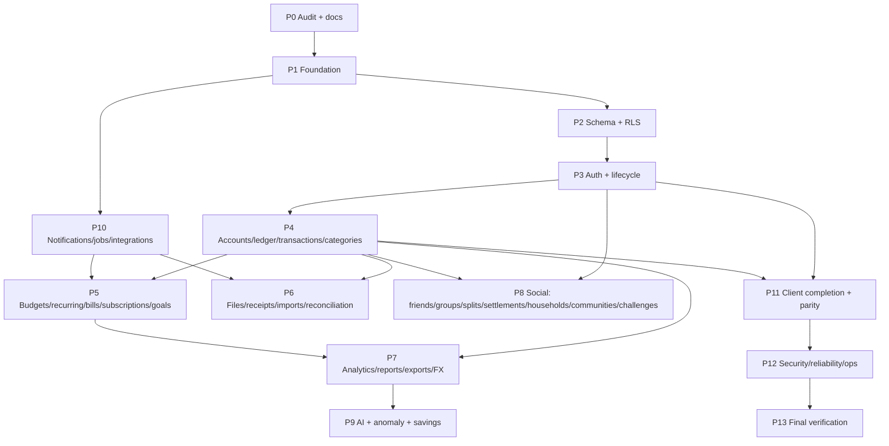

# Montra — Implementation Plan

The specification is authoritative. This plan orders the work into
vertical slices that keep the repository buildable after every milestone.
Progress is recorded in `docs/IMPLEMENTATION_STATUS.md`; per-requirement
status lives in `docs/REQUIREMENTS_TRACEABILITY.md`.

## Execution rules

- Every phase: requirements → design note → migration → domain logic +
  unit tests → repository + PostgreSQL integration tests → API + authz
  tests → web → mobile → docs/traceability → evidence.
- A requirement is `VERIFIED` only when its acceptance criteria are
  implemented **and** tests ran and passed (evidence recorded).
- Never claim Appwrite, Vercel, Supabase-hosted, SMTP, push, AI-provider or
  bank-provider verification without owner-configured hosted runs.

## Dependency graph (high level)

Note: the job queue/outbox/notification core (P10 infrastructure) is built
inside P1/P2 because budgets, recurring generation, imports and receipts
depend on it; P10 completes channels, preferences UI and integrations.

## Phases, milestones and exit criteria

### P0 — Repository and environment audit (this session)
- Deliverables: environment audit, ADRs, architecture, plan, traceability
  matrix, status, initial security/testing/operations docs.
- Exit: all spec sections mapped to requirement IDs.

### P1 — Engineering foundation
- Backend: module, config validation, slog logging with redaction, error
  model + codes, chi + Huma API with envelope, request ID, recovery, body
  limits, timeouts, CORS, security headers, rate limiting, health/readiness,
  metrics, graceful shutdown, pgx pool, transaction helpers with RLS
  context, migration runner, OpenAPI export + drift check, jobs/outbox core.
- Database: bootstrap script creates roles `montra_owner`, `montra_app`,
  `montra_worker` and databases `montra_dev`, `montra_test` on the existing
  server after printing the target; never touches other databases.
- Web: Vite + React + TS strict, router, query client, typed API client from
  the contract, auth/session handling, layout + navigation shell, design
  tokens, i18n, error boundaries, test setup, lint.
- Mobile: Flutter project, Riverpod, go_router, dio with refresh
  interceptor, secure storage, theme, l10n, navigation shell, test setup.
- Tooling: Makefile, scripts, `.env.example` files, CI workflows, README.
- Exit: `make check` (fmt, lint, unit tests, builds) passes for all three
  apps; migrations apply to `montra_test`; health endpoints respond.

### P2 — Database and core domain
- All logical entities from spec §5 as forward-only migrations with FKs,
  checks, uniques, indexes; RLS enabled on every table with policies per
  `docs/RLS_POLICY_MATRIX.md`; grants per role; audit/security/idempotency/
  outbox/jobs tables; currency registry seed; starter categories.
- Domain packages: money, currency, split, ledger, recurrence, fx,
  budgetcalc, settlement, forecast, reconcile (with unit + fuzz tests).
- Exit: migrations apply from empty and re-run idempotently; RLS
  multi-user tests pass; domain tests pass.

### P3 — Authentication and account lifecycle
- Register, verify email, login, logout, logout-all, refresh rotation +
  reuse detection, forgot/reset password, change password, TOTP MFA +
  recovery codes, sessions list/revoke, profile, preferences, consents,
  onboarding, data export job, deletion request + durable deletion job,
  brute-force/rate limits, generic errors, security events.
- Web + mobile screens: landing, signup, login, verify, recovery, MFA,
  onboarding, profile/settings/sessions/privacy/export/deletion.
- Exit: E2E journeys 1, 2, 23, 24 pass locally.

### P4 — Personal finance foundation
- Accounts (all types, archive/restore/close, opening balance, adjustment,
  balance + history, include/exclude), payment methods, categories
  (hierarchy, merge preview, archive, rules), tags, merchants + aliases,
  transactions (all types, states, idempotent create, versioned edit,
  void/restore, duplicate, bulk update/delete, refunds/reimbursements with
  caps, transfers with FX/fees and reversal, audit history, duplicate
  suggestions), search/filter/sort/cursor pagination, saved filters,
  dashboard summary + widgets.
- Exit: E2E journeys 3–7, 25 pass; ledger invariants tested.

### P5 — Budgets and planning
- Budgets (all types/periods, allocations, rollover, members), progress +
  pace + projection, threshold alerts with dedupe/snooze/quiet hours,
  recurring rules + occurrences (idempotent generation, DST, month-end,
  pause/resume/skip/edit-future), bills (mark paid by linking), subscriptions
  (manual, detection candidates with evidence, price history, trial alerts,
  cancellation checklist), goals (contributions, milestones, forecast,
  shared members).
- Exit: E2E journeys 8–10, 13, 18 pass.

### P6 — Receipts, imports, reconciliation
- File upload intent/complete/access/delete, validation, Appwrite adapter
  (test-double tested), dev disk adapter, receipt inbox, extraction jobs,
  review/correct/match/create, imports (CSV/XLSX/OFX/PDF) with mapping,
  preview, duplicate detection, confirm, retry-failed, cancel, row status,
  reconciliation candidates/matches/unmatch, retention cleanup.
- Exit: E2E journeys 11–12 pass.

### P7 — Analytics, reports, exports, multi-currency
- Canonical metrics layer (`docs/METRICS.md`), analytics endpoints, reports
  (async jobs), exports CSV/XLSX/PDF/JSON with formula-injection
  protection, FX rates (manual + ECB adapter), display-currency conversion
  with disclosure.
- Exit: report totals reconcile with ledger in tests.

### P8 — Social finance and community
- Friends, requests, block/mute/report, groups (types, roles, invitations,
  join requests, ownership transfer, archive/delete), shared expenses (all
  split methods, multiple payers, items, comments, attachments, disputes,
  edit history), balances + simplification suggestions, settlements
  (propose/confirm/dispute/void/partial), trips/events, households,
  communities (visibility, posts, comments, replies, reactions, polls,
  pinned, search), challenges (opt-in progress, consent leaderboards),
  moderation (reports, queue, actions, appeals, audit).
- Split: **P8a** social graph, groups, shared expenses, balances,
  settlements, linked personal records, activity notifications, group
  reports, recurring shared bills (backend done 2026-11-04);
  **P8b** communities, posts, challenges, moderation, user/content reports
  (backend done 2026-11-04).
- Exit: E2E journeys 14–21, 26 pass.

### P9 — AI and financial intelligence
- AI consent + preferences, deterministic context builder, Claude adapter,
  ask/insights/categorize/duplicate-check/subscription-detect/forecast/
  report-summary, anomaly rules, savings suggestions, feedback, evaluation
  suite (synthetic datasets, prompt injection, cross-user leakage).
- Exit: provider-off mode works; evaluation tests pass; E2E journey 22.
- Status 2026-11-04: backend done (adapter, assistant, suggestions,
  forecast, summaries, AI receipts/PDF statements, insights); live-model
  evaluation awaits an owner API key.

### P10 — Notifications and integrations
- Notification center, preferences (per category/group, quiet hours,
  digest), email/web-push/FCM adapters, delivery state, retries,
  integration registry/consent/webhooks/sync framework, health.
- Status: backend done and tested (ADR-047, ADR-048); no provider adapter
  enabled; clients in P11.

### P11 — Client completion and parity
- Parity table complete; every screen in spec §7 on web and mobile;
  accessibility, localization (en + hi scaffolding), responsive layouts.

### P12 — Security, reliability, operations
- Threat model review, authorization matrix tests, rate limits, secret
  scanning, dependency scanning, load-test scripts, backup/restore drill
  docs, runbooks, observability, retention/deletion drills.

### P13 — Final verification
- Requirement-by-requirement verification with recorded evidence.

## First milestone (M1)

P1 foundation + P2 schema/RLS + P3 authentication across backend, web and
mobile, with CI-equivalent checks passing locally.
