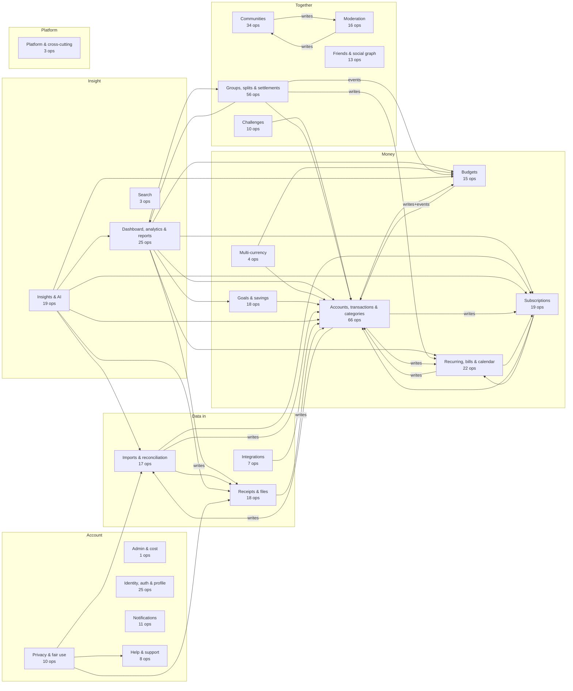

# Montra — Knowledge Graph

A machine-readable map of the whole project, generated from the code by
`scripts/docs/gen_knowledge_graph.py` and checked in CI. It answers
questions that otherwise need a grep across four codebases: which tables a
feature touches, which API operations no client calls, which requirements
of a domain are not verified yet, what a change to an outbox event sets off,
and where a requirement is implemented. For how each feature works end to
end, in prose, read [`FEATURES.md`](FEATURES.md).

| File | What it is |
|---|---|
| `docs/knowledge-graph/graph.json` | Nodes and edges, one per line (stable order, diff-friendly). |
| `docs/knowledge-graph/graph.schema.json` | JSON Schema (draft 2020-12) of `graph.json`. |
| `docs/knowledge-graph/graph.cypher` | Neo4j import: idempotent `MERGE` statements in `UNWIND` batches. |
| `docs/knowledge-graph/graph.graphml` | GraphML for yEd, Gephi, NetworkX (`props` as a JSON string). |

Everything in those files, and every section of this document marked
GENERATED, is rewritten by the generator. Edit the prose here; edit the
`DOMAINS` table in the script to change how folders map to domains.

## Why a generated graph

- **Accurate by construction.** Each fact comes from a source the build
  already trusts: the OpenAPI contract, the `httpx.Op` registrations, the
  migrations, the job registry, the routers, the endpoint registry and the
  traceability matrix. Nothing is typed by hand except the domain mapping.
- **Fails loudly.** A new backend package, web or mobile feature folder,
  contract tag or requirement prefix that is not in `DOMAINS` stops the
  generator (and CI) with a message naming it, so new code cannot silently
  fall out of the graph. Mappings that name a deleted folder fail too.
- **Checked in CI.** `make docs-check` (and the CI step "Knowledge graph is
  current") fails when any output is stale, the same way the error-code
  tables in `docs/API.md` are checked.
- **Deterministic.** Sorted nodes and edges, sorted property keys, no
  timestamps (unless `--stamp`), standard library only.

## Node types

IDs are stable and namespaced: `<prefix><natural key>`.

| Type | ID prefix (example) | Definition | Source |
|---|---|---|---|
| `feature` | `feature:budgets` | Feature domain grouping packages, tags, client features and requirement prefixes. | `DOMAINS` in the script |
| `app` | `app:web` | Deliverable area: `backend`, `web`, `mobile`, `database`, `contract`, `docs`, `repo`. | fixed list |
| `operation` | `op:transactions-create` | API operation: method, path, tag, summary, `auth_required` (contract `security`), `authz_session` / `authz_extra` / `rate_policy` (authorization matrix). | `contracts/openapi/montra.v1.json`, `docs/AUTHORIZATION_MATRIX.md` |
| `package` | `pkg:finance`, `pkg:platform/httpx`, `pkg:cmd/worker` | Go package (directory) with non-test files; `kind` is service, platform, domain, cmd or testutil. | `backend/internal/**`, `backend/cmd/**` |
| `table` | `table:transactions` | Table from `create table`; `rls_enabled`, `rls_helpers` (`owner(col)`, `worker`), `policy_count`. | `supabase/migrations/*.sql` |
| `migration` | `migration:20261104000003_finance_core` | Migration file. | `supabase/migrations/*.sql` |
| `job` | `job:budgets.evaluate` | Job type from `reg.Register(...)`; `schedule`, `timeout`, `concurrency` from the inventory. | Go sources, `docs/BACKGROUND_JOBS.md` |
| `event` | `event:transaction.created` | Outbox event type seen in `outbox.Emit` or `relay.On`. | Go sources |
| `web_feature` | `web:budgets`, `web:_shared`, `web:_app` | `web/src/features/<x>`; `_shared` is everything outside features and app (shared, i18n, root files), `_app` is `web/src/app`. | `web/src` |
| `web_route` | `webroute:/budgets/:budgetId` | Route in the React router; `page`, `requires_auth`, `paths_const` (name in `paths.ts`), `legacy_redirect`. | `web/src/app/router/routes.tsx`, `web/src/shared/config/paths.ts` |
| `mobile_feature` | `mobile:budgets`, `mobile:_core`, `mobile:_app` | `mobile/lib/features/<x>`; `_core` is the rest of `lib` (core, l10n, main), `_app` is `lib/app`. | `mobile/lib` |
| `mobile_route` | `mobileroute:/budgets/:id` | `GoRoute` path (nested routes joined to their parent); `screen`, `router_file`, `redirect`. | `mobile/lib/app/router/**` |
| `requirement` | `req:BUD-008` | Traceability row: `text`, `status`, `spec_section`, `section`, `location`, `deps`, `location_unresolved`. | `docs/REQUIREMENTS_TRACEABILITY.md` |
| `decision` | `adr:ADR-036` | Architecture decision record heading. | `docs/DECISIONS.md` |
| `doc` | `doc:API.md` | Markdown file in `docs/`, with its `title`. | `docs/*.md` |

## Edge types

| Type | From → to | Meaning and how it is found |
|---|---|---|
| `includes` | feature → package, web_feature, mobile_feature | Curated `DOMAINS` table. |
| `belongs_to` | operation, requirement, job, table → feature | Operation by contract tag; requirement by ID prefix; job by the package handling it; table by owning package (see heuristics). |
| `part_of` | package, table, operation, web_feature, mobile_feature → app | Where the node lives. |
| `implemented_in` | operation → package | Package containing `httpx.Op("<operationId>", ...)`; `props.match` is `exact`, `prefix` (`Op("accounts-"+action, ...)`) or `suffix` (`Op(target+"-reactions-add", ...)`). |
| `depends_on` | package → package | Go import of another `montra/backend/...` package (test files excluded). |
| `depends_on` | requirement → requirement, feature, decision, package | Deps column: exact IDs, ID prefixes (`TXN`, `AUTHZ-*` → that prefix's feature), `ADR-nnn`, `DM:x`. |
| `reads` | package → table | `from` / `join` on a known table in a Go string literal that looks like SQL; `props.literals` counts literals. |
| `writes` | package → table | `insert into` / `update` / `delete from`; `props.insert`, `props.update`, `props.delete` count literals. |
| `created_in` | table → migration | Migration with the table's `create table`. |
| `alters` | migration → table | Later migration that alters, indexes or adds policies to the table. |
| `handled_in` | job → package | Package calling `reg.Register(<job>, ...)`. |
| `emits` | package → event | `outbox.Emit(..., outbox.Event{Type: <event>, ...})` with a literal or constant type. |
| `triggers` | event → job | `relay.On(<event>, handler)`: the `jobs.Spec{Type: ...}` the handler returns (inline func, named func, or a `for _, ev := range []string{...}` loop). |
| `enqueues` | package → job | `jobs.Spec{Type: ...}` outside relay routes (direct enqueue). |
| `calls` | web_feature, mobile_feature → operation | Web: `api.GET('/path'...)` / `rawApi.POST(...)` literals matched to contract (method, path). Mobile: `ApiEndpoints.<name>` uses resolved through `core/api/endpoints.dart`. `props.sites` counts call sites. |
| `handled_by` | web_route → web_feature, mobile_route → mobile_feature | Web: the `@/features/<x>/...` module lazily imported (or eagerly imported element). Mobile: the module defining the screen class in the route builder. |
| `located_in` | requirement → package, web_feature, mobile_feature, doc, decision, feature, app | Location column legend: `BE:x`, `DM:x`, `W:x`, `M:x`, `DOC:x`, `DB`, bare `W` / `M` / `BE` / `all`, and paths. |
| `references` | requirement → doc, decision | A `docs/X.md`, `X.md`, `DOC:X` or `ADR-nnn` mention anywhere in the row. |
| `links_to` | doc → doc | One doc mentions another doc's file name. |
| `documented_in` | decision → doc | ADR heading in `docs/DECISIONS.md`. |

## Counts

<!-- BEGIN GENERATED: knowledge graph counts (scripts/docs/gen_knowledge_graph.py) -->

**1563 nodes, 5471 edges.**

| Node type | Count | Edge type | Count |
|---|---|---|---|
| `app` | 7 | `alters` | 62 |
| `decision` | 50 | `belongs_to` | 999 |
| `doc` | 25 | `calls` | 821 |
| `event` | 27 | `created_in` | 113 |
| `feature` | 23 | `depends_on` | 548 |
| `job` | 51 | `documented_in` | 50 |
| `migration` | 28 | `emits` | 25 |
| `mobile_feature` | 35 | `enqueues` | 17 |
| `mobile_route` | 152 | `handled_by` | 254 |
| `operation` | 420 | `handled_in` | 51 |
| `package` | 70 | `implemented_in` | 420 |
| `requirement` | 415 | `includes` | 140 |
| `table` | 113 | `links_to` | 100 |
| `web_feature` | 35 | `located_in` | 530 |
| `web_route` | 112 | `part_of` | 673 |
|  |  | `reads` | 297 |
|  |  | `references` | 130 |
|  |  | `triggers` | 27 |
|  |  | `writes` | 214 |

<!-- END GENERATED: knowledge graph counts -->

## Overview

<!-- BEGIN GENERATED: knowledge graph overview (scripts/docs/gen_knowledge_graph.py) -->



Arrows: the source domain's Go packages import the target's packages (plain), write SQL into tables the target owns (`writes`), or emit outbox events that trigger the target's jobs (`events`). Not drawn: arrows into the shared domains (`identity` is used by 21 domains; `notifications` is used by 17 domains; `fx` is used by 9 domains; every domain uses `platform`), `platform`'s own wiring (`cmd/*`, `app`), and `privacy` deleting rows in every domain.

<!-- END GENERATED: knowledge graph overview -->

## Domains

<!-- BEGIN GENERATED: knowledge graph domains (scripts/docs/gen_knowledge_graph.py) -->

| Domain | Backend packages | Ops | Tables | Jobs | Web features | Mobile features | Requirements (status counts) |
|---|---|---|---|---|---|---|---|
| **Admin & cost** (`admin`) | `admin` | 1 | 0 | 0 | admin | – | 7: T1 I2 P4 |
| **Dashboard, analytics & reports** (`analytics`) | `analytics`, `reports`, `reports/render` | 25 | 3 | 2 | analytics, dashboard, reports | analytics, dashboard, reports | 25: V7 T17 P1 |
| **Budgets** (`budgets`) | `budgets`, `domain/budgetcalc`, `domain/period` | 15 | 5 | 1 | budgets | budgets | 11: V2 T6 I2 P1 |
| **Challenges** (`challenges`) | `challenges` | 10 | 3 | 2 | challenges | challenges | 3: V1 T2 |
| **Communities** (`communities`) | `communities` | 34 | 9 | 4 | communities | communities | 5: V2 T3 |
| **Multi-currency** (`fx`) | `domain/currency`, `fx` | 4 | 1 | 1 | fx | fx | 7: V3 T4 |
| **Goals & savings** (`goals`) | `goals` | 18 | 4 | 3 | goals | goals | 9: V6 T2 P1 |
| **Groups, splits & settlements** (`groups`) | `domain/settlement`, `domain/split`, `groups` | 56 | 14 | 5 | group-money, groups | group_money, groups | 22: V10 T11 I1 |
| **Identity, auth & profile** (`identity`) | `auth`, `platform/identity`, `store/db`, `users` | 25 | 12 | 4 | account, auth, onboarding, settings | auth, onboarding, settings | 21: V3 T14 I3 N1 |
| **Imports & reconciliation** (`imports`) | `domain/reconcile`, `domain/statement`, `imports`, `reconciliation` | 17 | 5 | 4 | imports, reconciliation | imports, reconciliation | 12: V4 T7 P1 |
| **Insights & AI** (`insights`) | `ai`, `ai/llm`, `insights` | 19 | 6 | 2 | insights | insights | 22: V4 T13 I1 P4 |
| **Integrations** (`integrations`) | `integrations` | 7 | 3 | 3 | integrations | integrations | 11: V3 T7 B1 |
| **Accounts, transactions & categories** (`ledger`) | `categories`, `domain/ledger`, `finance` | 66 | 14 | 0 | accounts, categories, payment-methods, transactions | accounts, labels, payment_methods, transactions | 53: V14 T32 I7 |
| **Moderation** (`moderation`) | `moderation` | 16 | 3 | 3 | moderation | moderation | 4: T3 B1 |
| **Notifications** (`notifications`) | `notifications`, `platform/email` | 11 | 4 | 3 | notifications | notifications | 8: V1 T6 I1 |
| **Recurring, bills & calendar** (`planning`) | `domain/recurrence`, `recurring` | 22 | 3 | 1 | planning | bills, calendar, recurring | 11: V6 T5 |
| **Platform & cross-cutting** (`platform`) | 25 (cmd/*, platform/*, store, testutil, …) | 3 | 6 | 1 | _app, _shared, marketing | _app, _core | 145: V28 T69 I30 P16 N1 B1 |
| **Privacy & fair use** (`privacy`) | `fairuse`, `privacy` | 10 | 2 | 3 | privacy | privacy | 6: T2 I1 P1 B2 |
| **Receipts & files** (`receipts`) | `files`, `platform/storage`, `receipts` | 18 | 5 | 3 | receipts | receipts | 16: V2 T11 I1 P2 |
| **Search** (`search`) | `search` | 3 | 1 | 0 | search | search | 3: T3 |
| **Friends & social graph** (`social`) | `social` | 13 | 4 | 1 | social | people, social | 5: V1 T3 P1 |
| **Subscriptions** (`subscriptions`) | `domain/subdetect`, `subscriptions` | 19 | 4 | 3 | subscriptions | subscriptions | 8: V6 T1 B1 |
| **Help & support** (`support`) | `support` | 8 | 2 | 2 | support | support | 1: P1 |

Status letters: V verified, T tested, I implemented, P in progress, N not started, B blocked. Ops are counted by contract tag, tables by owning package (the one that inserts most, then updates, reads), jobs by the package that handles them, requirements by ID prefix.

<!-- END GENERATED: knowledge graph domains -->

## Regenerate and check

```bash
make docs          # regenerates the API.md error-code tables and the knowledge graph
make docs-check    # fails if either is stale (CI runs the same check)

python3 scripts/docs/gen_knowledge_graph.py            # just the graph
python3 scripts/docs/gen_knowledge_graph.py --check    # exit 1 when stale
python3 scripts/docs/gen_knowledge_graph.py --stamp    # also write generated_at (ignored by --check)
python3 -m unittest scripts/docs/test_gen_knowledge_graph.py   # parser unit tests
```

Regenerate after changing the contract, Go code, migrations, routers, the
mobile endpoint registry, or the traceability matrix. When the generator
stops with `DOMAINS: ... is not mapped to a domain`, add the folder, tag or
requirement prefix to the right entry of `DOMAINS` in the script (each name
belongs to exactly one domain).

## Querying the graph

### jq

```bash
G=docs/knowledge-graph/graph.json

# Which tables does the budgets package touch (reads and writes)?
jq -r '.edges[] | select(.source=="pkg:budgets" and (.type=="reads" or .type=="writes"))
       | "\(.type)\t\(.target)"' $G

# ... or every package of the budgets domain:
jq -r '[.edges[] | select(.source=="feature:budgets" and .type=="includes") | .target] as $p
       | [.edges[] | select((.source|IN($p[])) and (.type=="reads" or .type=="writes")) | .target]
       | unique[]' $G

# Which operations have no web or mobile caller?
jq -r '[.edges[] | select(.type=="calls") | .target] as $called
       | .nodes[] | select(.type=="operation" and (.id|IN($called[])|not)) | "\(.id)\t\(.label)"' $G

# Requirements of the groups domain that are not VERIFIED:
jq -r '[.edges[] | select(.type=="belongs_to" and .target=="feature:groups") | .source] as $r
       | .nodes[] | select(.type=="requirement" and (.id|IN($r[])) and .props.status!="VERIFIED")
       | "\(.id)\t\(.props.status)\t\(.props.text)"' $G

# Who calls an operation, and which package implements it?
jq -r '.edges[] | select(.target=="op:budgets-create" and .type=="calls") | .source' $G
jq -r '.edges[] | select(.source=="op:budgets-create" and .type=="implemented_in") | .target' $G

# What does a transaction change set off? (event -> jobs -> handling package)
jq -r '.edges[] | select(.source=="event:transaction.created" and .type=="triggers") | .target' $G

# Public (no session) operations:
jq -r '.nodes[] | select(.type=="operation" and (.props.auth_required|not)) | .label' $G
```

Answers at generation time (the same queries, computed by the generator):

<!-- BEGIN GENERATED: knowledge graph examples (scripts/docs/gen_knowledge_graph.py) -->

- Tables `pkg:budgets` touches (13): `budget_alerts`, `budget_allocations`, `budget_members`, `budget_period_snapshots`, `budgets`, `categories`, `group_expense_shares`, `group_expenses`, `group_members`, `groups`, `profiles`, `transactions`, `user_preferences`
  - of which it writes (5): `budget_alerts`, `budget_allocations`, `budget_members`, `budget_period_snapshots`, `budgets`
- Operations with no web or mobile caller: **19** of 420 (web calls 398, mobile calls 388, both 385). By tag: AI 12, Files 1, Insights 1, Integrations 1, Receipts 1, Transactions 3
- Requirements of `feature:groups` not VERIFIED (12): `req:BAL-002` TESTED, `req:GRP-001` TESTED, `req:GRP-002` TESTED, `req:GRP-004` TESTED, `req:GRP-006` TESTED, `req:HH-001` TESTED, `req:HH-002` TESTED, `req:SETL-003` IMPLEMENTED, `req:SPLT-001` TESTED, `req:SPLT-004` TESTED, `req:SPLT-005` TESTED, `req:TRIP-001` TESTED

<!-- END GENERATED: knowledge graph examples -->

### Neo4j (Cypher)

Import into an empty or existing database (the file is idempotent):

```bash
cypher-shell -u neo4j -p <password> -f docs/knowledge-graph/graph.cypher
```

Every node has the `:Entity` label plus a type label (`:Operation`,
`:Package`, `:Table`, `:Job`, `:Event`, `:WebFeature`, `:WebRoute`,
`:MobileFeature`, `:MobileRoute`, `:Requirement`, `:Decision`, `:Doc`,
`:Feature`, `:App`, `:Migration`); relationship types are the edge types in
upper case (`:CALLS`, `:READS`, `:WRITES`, `:IMPLEMENTED_IN`, ...).

```cypher
// Tables the budgets domain touches, with the verb
MATCH (:Feature {id:'feature:budgets'})-[:INCLUDES]->(p:Package)-[r:READS|WRITES]->(t:Table)
RETURN p.label, type(r), t.label ORDER BY t.label;

// Operations with no web or mobile caller
MATCH (o:Operation) WHERE NOT ()-[:CALLS]->(o)
RETURN o.tag, o.id, o.label ORDER BY o.tag, o.id;

// Requirements of the groups domain that are not VERIFIED
MATCH (r:Requirement)-[:BELONGS_TO]->(:Feature {id:'feature:groups'})
WHERE r.status <> 'VERIFIED' RETURN r.id, r.status, r.text ORDER BY r.id;

// Blast radius of a table: packages writing it, the operations they implement, their callers
MATCH (p:Package)-[:WRITES]->(:Table {id:'table:transactions'})
OPTIONAL MATCH (o:Operation)-[:IMPLEMENTED_IN]->(p)
OPTIONAL MATCH (c)-[:CALLS]->(o)
RETURN p.label, count(DISTINCT o) AS ops, collect(DISTINCT c.id) AS callers;

// Event-driven chain from an event to the tables its jobs' packages write
MATCH (:Event {id:'event:transaction.created'})-[:TRIGGERS]->(j:Job)-[:HANDLED_IN]->(p:Package)-[:WRITES]->(t:Table)
RETURN j.label, p.label, collect(t.label);

// Requirements located in a package, by status
MATCH (r:Requirement)-[:LOCATED_IN]->(:Package {id:'pkg:groups'})
RETURN r.status, count(*) ORDER BY r.status;
```

## Heuristics and known limits

The extraction is static and regex based. It is precise for code written in
the project's current conventions and says so when it is not (see
"Extraction gaps" below). Known blind spots:

- **SQL table detection** scans every Go string literal (raw or quoted)
  that contains `select`, `insert`, `update`, `delete` or `with`, and keeps
  only names of tables created by a migration after `from`, `join`,
  `insert into`, `update` or `delete from`. It misses SQL assembled from
  fragments split across literals (`"select ... from " + table`), table
  names in `format()` / dynamic SQL, SQL in `.sql` files read at run time,
  and views or functions that touch tables indirectly. A CTE that shares a
  table's name, or a table name in a comment inside a literal, would count;
  `delete ... using t` is not seen as a read of `t`. Tests (`_test.go`) are excluded;
  `testutil/*` packages are included but never own a table.
- **Table ownership** (`table → feature`) is the package that inserts into
  the table most, then updates, reads, and deletes; `testutil/*` and
  `cmd/*` are ignored. Shared tables (for example `transactions`) belong to
  one domain only.
- **RLS** is read from `alter table ... enable row level security`,
  `apply_owner_rls` / `apply_worker_rls`, `create policy ... on`, and
  `foreach t in array array[...] loop` blocks. Policies created inside SQL
  functions count as `rls_helpers`, not in `policy_count`. Policies dropped
  later are still counted. `docs/RLS_POLICY_MATRIX.md` (from the live
  database) is the authority.
- **Operations → packages**: exact `httpx.Op("<id>"` first, then the
  longest `Op("<prefix>"+x` prefix, then the longest `Op(x+"<suffix>"`
  suffix. `session required` comes from the contract `security`; the
  authorization matrix adds `authz_extra` (for example recent re-auth) and
  the rate policy.
- **Package imports** cover `montra/backend/...` imports only (no third
  party), from non-test files; sub-packages are separate nodes.
- **Jobs and events**: job and event names resolve through string literals
  and package constants (`JobX`, `pkg.EventY`). Events emitted with a
  computed type (`Type: "group_expense." + action`) have no `emits` edge;
  they are listed in the gaps table. `enqueues` covers `jobs.Spec{Type: X}`
  outside relay routes; jobs scheduled by the worker's periodic scheduler
  carry their schedule as a property instead.
- **Web calls** match `.GET|POST|PUT|PATCH|DELETE('<path>'` literals (the
  openapi-fetch client, typed against the contract) to the contract's
  (method, path). Calls through a variable path would be missed; there are
  none today. Test files and `.d.ts` are excluded.
- **Mobile calls** count `ApiEndpoints.<name>` references per module;
  `core/api/endpoints_contract_test.dart` keeps the registry aligned with
  the contract. A reference does not prove the call happens at run time.
- **Web routes** assume the flat route tree in `routes.tsx` (layouts and
  guards have no `path`); `requires_auth` means "declared after the
  `<RequireAuth />` branch". **Mobile routes** resolve `AppRoutes.x`
  constants and literal paths, join nested `GoRoute` paths to their parent,
  and find the screen as the first `...Screen|Page|View|Shell` class in the
  route body.
- **Requirements** are parsed from any table row whose first cell looks like
  an ID (`ABC-123`), so new sections and edits elsewhere in the file are
  tolerated. Location aliases (`BE:transactions` → `pkg:finance`,
  `BE:bills` → `pkg:recurring`, ...) live in `LOCATION_ALIASES`; tokens
  that still match nothing are kept in `props.location_unresolved` and
  counted below (for example `W:ai-assistant`, a deferred client feature).
- **Docs** link by file-name mention only, not by Markdown link parsing;
  generated sections of this document are ignored so the output never feeds
  back into itself.

## Extraction gaps

Anything the generator saw but could not attach. Zero is the goal for the
first rows; the requirement rows reflect the traceability matrix.

<!-- BEGIN GENERATED: knowledge graph gaps (scripts/docs/gen_knowledge_graph.py) -->

| Check | Count | Items |
|---|---|---|
| Operations with no `httpx.Op` match | 0 | – |
| Web API calls that match no contract operation | 0 | – |
| Mobile `ApiEndpoints` uses that match no contract operation | 0 | – |
| Mobile endpoints missing from the contract | 0 | – |
| Web routes with no feature module | 0 | – |
| `paths.ts` constants with no router entry | 0 | – |
| Mobile routes whose screen class was not found | 0 | – |
| Tables no Go SQL literal references | 0 | – |
| Routed events with no literal `outbox.Emit` (emitted with a computed type) | 2 | `group_expense.deleted`, `group_expense.updated` |
| Emitted events with no `relay.On` route | 1 | `file.ready` |
| Relay routes to unregistered jobs | 0 | – |
| Jobs missing from docs/BACKGROUND_JOBS.md | 0 | – |
| `outbox.Emit` calls with a non-constant type | 0 | – |
| Requirement Location tokens with no node (kept in `props.location_unresolved`) | 9 | `BE:platform/pagination`, `M:ai`, `W:ai-assistant`, `testdata`, `tests`×5 |
| Requirement Deps tokens with no node | 0 | – |
| Duplicate requirement IDs (first row kept) | 0 | – |

<!-- END GENERATED: knowledge graph gaps -->
