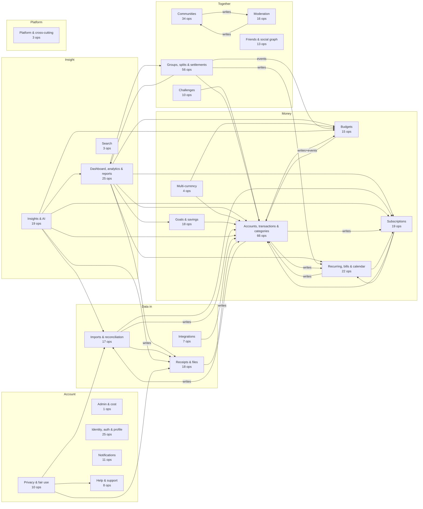
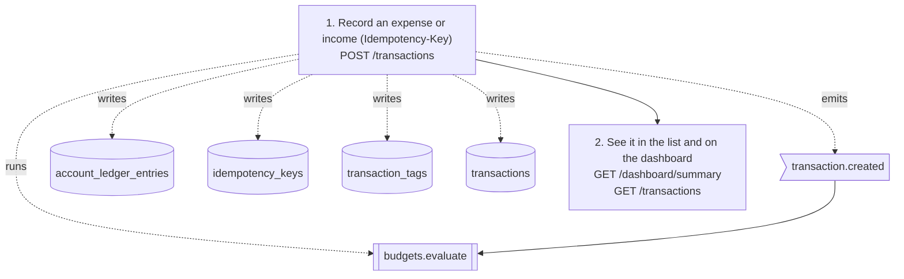
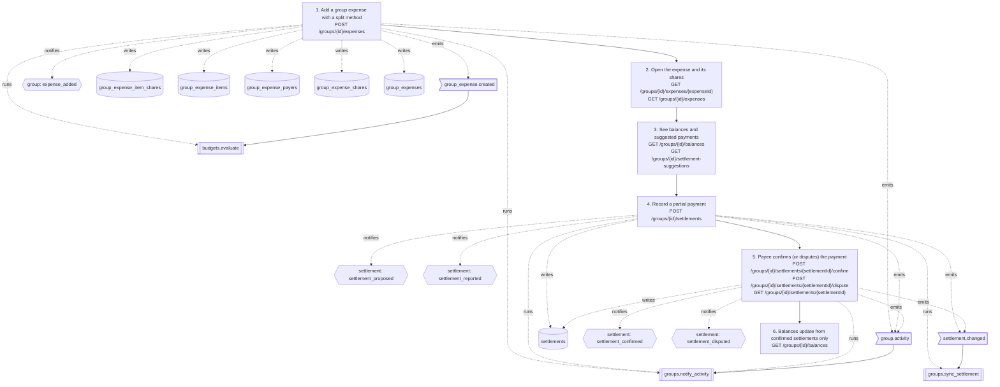
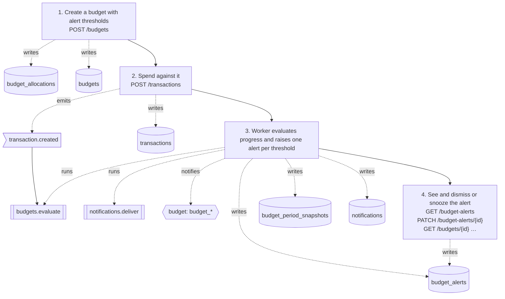
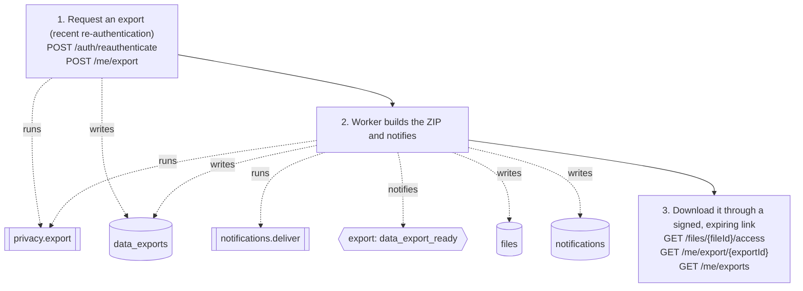

# Montra — Knowledge Graph

A machine-readable map of the whole project, generated from the code by
`scripts/docs/gen_knowledge_graph.py` and checked in CI. It covers both
**structure** (operations, packages, tables, jobs, client features, routes,
requirements) and **behaviour**: how each feature works end to end (user
journeys and feature flows, step by step), which tests verify what, how
row-level security is built from policies and SQL functions, which error
codes and notifications each package produces, which settings and external
providers each package depends on, and which CI jobs check which parts.

It answers questions that otherwise need a grep across four codebases:
which tables a feature touches, which operations no client calls or no
backend test covers, which requirements of a domain are not verified yet,
what a transaction change sets off, which policies and functions guard a
table, and what has to be configured before a provider works.

| File | What it is |
|---|---|
| `docs/knowledge-graph/graph.json` | Nodes and edges, one per line (stable order, diff-friendly). |
| `docs/knowledge-graph/graph.schema.json` | JSON Schema (draft 2020-12) of `graph.json`. |
| `docs/knowledge-graph/graph.cypher` | Neo4j import: idempotent `MERGE` statements in `UNWIND` batches. |
| `docs/knowledge-graph/graph.graphml` | GraphML for yEd, Gephi, NetworkX (`props` as a JSON string). |
| `scripts/docs/kg_curated.json` | Curated data: spec §14 journeys, providers, FEATURES.md area → domain. |

Everything in the `docs/knowledge-graph/` files, and every section of this
document marked GENERATED, is rewritten by the generator. Edit the prose
here; edit `DOMAINS` in the script to change how folders map to domains;
edit `scripts/docs/kg_curated.json` to change journeys or providers.

## Why a generated graph

- **Accurate by construction.** Each fact comes from a source the build
  already trusts: the OpenAPI contract, the `httpx.Op` registrations, the
  migrations, the job registry, the routers, the endpoint registry, the
  test files, `config.go`, the workflows and the traceability matrix. Only
  the domain mapping, the §14 journeys and the provider list are curated.
- **Fails loudly.** A new backend package, web or mobile feature folder,
  contract tag, requirement prefix or FEATURES.md section that is not mapped
  stops the generator (and CI) with a message naming it. Curated journeys
  and providers that name an operation, route, table, event, job,
  notification, policy, config or test that does not exist fail the build
  too. Every node must have at least one edge (no orphans).
- **Checked in CI.** `make docs-check` (and the CI steps "Knowledge graph
  parser tests" and "Knowledge graph … is current") fail when any output is
  stale, the same way the error-code tables in `docs/API.md` are checked.
- **Deterministic.** Sorted nodes and edges, sorted property keys, no
  timestamps (unless `--stamp`), standard library only.

## Node types

IDs are stable and namespaced: `<prefix><natural key>`.

| Type | ID prefix (example) | Definition | Source |
|---|---|---|---|
| `feature` | `feature:budgets` | Feature domain grouping packages, tags, client features and requirement prefixes. | `DOMAINS` in the script |
| `app` | `app:web` | Deliverable area: `backend`, `web`, `mobile`, `database`, `contract`, `docs`, `repo`. | fixed list |
| `operation` | `op:transactions-create` | API operation: method, path, tag, summary, `auth_required` (contract `security`), `authz_session` / `authz_extra` / `rate_policy`. | contract, `docs/AUTHORIZATION_MATRIX.md` |
| `package` | `pkg:finance`, `pkg:platform/httpx`, `pkg:cmd/worker` | Go package (directory) with non-test files; `kind` is service, platform, domain, cmd or testutil. | `backend/internal/**`, `backend/cmd/**` |
| `table` | `table:transactions` | Table from `create table`; `rls_enabled`, `rls_helpers`, `policy_count` (active `policy` nodes). | `supabase/migrations/*.sql` |
| `migration` | `migration:20261104000003_finance_core` | Migration file. | `supabase/migrations/*.sql` |
| `sql_function` | `fn:montra.current_user_id` | SQL function: `security_definer`, `volatility`, `language`, `returns`, `execute_roles`, `defined_in`. | `create function` in migrations |
| `policy` | `policy:budgets.app_budgets_select` | RLS policy: `table`, `command`, `roles`, `mode`, `via` (statement, loop or `helper apply_owner_rls`), `defined_in`, `dropped_in`, `active`. | `create policy`, `foreach … loop`, RLS helper calls |
| `job` | `job:budgets.evaluate` | Job type from `reg.Register(...)`; `schedule`, `timeout`, `concurrency`. | Go sources, `docs/BACKGROUND_JOBS.md` |
| `event` | `event:transaction.created` | Outbox event type seen in `outbox.Emit` or `relay.On`. | Go sources |
| `notification_type` | `notif:budget/budget_*` | Notification category and event type (`*` marks a computed suffix). | `notifications.Notification{Category:, EventType:}`, the groups activity table |
| `error_code` | `err:DOMAIN_RULE_VIOLATION`, `err:zero_based_unallocated` | `kind` top (API `error.code`) or detail (`error.details[].code`); `http_status`, `top_code`, `message`. | `apperr` constructors, `apperr.Rule/ConflictCode/FieldCode`, `apperr.Detail{Code:}` |
| `config` | `config:STORAGE_PROVIDER` | Environment variable: `field`, `loader`, `required`, `required_when`, `dev_only`, `dev_only_values`, `secret`, `validation` (rule texts). Never values. | `platform/config/config.go` |
| `provider` | `provider:appwrite` | External service or adapter with `status` (`enabled_in_dev`, `needs_owner_credentials`, `optional_public`, `no_adapters_registered`). | curated |
| `web_feature` | `web:budgets`, `web:_shared`, `web:_app` | `web/src/features/<x>`; `_shared` is everything outside features and app, `_app` is `web/src/app`. | `web/src` |
| `web_route` | `webroute:/budgets/:budgetId` | React route: `page`, `requires_auth`, `paths_const`, `legacy_redirect`. | `routes.tsx`, `paths.ts` |
| `mobile_feature` | `mobile:budgets`, `mobile:_core`, `mobile:_app` | `mobile/lib/features/<x>`; `_core` is the rest of `lib`, `_app` is `lib/app`. | `mobile/lib` |
| `mobile_route` | `mobileroute:/budgets/:id` | `GoRoute` path; `screen`, `router_file`, `redirect`. | `mobile/lib/app/router/**` |
| `flow` | `flow:journey-08`, `flow:feature-3.7` | A spec §14 journey (curated, `status` implemented or deferred) or a FEATURES.md §3 "How it works end to end" flow. | `kg_curated.json`, `docs/FEATURES.md` |
| `step` | `step:journey-08/03` | Ordered step of a flow (`order`); its links say which routes, operations, tables, events, jobs, notifications and policies it involves. | same as its flow |
| `test` | `test:backend/tests/api/budgets_test.go::TestBudgetProgressAlertsDedupeAndRefunds` | Go test function (`go_api`, `go_rls`, `go_unit`), web unit test file (`web_unit`), Playwright test (`web_e2e`), mobile test file (`mobile_unit`), integration test (`mobile_integration`). | test sources |
| `requirement` | `req:BUD-008` | Traceability row: `text`, `status`, `spec_section`, `section`, `location`, `deps`. | `docs/REQUIREMENTS_TRACEABILITY.md` |
| `decision` | `adr:ADR-036` | Architecture decision record heading. | `docs/DECISIONS.md` |
| `doc` | `doc:API.md` | Markdown file in `docs/`. | `docs/*.md` |
| `workflow`, `ci_job` | `workflow:ci.yml`, `ci:ci/backend` | GitHub Actions workflow and job (`steps`). | `.github/workflows/*.yml` |
| `make_target` | `make:docs-check` | Makefile target (`help`, `recipe`). | `Makefile` |

## Edge types

| Type | From → to | Meaning and how it is found |
|---|---|---|
| `includes` | feature → package, web_feature, mobile_feature; workflow → ci_job | Curated `DOMAINS`; workflow `jobs:`. |
| `belongs_to` | operation, requirement, job, table, flow → feature | By contract tag, ID prefix, handling package, owning package, curated domain / `feature_area_domains`. |
| `part_of` | package, table, operation, migration, doc, test, sql_function, web/mobile feature, workflow, make_target → app | Where the node lives. |
| `implemented_in` | operation → package | `httpx.Op("<id>"` (`props.match` exact, prefix or suffix). |
| `depends_on` | package → package; requirement → requirement, feature, decision, package; make_target → make_target; ci_job → ci_job | Go imports; Deps column; Makefile prerequisites; workflow `needs`. |
| `reads` / `writes` | package, sql_function → table; policy → table (`reads`, from its expression); journey step → table | SQL in Go string literals or function bodies; curated for steps. `writes` props count `insert` / `update` / `delete`. |
| `involves` | feature-flow step or flow → table, config, package | Named in FEATURES.md (the doc does not say read or write). |
| `created_in` / `alters` | table → migration / migration → table | `create table`; later `alter`, indexes, policies, grants. |
| `defines` / `redefines` | migration → sql_function, policy | First `create`, later `create or replace` (or drop and re-create). |
| `protects` | policy → table | `create policy … on <table>`. |
| `uses` | policy → sql_function; table → sql_function (trigger or helper call); step → policy | Function names in `using` / `with check`; `create trigger … execute function`; `select apply_owner_rls('t')`; curated. |
| `calls` | web/mobile feature, step, flow → operation; package, sql_function → sql_function | API literals and `ApiEndpoints`; `METHOD /path` in flows; `montra.fn(` in SQL. |
| `handled_in` | job → package | `reg.Register(<job>, ...)`. |
| `emits` | package, step, flow → event | `outbox.Emit(... Type: X)`; named in flows. |
| `triggers` | event → job | `relay.On(<event>, handler)` and the `jobs.Spec{Type:}` it returns. |
| `enqueues` | package → job | `jobs.Spec{Type: X}` outside relay routes. |
| `runs` | step, flow → job; ci_job, make_target → test | Named in flows; test kinds a command runs (`go test ./tests/...`, `pnpm test`, `flutter test`, `pnpm e2e`, …). |
| `sends` | package, job, step → notification_type | Package creating it; job whose handler reaches the creating function (3 calls deep); flows. |
| `opens` | notification_type → web_route | Category home page in `web/src/features/notifications/links.ts`. |
| `raises` | package → error_code | `apperr` calls in the package (`props.http_status`). |
| `defined_in` | error_code (top), config → package | `pkg:platform/apperr`, `pkg:platform/config`. |
| `configures` | config → package | The package reads `.<Section>.<Field>` or takes the whole `config.<Section>Config`. |
| `integrates` / `configured_by` | package → provider / provider → config | Curated provider list (validated). |
| `checks` / `mirrors` | ci_job, make_target → app / ci_job → make_target | Command classification; CI runs exactly the target's commands. |
| `covers` | test → operation, table, sql_function, package, web_feature, mobile_feature, web_route | Go API tests: `c.Do(t, http.MethodX, "/path"+id…)` incl. helpers (`props.direct`); RLS tests: SQL in the test; unit tests: their package or feature; e2e: `goto()` routes and `/api/v1` literals. |
| `verifies` | test → flow | Curated per journey, or a journey number in the test title (`props.via`). |
| `verified_by` | requirement → test | `TestX` names and test file names in the row's Tests/Evidence cells. |
| `has_step` / `next` | flow → step / step → step | Order of steps. |
| `shown_on` | step, flow → web_route, mobile_route | Curated; FEATURES.md Web and Mobile sections. |
| `handled_by` | web_route → web_feature, mobile_route → mobile_feature | Lazy import / screen class. |
| `redirects_to` | web_route, mobile_route → route | `LegacyRedirect to=…`, `GoRoute(redirect: …)`. |
| `located_in` | requirement → package, web/mobile feature, doc, decision, feature, app | Location column. |
| `references` / `links_to` / `documented_in` | requirement → doc, decision; doc → doc; decision → doc | Mentions; ADR headings. |

## Counts

<!-- BEGIN GENERATED: knowledge graph counts (scripts/docs/gen_knowledge_graph.py) -->

**3227 nodes, 15232 edges.**

| Node type | Count | Edge type | Count |
|---|---|---|---|
| `app` | 7 | `alters` | 63 |
| `ci_job` | 9 | `belongs_to` | 1055 |
| `config` | 100 | `calls` | 1480 |
| `decision` | 50 | `checks` | 42 |
| `doc` | 25 | `configured_by` | 36 |
| `error_code` | 207 | `configures` | 119 |
| `event` | 27 | `covers` | 2837 |
| `feature` | 23 | `created_in` | 113 |
| `flow` | 56 | `defined_in` | 130 |
| `job` | 51 | `defines` | 391 |
| `make_target` | 35 | `depends_on` | 564 |
| `migration` | 28 | `documented_in` | 50 |
| `mobile_feature` | 35 | `emits` | 94 |
| `mobile_route` | 152 | `enqueues` | 17 |
| `notification_type` | 65 | `handled_by` | 254 |
| `operation` | 420 | `handled_in` | 51 |
| `package` | 70 | `has_step` | 239 |
| `policy` | 331 | `implemented_in` | 420 |
| `provider` | 10 | `includes` | 149 |
| `requirement` | 415 | `integrates` | 12 |
| `sql_function` | 60 | `involves` | 185 |
| `step` | 239 | `links_to` | 100 |
| `table` | 113 | `located_in` | 530 |
| `test` | 550 | `mirrors` | 6 |
| `web_feature` | 35 | `next` | 183 |
| `web_route` | 112 | `opens` | 65 |
| `workflow` | 2 | `part_of` | 1373 |
|  |  | `protects` | 331 |
|  |  | `raises` | 337 |
|  |  | `reads` | 437 |
|  |  | `redefines` | 6 |
|  |  | `redirects_to` | 10 |
|  |  | `references` | 130 |
|  |  | `runs` | 1381 |
|  |  | `sends` | 155 |
|  |  | `shown_on` | 384 |
|  |  | `triggers` | 27 |
|  |  | `uses` | 437 |
|  |  | `verified_by` | 640 |
|  |  | `verifies` | 65 |
|  |  | `writes` | 334 |

<!-- END GENERATED: knowledge graph counts -->

## Overview

<!-- BEGIN GENERATED: knowledge graph overview (scripts/docs/gen_knowledge_graph.py) -->



Arrows: the source domain's Go packages import the target's packages (plain), write SQL into tables the target owns (`writes`), or emit outbox events that trigger the target's jobs (`events`). Not drawn: arrows into the shared domains (`identity` is used by 21 domains; `notifications` is used by 17 domains; `fx` is used by 9 domains; every domain uses `platform`), `platform`'s own wiring (`cmd/*`, `app`), and `privacy` deleting rows in every domain.

<!-- END GENERATED: knowledge graph overview -->

## Domains

<!-- BEGIN GENERATED: knowledge graph domains (scripts/docs/gen_knowledge_graph.py) -->

| Domain | Backend packages | Ops | Tables | Jobs | Web features | Mobile features | Requirements (status counts) |
|---|---|---|---|---|---|---|---|
| **Admin & cost** (`admin`) | `admin` | 1 | 0 | 0 | admin | – | 7: T1 I2 P4 |
| **Dashboard, analytics & reports** (`analytics`) | `analytics`, `reports`, `reports/render` | 25 | 3 | 2 | analytics, dashboard, reports | analytics, dashboard, reports | 25: V7 T17 P1 |
| **Budgets** (`budgets`) | `budgets`, `domain/budgetcalc`, `domain/period` | 15 | 5 | 1 | budgets | budgets | 11: V2 T6 I2 P1 |
| **Challenges** (`challenges`) | `challenges` | 10 | 3 | 2 | challenges | challenges | 3: V1 T2 |
| **Communities** (`communities`) | `communities` | 34 | 9 | 4 | communities | communities | 5: V2 T3 |
| **Multi-currency** (`fx`) | `domain/currency`, `fx` | 4 | 1 | 1 | fx | fx | 7: V3 T4 |
| **Goals & savings** (`goals`) | `goals` | 18 | 4 | 3 | goals | goals | 9: V6 T2 P1 |
| **Groups, splits & settlements** (`groups`) | `domain/settlement`, `domain/split`, `groups` | 56 | 14 | 5 | group-money, groups | group_money, groups | 22: V10 T11 I1 |
| **Identity, auth & profile** (`identity`) | `auth`, `platform/identity`, `store/db`, `users` | 25 | 12 | 4 | account, auth, onboarding, settings | auth, onboarding, settings | 21: V3 T14 I3 N1 |
| **Imports & reconciliation** (`imports`) | `domain/reconcile`, `domain/statement`, `imports`, `reconciliation` | 17 | 5 | 4 | imports, reconciliation | imports, reconciliation | 12: V4 T7 P1 |
| **Insights & AI** (`insights`) | `ai`, `ai/llm`, `insights` | 19 | 6 | 2 | insights | insights | 22: V4 T13 I1 P4 |
| **Integrations** (`integrations`) | `integrations` | 7 | 3 | 3 | integrations | integrations | 11: V3 T7 B1 |
| **Accounts, transactions & categories** (`ledger`) | `categories`, `domain/ledger`, `finance` | 66 | 14 | 0 | accounts, categories, payment-methods, transactions | accounts, labels, payment_methods, transactions | 53: V14 T32 I7 |
| **Moderation** (`moderation`) | `moderation` | 16 | 3 | 3 | moderation | moderation | 4: T3 B1 |
| **Notifications** (`notifications`) | `notifications`, `platform/email` | 11 | 4 | 3 | notifications | notifications | 8: V1 T6 I1 |
| **Recurring, bills & calendar** (`planning`) | `domain/recurrence`, `recurring` | 22 | 3 | 1 | planning | bills, calendar, recurring | 11: V6 T5 |
| **Platform & cross-cutting** (`platform`) | 25 (cmd/*, platform/*, store, testutil, …) | 3 | 6 | 1 | _app, _shared, marketing | _app, _core | 145: V28 T69 I30 P16 N1 B1 |
| **Privacy & fair use** (`privacy`) | `fairuse`, `privacy` | 10 | 2 | 3 | privacy | privacy | 6: T2 I1 P1 B2 |
| **Receipts & files** (`receipts`) | `files`, `platform/storage`, `receipts` | 18 | 5 | 3 | receipts | receipts | 16: V2 T11 I1 P2 |
| **Search** (`search`) | `search` | 3 | 1 | 0 | search | search | 3: T3 |
| **Friends & social graph** (`social`) | `social` | 13 | 4 | 1 | social | people, social | 5: V1 T3 P1 |
| **Subscriptions** (`subscriptions`) | `domain/subdetect`, `subscriptions` | 19 | 4 | 3 | subscriptions | subscriptions | 8: V6 T1 B1 |
| **Help & support** (`support`) | `support` | 8 | 2 | 2 | support | support | 1: P1 |

Status letters: V verified, T tested, I implemented, P in progress, N not started, B blocked. Ops are counted by contract tag, tables by owning package (the one that inserts most, then updates, reads), jobs by the package that handles them, requirements by ID prefix.

<!-- END GENERATED: knowledge graph domains -->

## How a feature works

Every spec §14 journey (1–26) and every FEATURES.md §3 area is a `flow`
with ordered `step`s. A journey step names the screens (web and mobile
routes), the operations it calls, the tables it reads and writes, the
outbox events it emits, the jobs that run, the notifications sent, and,
for the denial journeys, the RLS policies that refuse access. Feature-flow
steps are read from the numbered "How it works end to end" lists in
FEATURES.md, resolving `METHOD /path` mentions to operations (including
`…/suffix` shorthand) and backticked table, job, event, config and source
path names; the area's Web, Mobile, Data and Background work sections link
to the flow itself. Journey 22 (AI question) is marked `deferred`.

### Flows by domain

<!-- BEGIN GENERATED: knowledge graph flows (scripts/docs/gen_knowledge_graph.py) -->

| Domain | Flow | Status | Steps | Ops | Tables | Jobs | Notifications | Verified by tests |
|---|---|---|---|---|---|---|---|---|
| admin | `feature-3.30` §3.30 Admin and staff tools | implemented | 4 | 1 | 9 | 1 | 0 | 0 |
| analytics | `feature-3.12` §3.12 Analytics, reports and exports | implemented | 5 | 23 | 5 | 3 | 0 | 0 |
| analytics | `feature-3.3` §3.3 Dashboard | implemented | 5 | 4 | 9 | 0 | 0 | 0 |
| budgets | `feature-3.7` §3.7 Budgets and alerts | implemented | 7 | 15 | 5 | 2 | 1 | 0 |
| budgets | `journey-08` Journey 8: Budget and threshold alert | implemented | 4 | 6 | 6 | 2 | 1 | 3 |
| challenges | `feature-3.20` §3.20 Challenges | implemented | 5 | 9 | 3 | 2 | 0 | 0 |
| challenges | `journey-21` Journey 21: Join a challenge with opt-in progress | implemented | 3 | 5 | 2 | 2 | 2 | 2 |
| communities | `feature-3.19` §3.19 Communities, posts and comments | implemented | 6 | 28 | 9 | 4 | 0 | 0 |
| communities | `journey-19` Journey 19: Public and private community | implemented | 4 | 9 | 3 | 2 | 3 | 2 |
| communities | `journey-20` Journey 20: Post and comment | implemented | 2 | 3 | 2 | 2 | 2 | 2 |
| fx | `feature-3.24` §3.24 Exchange rates and multi-currency | implemented | 5 | 4 | 5 | 1 | 0 | 0 |
| goals | `feature-3.15` §3.15 Goals | implemented | 7 | 13 | 4 | 3 | 0 | 0 |
| goals | `journey-13` Journey 13: Create a goal and contribute | implemented | 3 | 4 | 3 | 1 | 1 | 3 |
| groups | `feature-3.17` §3.17 Groups | implemented | 8 | 18 | 6 | 3 | 0 | 0 |
| groups | `feature-3.18` §3.18 Group money | implemented | 8 | 32 | 12 | 5 | 0 | 0 |
| groups | `journey-14` Journey 14: Create a group and invite | implemented | 3 | 4 | 3 | 1 | 2 | 3 |
| groups | `journey-15` Journey 15: Equal, exact and itemized splits | implemented | 2 | 3 | 5 | 2 | 1 | 3 |
| groups | `journey-16` Journey 16: Settlement suggestion and partial settlement | implemented | 2 | 3 | 3 | 2 | 2 | 2 |
| groups | `journey-17` Journey 17: Confirm a settlement | implemented | 2 | 4 | 1 | 1 | 2 | 2 |
| groups | `journey-18` Journey 18: Household budget | implemented | 3 | 4 | 5 | 1 | 0 | 3 |
| groups | `journey-26` Journey 26: Removed group member is denied | implemented | 2 | 3 | 2 | 1 | 1 | 3 |
| identity | `feature-3.1` §3.1 Sign-in and account security | implemented | 7 | 20 | 11 | 5 | 0 | 0 |
| identity | `feature-3.2` §3.2 Onboarding | implemented | 4 | 6 | 5 | 0 | 0 | 0 |
| identity | `feature-3.26` §3.26 Profile and preferences | implemented | 4 | 5 | 3 | 0 | 0 | 0 |
| identity | `journey-01` Journey 1: Register and verify | implemented | 3 | 4 | 7 | 1 | 0 | 4 |
| identity | `journey-02` Journey 2: Onboard without a bank connection | implemented | 3 | 7 | 7 | 0 | 0 | 2 |
| imports | `feature-3.11` §3.11 Statement imports and reconciliation | implemented | 7 | 17 | 7 | 4 | 0 | 0 |
| imports | `journey-12` Journey 12: Import and reconcile a statement | implemented | 5 | 14 | 8 | 4 | 1 | 4 |
| insights | `feature-3.13` §3.13 AI assistant (deferred) | deferred | 4 | 13 | 3 | 0 | 0 | 0 |
| insights | `feature-3.14` §3.14 Insights | implemented | 5 | 7 | 3 | 2 | 1 | 0 |
| insights | `journey-22` Journey 22: Ask a grounded AI question | deferred | 1 | 2 | 5 | 0 | 0 | 1 |
| integrations | `feature-3.23` §3.23 Integrations | implemented | 6 | 7 | 4 | 3 | 0 | 0 |
| ledger | `feature-3.4` §3.4 Accounts, balances and payment methods | implemented | 6 | 14 | 4 | 0 | 0 | 0 |
| ledger | `feature-3.5` §3.5 Transactions | implemented | 10 | 22 | 7 | 1 | 0 | 0 |
| ledger | `feature-3.6` §3.6 Categories, merchants, tags and rules | implemented | 5 | 28 | 6 | 0 | 0 | 0 |
| ledger | `journey-03` Journey 3: Create an account | implemented | 2 | 4 | 3 | 1 | 0 | 3 |
| ledger | `journey-04` Journey 4: Add income and expense | implemented | 2 | 3 | 4 | 1 | 0 | 3 |
| ledger | `journey-05` Journey 5: Edit and delete a transaction | implemented | 3 | 5 | 3 | 1 | 0 | 2 |
| ledger | `journey-06` Journey 6: Transfer between accounts | implemented | 2 | 4 | 3 | 1 | 0 | 2 |
| ledger | `journey-07` Journey 7: Refund an expense | implemented | 1 | 1 | 2 | 1 | 0 | 2 |
| moderation | `feature-3.21` §3.21 Moderation and appeals | implemented | 6 | 16 | 3 | 3 | 0 | 0 |
| notifications | `feature-3.22` §3.22 Notifications | implemented | 7 | 12 | 5 | 3 | 0 | 0 |
| planning | `feature-3.8` §3.8 Recurring rules, bills and the calendar | implemented | 6 | 22 | 4 | 1 | 0 | 0 |
| planning | `journey-09` Journey 9: Recurring bill | implemented | 4 | 4 | 6 | 3 | 2 | 2 |
| platform | `journey-25` Journey 25: Cross-user access is denied | implemented | 1 | 3 | 2 | 0 | 0 | 3 |
| privacy | `feature-3.28` §3.28 Privacy: consents, export, deletion and deactivation | implemented | 4 | 11 | 5 | 4 | 2 | 0 |
| privacy | `feature-3.29` §3.29 Fair-use limits | implemented | 2 | 2 | 1 | 0 | 0 | 0 |
| privacy | `journey-23` Journey 23: Export my data | implemented | 3 | 5 | 3 | 2 | 1 | 2 |
| privacy | `journey-24` Journey 24: Request account deletion | implemented | 3 | 4 | 2 | 3 | 1 | 2 |
| receipts | `feature-3.10` §3.10 Receipts | implemented | 7 | 11 | 6 | 2 | 0 | 0 |
| receipts | `journey-11` Journey 11: Upload and review a receipt | implemented | 4 | 9 | 7 | 1 | 1 | 2 |
| search | `feature-3.25` §3.25 Search | implemented | 3 | 3 | 1 | 0 | 0 | 0 |
| social | `feature-3.16` §3.16 Friends and social | implemented | 4 | 11 | 5 | 1 | 0 | 0 |
| subscriptions | `feature-3.9` §3.9 Subscriptions and detection | implemented | 6 | 14 | 4 | 3 | 0 | 0 |
| subscriptions | `journey-10` Journey 10: Subscription reminder | implemented | 3 | 3 | 3 | 2 | 2 | 3 |
| support | `feature-3.27` §3.27 Help and support | implemented | 6 | 9 | 2 | 2 | 0 | 0 |

Journeys (`journey-NN`, spec §14) are curated in `scripts/docs/kg_curated.json`; feature flows (`feature-3.N`) are read from the numbered steps of `docs/FEATURES.md` §3. Counts include the flow's own links (endpoint table, Data and Background work sections).

<!-- END GENERATED: knowledge graph flows -->

### Key journeys

Generated from the journey steps: solid arrows are the step order, dotted
arrows what a step writes, emits, runs or notifies; event → job arrows are
the outbox routes.

<!-- BEGIN GENERATED: knowledge graph flowdiagrams (scripts/docs/gen_knowledge_graph.py) -->

**Add an expense (journey 4)**



**A group expense through settlement (journeys 15-17)**



**A budget alert (journey 8)**



**A data export (journey 23)**



<!-- END GENERATED: knowledge graph flowdiagrams -->

## Regenerate and check

```bash
make docs          # regenerates the API.md error-code tables and the knowledge graph
make docs-check    # fails if either is stale; also runs the generator's unit tests (CI does the same)

python3 scripts/docs/gen_knowledge_graph.py            # just the graph
python3 scripts/docs/gen_knowledge_graph.py --check    # exit 1 when stale
python3 scripts/docs/gen_knowledge_graph.py --stamp    # also write generated_at (ignored by --check)
python3 -B -m unittest scripts/docs/test_gen_knowledge_graph.py   # parser unit tests
```

Regenerate after changing the contract, Go code or tests, migrations,
routers, the mobile endpoint registry, web or mobile tests, workflows, the
Makefile, FEATURES.md or the traceability matrix. When the generator stops:

- `DOMAINS: ... is not mapped to a domain`: add the folder, tag or
  requirement prefix to one entry of `DOMAINS` in the script.
- `docs/FEATURES.md §3.N ... is not in feature_area_domains`: map the new
  section to a domain in `scripts/docs/kg_curated.json`.
- `kg_curated.json: journey-NN step ... references X, which is not a node`:
  a route, operation, table or test a journey names was renamed or removed;
  update the journey.
- `orphan node(s)`: a new node kind or source produced a node nothing links
  to; link it (every node needs at least one edge).

The generator also checks `graph.cypher` for well-formed statements
(balanced brackets and quotes, every statement terminated, only `CREATE`,
`UNWIND`, `MATCH` or `MERGE` statements). The file has not been loaded into
a live Neo4j in this repository's CI; the checks are syntactic.

## Querying the graph

### jq

```bash
G=docs/knowledge-graph/graph.json

# Which tables does the budgets package touch (reads and writes)?
jq -r '.edges[] | select(.source=="pkg:budgets" and (.type=="reads" or .type=="writes"))
       | "\(.type)\t\(.target)"' $G

# Which operations have no web or mobile caller?
jq -r '[.edges[] | select(.type=="calls" and (.source|test("^(web|mobile):"))) | .target] as $called
       | .nodes[] | select(.type=="operation" and (.id|IN($called[])|not)) | "\(.id)\t\(.label)"' $G

# Which operations have no backend API test?
jq -r '[.nodes[] | select(.type=="test" and .props.kind=="go_api") | .id] as $t
       | [.edges[] | select(.type=="covers" and (.source|IN($t[])) and (.target|startswith("op:"))) | .target] as $c
       | .nodes[] | select(.type=="operation" and (.id|IN($c[])|not)) | .id' $G

# Requirements of the groups domain that are not VERIFIED:
jq -r '[.edges[] | select(.type=="belongs_to" and .target=="feature:groups") | .source] as $r
       | .nodes[] | select(.type=="requirement" and (.id|IN($r[])) and .props.status!="VERIFIED")
       | "\(.id)\t\(.props.status)\t\(.props.text)"' $G

# The steps of journey 8 with everything each step touches:
jq -r '[.edges[] | select(.source=="flow:journey-08" and .type=="has_step") | .target] as $s
       | .edges[] | select(.source|IN($s[])) | select(.type!="next") | "\(.source)\t\(.type)\t\(.target)"' $G

# What does a transaction change set off? (event -> jobs -> notifications)
jq -r '.edges[] | select(.source=="event:transaction.created" and .type=="triggers") | .target' $G
jq -r '.edges[] | select(.source=="job:budgets.evaluate" and .type=="sends") | .target' $G

# Which policies protect a table, and which SQL functions do they use?
jq -r '[.edges[] | select(.type=="protects" and .target=="table:transactions") | .source] as $p
       | .edges[] | select((.source|IN($p[])) and .type=="uses") | "\(.source)\t\(.target)"' $G

# Error codes a package raises, with HTTP status:
jq -r '.edges[] | select(.source=="pkg:budgets" and .type=="raises") | "\(.target)\t\(.props.http_status)"' $G

# Settings a provider needs and which are secret or required:
jq -r '[.edges[] | select(.source=="provider:appwrite" and .type=="configured_by") | .target] as $c
       | .nodes[] | select(.id|IN($c[])) | "\(.id)\tsecret=\(.props.secret)\twhen=\(.props.required_when)"' $G

# Tests a requirement names, and the CI jobs that run them:
jq -r '.edges[] | select(.source=="req:BUD-003" and .type=="verified_by") | .target' $G
```

Answers at generation time (the same questions, computed by the generator):

<!-- BEGIN GENERATED: knowledge graph examples (scripts/docs/gen_knowledge_graph.py) -->

- Tables `pkg:budgets` touches (13): `budget_alerts`, `budget_allocations`, `budget_members`, `budget_period_snapshots`, `budgets`, `categories`, `group_expense_shares`, `group_expenses`, `group_members`, `groups`, `profiles`, `transactions`, `user_preferences`
  - of which it writes (5): `budget_alerts`, `budget_allocations`, `budget_members`, `budget_period_snapshots`, `budgets`
- Operations with no web or mobile caller: **19** of 420 (web calls 398, mobile calls 388, both 385). By tag: AI 12, Files 1, Insights 1, Integrations 1, Receipts 1, Transactions 3
- Requirements of `feature:groups` not VERIFIED (12): `req:BAL-002` TESTED, `req:GRP-001` TESTED, `req:GRP-002` TESTED, `req:GRP-004` TESTED, `req:GRP-006` TESTED, `req:HH-001` TESTED, `req:HH-002` TESTED, `req:SETL-003` IMPLEMENTED, `req:SPLT-001` TESTED, `req:SPLT-004` TESTED, `req:SPLT-005` TESTED, `req:TRIP-001` TESTED
- Operations with no backend API test: **52** of 420 (368 covered by `backend/tests/api`): `accounts-balance`, `accounts-statement-lines`, `accounts-transactions`, `ai-conversations-delete`, `ai-conversations-list`, `ai-subscriptions-detect`, `analytics-expenses`, `auth-email-resend`, `categories-restore`, `category-rules-delete`, `comments-delete`, `comments-reactions-add`, `comments-reactions-remove`, `comments-update`, `communities-archive`, `communities-members-reject`, `communities-restore`, `communities-transfer-ownership`, `files-download`, `files-upload-content`, `friend-requests-decline`, `goals-achieve`, `goals-list`, `groups-join-requests-decline`, `groups-recurring-stop`, `groups-settlements-list`, `groups-settlements-unlink`, `me-consents-list`, `me-deactivate`, `me-mfa-recovery-codes`, `me-preferences-get`, `moderation-platform-appeals`, `notifications-read-all`, `notifications-update`, `payment-methods-list`, `push-endpoints-delete`, `reconciliation-matches`, `saved-filters-create`, `saved-filters-delete`, `saved-filters-list`, `subscriptions-cancellation-started`, `subscriptions-reactivate`, `subscriptions-verify`, `tags-delete`, `transactions-attachments-add`, `transactions-attachments-list`, `transactions-attachments-remove`, `transactions-bulk-delete`, `transactions-duplicate`, `transactions-search`, `transfers-get`, `webhooks-receive`
- `event:transaction.created` is emitted by `pkg:finance` and triggers `job:budgets.evaluate` (handled in `pkg:budgets`; sends `notif:budget/budget_*`)
- Policies protecting `table:transactions`: `policy:transactions.app_owner_all`, `policy:transactions.app_transactions_group_read`, `policy:transactions.worker_all`; they use `fn:montra.current_user_id`, `fn:montra.is_group_member`
- `provider:appwrite` (needs_owner_credentials) is configured by `APPWRITE_API_KEY`, `APPWRITE_BUCKET_EXPORTS`, `APPWRITE_BUCKET_GROUP`, `APPWRITE_BUCKET_PRIVATE`, `APPWRITE_BUCKET_PUBLIC_MEDIA`, `APPWRITE_BUCKET_TEMP`, `APPWRITE_ENDPOINT`, `APPWRITE_PROJECT_ID`, `APPWRITE_TIMEOUT`, `STORAGE_PROVIDER`

<!-- END GENERATED: knowledge graph examples -->

### Neo4j (Cypher)

Import into an empty or existing database (the file is idempotent):

```bash
cypher-shell -u neo4j -p <password> -f docs/knowledge-graph/graph.cypher
```

Every node has the `:Entity` label plus a type label (`:Operation`,
`:Package`, `:Table`, `:Job`, `:Event`, `:Flow`, `:Step`, `:Test`,
`:SqlFunction`, `:Policy`, `:ErrorCode`, `:NotificationType`, `:Config`,
`:Provider`, `:Workflow`, `:CiJob`, `:MakeTarget`, `:WebFeature`,
`:WebRoute`, `:MobileFeature`, `:MobileRoute`, `:Requirement`,
`:Decision`, `:Doc`, `:Feature`, `:App`, `:Migration`); relationship types
are the edge types in upper case (`:CALLS`, `:READS`, `:HAS_STEP`, …).

```cypher
// Tables the budgets domain touches, with the verb
MATCH (:Feature {id:'feature:budgets'})-[:INCLUDES]->(p:Package)-[r:READS|WRITES]->(t:Table)
RETURN p.label, type(r), t.label ORDER BY t.label;

// Operations with no backend API test
MATCH (o:Operation)
WHERE NOT EXISTS { MATCH (t:Test {kind:'go_api'})-[:COVERS]->(o) }
RETURN o.tag, o.id ORDER BY o.tag, o.id;

// Requirements of the groups domain that are not VERIFIED, with the tests they name
MATCH (r:Requirement)-[:BELONGS_TO]->(:Feature {id:'feature:groups'})
WHERE r.status <> 'VERIFIED'
OPTIONAL MATCH (r)-[:VERIFIED_BY]->(t:Test)
RETURN r.id, r.status, collect(t.label) ORDER BY r.id;

// A journey step by step
MATCH (:Flow {id:'flow:journey-08'})-[h:HAS_STEP]->(s:Step)
OPTIONAL MATCH (s)-[x]->(n) WHERE type(x) <> 'NEXT'
RETURN h.order, s.label, type(x), n.id ORDER BY h.order;

// From an event to the notifications its jobs send and the pages they open
MATCH (:Event {id:'event:transaction.created'})-[:TRIGGERS]->(j:Job)-[:SENDS]->(n:NotificationType)
OPTIONAL MATCH (n)-[:OPENS]->(r:WebRoute)
RETURN j.label, n.id, r.label;

// The security model of a table: policies, the functions they call, and the tables those read
MATCH (p:Policy)-[:PROTECTS]->(:Table {id:'table:group_expenses'})
OPTIONAL MATCH (p)-[:USES]->(f:SqlFunction)
OPTIONAL MATCH (f)-[:READS]->(t:Table)
RETURN p.label, p.command, collect(DISTINCT f.label), collect(DISTINCT t.label);

// What breaks if a setting is missing: config -> packages -> operations
MATCH (c:Config {id:'config:STORAGE_PROVIDER'})-[:CONFIGURES]->(p:Package)<-[:IMPLEMENTED_IN]-(o:Operation)
RETURN p.label, count(o) AS ops;

// Which CI job runs the tests that verify a journey
MATCH (t:Test)-[:VERIFIES]->(:Flow {id:'flow:journey-23'})
OPTIONAL MATCH (j:CiJob)-[:RUNS]->(t)
RETURN t.label, collect(j.label);
```

## Heuristics and known limits

The extraction is static and regex based. It is precise for code written in
the project's current conventions and says so when it is not (see
"Extraction gaps" below). Known blind spots:

- **SQL table detection** scans every Go string literal that contains
  `select`, `insert`, `update`, `delete` or `with`, and keeps only names of
  tables created by a migration after `from`, `join`, `insert into`,
  `update` or `delete from`. It misses SQL assembled from fragments split
  across literals, table names in `format()` / dynamic SQL, and access
  through views; a CTE that shares a table's name would count;
  `delete ... using t` is not seen as a read of `t`. Function bodies are
  scanned the same way. Tests (`_test.go`) are excluded from package
  edges; `testutil/*` packages are included but never own a table.
- **Table ownership** (`table → feature`) is the package that inserts into
  the table most, then updates, reads, and deletes.
- **Policies** come from `create policy` statements, `foreach … loop`
  blocks that `execute format('create policy …')`, and RLS helper functions
  (`apply_owner_rls`, `apply_worker_rls`) whose bodies hold policy
  templates, instantiated for each `select helper('table')` call.
  `drop policy` marks a policy inactive (`dropped_in`); policies created in
  other dynamic SQL would be missed. `docs/RLS_POLICY_MATRIX.md` (from the
  live database) is the authority.
- **Operations → packages**: exact `httpx.Op("<id>"` first, then the
  longest `Op("<prefix>"+x` prefix, then the longest `Op(x+"<suffix>"`
  suffix.
- **Backend test coverage** follows `c.Do(t, http.MethodX, <path>)` calls in
  `backend/tests/api` test functions and, transitively, in the helpers they
  call (including `testutil/apitest`); `props.direct` is false when the call
  is in a helper. Paths are rebuilt from literals and local variables
  (`"/budgets/"+id`, `path := …`); a placeholder that stands for an action
  segment (`"/goals/"+id+"/"+action`) resolves to the actions quoted in the
  function. Paths built in loops over computed values, or passed in from
  elsewhere, stay unresolved (counted below). A covered operation means
  "called by a test", not "every clause asserted".
- **Web e2e coverage** reads `page.goto('/path')` and `/api/v1/…` literals
  inside each `test()`; helpers in `web/e2e/support` are not followed. Web
  and mobile unit tests are linked to features by location and imports, not
  to operations.
- **Requirements → tests** match `TestX` names and test file names written
  in the row; rows that say "API" or "budgets suite" without a name link to
  nothing.
- **Feature flows** depend on FEATURES.md's wording: steps that are prose
  only (no endpoint, table, job, event, config or source path in backticks)
  have no links and are listed below.
- **Notifications**: a computed event type (`"budget_" + a.kind`) becomes
  `budget_*`, a variable one `*`; the groups activity table is parsed from
  `groups/jobs.go`. A job "sends" a notification when its handler reaches
  the creating function within three calls in the same package.
- **Configuration**: keys and their struct paths come from `LoadFrom`;
  `required`, `required_when`, `dev_only` and `secret` come from the
  validation messages and the key name, never from values. `configures`
  finds packages that read `.<Section>.<Field>` or take the whole
  `config.<Section>Config`; settings consumed only through `app` wiring
  point at `pkg:app`.
- **CI**: workflows are read line by line (no YAML library): jobs, `needs`,
  step names and `run` / `script` commands. A job `runs` every test of the
  kinds its commands execute; `mirrors` needs the target's exact commands.
- **Web routes** assume the flat route tree in `routes.tsx`; **mobile
  routes** resolve `AppRoutes.x` constants, literal paths and nested
  `GoRoute`s.
- **Docs** link by file-name mention only; generated sections of this
  document are ignored so the output never feeds back into itself.

## Extraction gaps

Anything the generator saw but could not attach. Zero is the goal for the
first rows; the requirement and FEATURES.md rows reflect those documents.

<!-- BEGIN GENERATED: knowledge graph gaps (scripts/docs/gen_knowledge_graph.py) -->

| Check | Count | Items |
|---|---|---|
| Operations with no `httpx.Op` match | 0 | – |
| Web API calls that match no contract operation | 0 | – |
| Mobile `ApiEndpoints` uses that match no contract operation | 0 | – |
| Mobile endpoints missing from the contract | 0 | – |
| Web routes with no feature module | 0 | – |
| `paths.ts` constants with no router entry | 0 | – |
| Mobile routes whose screen class was not found | 0 | – |
| Tables no Go SQL literal references | 0 | – |
| Routed events with no literal `outbox.Emit` (emitted with a computed type) | 2 | `group_expense.deleted`, `group_expense.updated` |
| Emitted events with no `relay.On` route | 1 | `file.ready` |
| Relay routes to unregistered jobs | 0 | – |
| Jobs missing from docs/BACKGROUND_JOBS.md | 0 | – |
| `outbox.Emit` calls with a non-constant type | 0 | – |
| Requirement Location tokens with no node (kept in `props.location_unresolved`) | 9 | `BE:platform/pagination`, `M:ai`, `W:ai-assistant`, `testdata`, `tests`×5 |
| Requirement Deps tokens with no node | 0 | – |
| Duplicate requirement IDs (first row kept) | 0 | – |
| Redirect routes whose target matches no route | 0 | – |
| `METHOD /path` mentions in FEATURES.md flows that match no operation | 0 | – |
| FEATURES.md flow steps with no resolvable reference (prose only) | 14 | `feature-3.10/01`, `feature-3.11/03`, `feature-3.13/04`, `feature-3.18/02`, `feature-3.2/04`, `feature-3.24/01`, `feature-3.24/05`, `feature-3.25/02`, `feature-3.26/04`, `feature-3.3/05`, `feature-3.30/01`, `feature-3.30/03`, `feature-3.30/04`, `feature-3.7/06` |
| Routes in FEATURES.md Web/Mobile sections that match no route | 0 | – |
| `feature_area_domains` entries with no FEATURES.md section | 0 | – |
| Backend test `c.Do` calls whose path could not be resolved | 25 | `TestCommunityInvitationNoticeAndInviterName: GET /users/{}`, `TestDashboardPlanningCardsAndWidgets: GET /users/{}`, `TestGroupConflictCodesLinksAndContract: GET /openapi.json`, `TestGroupExpensePagesFiltersAndForeignCurrency: GET /openapi.json`, `TestGroupRecurringOrdinaryMemberAddsOccurrence: GET /openapi.json`, `TestImportsReconciliationContractShapes: GET /openapi.json`, `TestReconciliationHistoryCountsAndAccountFields: GET /openapi.json`, `TestRound6ReadsLinksAndCodes: GET /users/{}`, `TestSubscriptionCodesCancellationDateAndChecklist: GET /openapi.json`, `TestSubscriptionsAndGoalsContractShapes: GET /openapi.json`, `backend/tests/api/communities_test.go:TestChallengesOptInProgressAndLeaderboard`, `backend/tests/api/communities_test.go:TestCommunitiesMembershipPostsPollsAndSafety`, `backend/tests/api/groups_fixes_test.go:TestGroupJoinApprovalPreviewAndInvitations`, `backend/tests/api/groups_fixes_test.go:TestGroupsMyNetAndPartialSettingsUpdate`, `backend/tests/api/groups_test.go:TestGroupMembershipInvitationsRolesAndIsolation`, `backend/tests/api/imports_recon_fixes_test.go:TestReconciliationHistoryCountsAndAccountFields`, `backend/tests/api/imports_recon_fixes_test.go:TestStatementLinesManualMatchAndExactUndo`, `backend/tests/api/imports_recon_fixes_test.go:pageOf`, `backend/tests/api/organize_test.go:orgNames`, `backend/tests/api/organize_test.go:orgPages`, `backend/tests/api/receipts_social_fixes_test.go:TestSocialExactSearchOptInListsAndCodes` |
| Test names in requirement rows with no test function | 0 | – |
| Notification types whose category has no web page | 0 | – |

<!-- END GENERATED: knowledge graph gaps -->
